# 802.1X e RADIUS (EAP)

Autenticação de acesso à rede: suplicante, autenticador e servidor RADIUS trocando mensagens EAP até liberar ou bloquear a porta.

- **Categoria:** Protocolos de rede seguros
- **Motor:** nativo (TypeScript puro, apresentado pela bancada genérica)
- **Código-fonte:** `src/sims/802-1x/`
- **RFCs e padrões:** [RFC 3748](https://www.rfc-editor.org/rfc/rfc3748) (EAP), [RFC 2865](https://www.rfc-editor.org/rfc/rfc2865) (RADIUS), [RFC 3579](https://www.rfc-editor.org/rfc/rfc3579) (RADIUS e EAP), [RFC 5216](https://www.rfc-editor.org/rfc/rfc5216) (EAP-TLS), [RFC 9190](https://www.rfc-editor.org/rfc/rfc9190) (EAP-TLS 1.3), [RFC 5080](https://www.rfc-editor.org/rfc/rfc5080) (Problemas comuns do RADIUS)
- **Tópicos:** Autenticação EAP: EAP-TLS, PEAP e EAP-MD5; EAP sobre EAPOL e sobre RADIUS; Estado da porta controlada; Falhas: recusa, servidor inalcançável, segredo diferente e sem suplicante; Reautenticação, logoff e segundo dispositivo na porta; Riscos: sem autenticação mútua e PEAP sem validar o servidor

## 1. Modos

| Modo | Cenário inicial | Cenários |
| --- | --- | --- |
| Autenticação | EAP-TLS: certificados nos dois lados | 6.1.1 a 6.1.3 |
| Falhas | Senha incorreta (PEAP) | 6.2.1 a 6.2.5 |
| Porta e sessão | Reautenticação sem cortar a sessão | 6.3.1 a 6.3.4 |
| Riscos e defesas | EAP-MD5 aceita um autenticador falso | 6.4.1 a 6.4.4 |

## 2. Como ler os diagramas

Este documento usa até dois tipos de diagrama. Cada figura traz uma legenda com o tipo, o que mostra e a que modo ou cenário se refere.

| Tipo | O que é | Vale para | Equivale, no simulador, a |
| --- | --- | --- | --- |
| A, topologia | Os elementos da rede e os enlaces que os ligam. É estático. | Um modo inteiro | A visão "Topologia" do quadro principal |
| B, sequência | As mensagens na ordem do tempo, entre os participantes. É dinâmico. | Um único cenário, com a configuração indicada | Ao diagrama de sequência e à aba Captura |

### 2.1 Legenda dos diagramas

**Tipo A (topologia)**

- Retângulo: host (computador ou servidor final).
- Hexágono: switch.
- Retângulo arredondado: roteador, ou dispositivo que encaminha ou traduz.
- Estádio (cantos bem arredondados): servidor ou rede externa.
- Retângulo vermelho: atacante (quando existe no modo).
- Linha contínua: enlace. Linha tracejada: enlace alternativo, forjado ou caído, ou ainda relação de peering (no BGP), conforme o rótulo e o cenário.
- O Mermaid posiciona os elementos automaticamente: o layout difere do simulador, as ligações não.

**Tipo B (sequência)**

- Cada coluna é um participante (cliente, servidor, roteador ou outro). O tempo corre de cima para baixo.
- Seta cheia: mensagem enviada. Seta com X: mensagem perdida.
- `[cifrado]` no início do rótulo: a mensagem viaja cifrada.
- Faixa horizontal com texto: início de uma fase do cenário.
- A ordem é a da aba Captura; os intervalos de tempo não são desenhados em escala.

### 2.2 Lista de figuras

**Tipo A (topologia)**

- [Figura 3.1](#31-autenticação): topologia do modo "Autenticação"
- [Figura 3.2a](#32-falhas): topologia do modo "Falhas", variante a
- [Figura 3.2b](#32-falhas): topologia do modo "Falhas", variante b
- [Figura 3.2c](#32-falhas): topologia do modo "Falhas", variante c
- [Figura 3.3a](#33-porta-e-sessão): topologia do modo "Porta e sessão", variante a
- [Figura 3.3b](#33-porta-e-sessão): topologia do modo "Porta e sessão", variante b
- [Figura 3.4](#34-riscos-e-defesas): topologia do modo "Riscos e defesas"

**Tipo B (sequência)**

- [Figura 6.1.1](#611-eap-tls-certificados-nos-dois-lados): sequência de "EAP-TLS: certificados nos dois lados"
- [Figura 6.1.2](#612-peap-certificado-no-servidor-senha-no-cliente): sequência de "PEAP: certificado no servidor, senha no cliente"
- [Figura 6.1.3](#613-eap-md5-só-desafio-e-resposta): sequência de "EAP-MD5: só desafio e resposta"
- [Figura 6.2.1](#621-senha-incorreta-peap): sequência de "Senha incorreta (PEAP)"
- [Figura 6.2.2](#622-certificado-do-cliente-expirado-eap-tls): sequência de "Certificado do cliente expirado (EAP-TLS)"
- [Figura 6.2.3](#623-servidor-radius-inalcançável): sequência de "Servidor RADIUS inalcançável"
- [Figura 6.2.4](#624-segredo-compartilhado-diferente): sequência de "Segredo compartilhado diferente"
- [Figura 6.2.5](#625-dispositivo-sem-suplicante): sequência de "Dispositivo sem suplicante"
- [Figura 6.3.1](#631-reautenticação-sem-cortar-a-sessão): sequência de "Reautenticação sem cortar a sessão"
- [Figura 6.3.2](#632-eapol-logoff-fecha-a-porta): sequência de "EAPOL-Logoff fecha a porta"
- [Figura 6.3.3](#633-segundo-dispositivo-aproveita-a-porta): sequência de "Segundo dispositivo aproveita a porta"
- [Figura 6.3.4](#634-defesa-autorização-por-endereço-mac): sequência de "Defesa: autorização por endereço MAC"
- [Figura 6.4.1](#641-eap-md5-aceita-um-autenticador-falso): sequência de "EAP-MD5 aceita um autenticador falso"
- [Figura 6.4.2](#642-defesa-eap-tls-com-autenticação-mútua): sequência de "Defesa: EAP-TLS com autenticação mútua"
- [Figura 6.4.3](#643-peap-sem-validar-o-certificado-do-servidor): sequência de "PEAP sem validar o certificado do servidor"
- [Figura 6.4.4](#644-defesa-validar-a-ca-e-o-nome-do-servidor): sequência de "Defesa: validar a CA e o nome do servidor"

## 3. Topologia

Figuras do Tipo A, uma por modo (e uma por variante do desenho, quando a rede muda entre cenários). Foram geradas a partir da mesma definição de topologia que a bancada usa.

### 3.1 Autenticação


*Figura 3.1 (Tipo A, topologia).* Elementos do modo "Autenticação": Notebook (suplicante); SW1 (autenticador, Gi1/0/5); Rede (rede corporativa); RADIUS (192.0.2.10). Vale para todos os cenários do modo (6.1.1 a 6.1.3).

### 3.2 Falhas


*Figura 3.2a (Tipo A, topologia).* Elementos do modo "Falhas": Notebook (suplicante); SW1 (autenticador, Gi1/0/5); Rede (rede corporativa); RADIUS (192.0.2.10). Vale para os cenários (6.2.1 e 6.2.2; 6.2.4).


*Figura 3.2b (Tipo A, topologia).* Elementos do modo "Falhas": Notebook (suplicante); SW1 (autenticador, Gi1/0/5); Rede (rede corporativa); RADIUS (192.0.2.10). Linhas tracejadas: enlaces alternativos, forjados ou caídos. Vale para os cenários (6.2.3).


*Figura 3.2c (Tipo A, topologia).* Elementos do modo "Falhas": Impressora (sem suplicante 802.1X); SW1 (autenticador, Gi1/0/5); Rede (rede corporativa). Vale para os cenários (6.2.5).

### 3.3 Porta e sessão

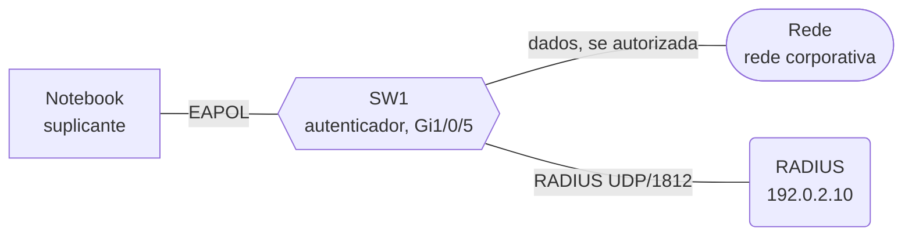

*Figura 3.3a (Tipo A, topologia).* Elementos do modo "Porta e sessão": Notebook (suplicante); SW1 (autenticador, Gi1/0/5); Rede (rede corporativa); RADIUS (192.0.2.10). Vale para os cenários (6.3.1 e 6.3.2).

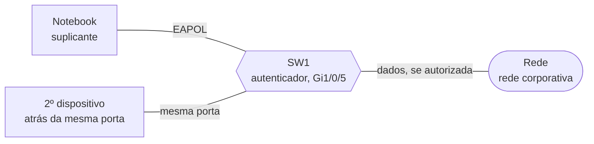

*Figura 3.3b (Tipo A, topologia).* Elementos do modo "Porta e sessão": Notebook (suplicante); SW1 (autenticador, Gi1/0/5); Rede (rede corporativa); 2º dispositivo (atrás da mesma porta). Vale para os cenários (6.3.3 e 6.3.4).

### 3.4 Riscos e defesas

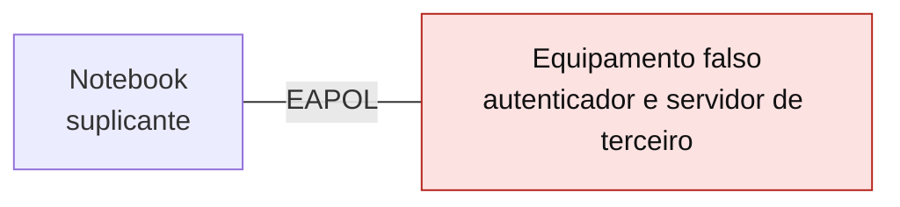

*Figura 3.4 (Tipo A, topologia).* Elementos do modo "Riscos e defesas": Notebook (suplicante); Equipamento falso (autenticador e servidor de terceiro). Vale para todos os cenários do modo (6.4.1 a 6.4.4).

## 4. Abas da bancada

Cenário, Captura, Mensagem, Porta, RADIUS (modos: Autenticação; Falhas; Porta e sessão), Métodos EAP (modos: Autenticação; Riscos e defesas), Experimento, Referência e Log.

## 5. Configurações (campos do painel)

### 5.1 Rede

- **RTT até o servidor RADIUS (ms)**. Valores: 1; 5; 20; 100; 300. Padrão: 5. Modos: todos.
  - Tempo de ida e volta entre o switch e o servidor RADIUS.
  - A troca entre o suplicante e o switch é local, em microssegundos. A troca entre o switch e o servidor RADIUS cruza a rede e depende da distância.
  - O RTT muda o espaçamento das mensagens, não o resultado. Em redes com o servidor longe, a autenticação demora mais porque o EAP precisa de várias idas e voltas.

### 5.2 Método EAP

- **Método EAP**. Valores: EAP-TLS (certificado nos dois lados); PEAP com MSCHAPv2 (certificado no servidor, senha no cliente); EAP-MD5 (só senha, sem autenticar o servidor). Padrão: EAP-TLS (certificado nos dois lados). Modos: Autenticação; Porta e sessão.
  - O EAP é um arcabouço: o método define como a identidade é provada.
  - **EAP-TLS:** os dois lados têm certificado e se autenticam mutuamente. É o mais forte e o mais trabalhoso, pois exige emitir e gerir certificados de cliente.
  - **PEAP com MSCHAPv2:** o servidor se autentica por certificado, e o cliente prova a senha dentro de um túnel TLS. Muito usado por exigir só um certificado no servidor. Não é um padrão da IETF.
  - **EAP-MD5:** desafio e resposta com a senha, sem túnel, sem autenticar o servidor e sem derivar chaves. Existe por simplicidade e não deve ser usado em redes reais.

### 5.3 Falha

- **Causa da falha**. Valores: Senha incorreta (PEAP); Certificado do cliente expirado (EAP-TLS); Servidor RADIUS inalcançável; Segredo compartilhado diferente no servidor; Dispositivo sem suplicante 802.1X. Padrão: Senha incorreta (PEAP). Modos: Falhas.
  - Cinco defeitos comuns, com sintomas parecidos e causas diferentes.
  - **Senha incorreta e certificado expirado:** o servidor responde com Access-Reject. A recusa é explícita.
  - **Servidor inalcançável e segredo diferente:** o autenticador não recebe resposta nenhuma. Para quem olha só a porta, os dois sintomas são idênticos; a diferença aparece no servidor, que descarta em silêncio o pedido com Message-Authenticator inválido.
  - **Sem suplicante:** o dispositivo (uma impressora, por exemplo) não entende o EAPOL. O servidor nem chega a ser consultado.

### 5.4 Sessão

- **O que acontece com a porta**. Valores: Reautenticação periódica (Session-Timeout); Suplicante envia EAPOL-Logoff; Segundo dispositivo atrás da mesma porta. Padrão: Reautenticação periódica (Session-Timeout). Modos: Porta e sessão.
  - Três situações depois que a porta já foi autorizada.
  - **Reautenticação:** o Access-Accept traz um Session-Timeout. Ao expirar, o autenticador autentica de novo sem fechar a porta.
  - **Logoff:** o suplicante avisa que a sessão terminou, e o switch fecha a porta na hora.
  - **Segundo dispositivo:** o 802.1X autoriza a porta, não o dispositivo. Quem estiver atrás do mesmo ponto aproveita a autorização, a menos que o switch autorize por endereço MAC.
- **Autorização da porta (segundo dispositivo)**. Valores: Por porta (modelo básico do 802.1X); Por endereço MAC (modo de implementação). Padrão: Por porta (modelo básico do 802.1X). Modos: Porta e sessão.
  - Vale para o cenário do segundo dispositivo.
  - **Por porta:** depois da primeira autenticação, a porta inteira fica aberta, para qualquer dispositivo ligado a ela.
  - **Por endereço MAC:** o switch libera só os endereços que se autenticaram. Os nomes e os detalhes desse modo variam por fabricante e não fazem parte do modelo básico do padrão.

### 5.5 Risco

- **Risco**. Valores: EAP-MD5: o suplicante não autentica o servidor; PEAP sem validar o certificado do servidor. Padrão: EAP-MD5: o suplicante não autentica o servidor. Modos: Riscos e defesas.
  - Duas configurações fracas, mostradas só para explicar o efeito e a defesa.
  - **EAP-MD5:** não há autenticação mútua. O suplicante não consegue saber se quem diz Success é o autenticador legítimo.
  - **PEAP sem validação:** o túnel TLS existe, mas, se o suplicante não confere o certificado do servidor, ele pode abrir o túnel com qualquer um e entregar a credencial dentro dele.

### 5.6 Defesa

- **Defesa aplicada**. Valores: Nenhuma (configuração fraca); Defesa para este risco. Padrão: Nenhuma (configuração fraca). Modos: Riscos e defesas.
  - A defesa depende do risco escolhido.
  - **Contra o EAP-MD5:** usar um método com autenticação mútua, como o EAP-TLS, no qual o suplicante valida o certificado do servidor.
  - **Contra o PEAP sem validação:** configurar o suplicante para validar a cadeia até a CA da organização e o nome do servidor RADIUS, e não permitir que o usuário aceite um certificado novo.

## 6. Cenários

### 6.1 Modo: Autenticação

> **Grupo:** Autenticação bem-sucedida

O 802.1X mantém a porta fechada até o servidor RADIUS aceitar o suplicante. O EAP carrega a prova de identidade; o método EAP define como ela é feita; o switch só repassa o EAP e abre ou fecha a porta conforme o resultado.

#### 6.1.1 EAP-TLS: certificados nos dois lados

*A porta só abre depois do Accept.*

**Configuração aplicada:** Método EAP = tls

O Notebook liga o cabo. A porta começa **fechada**: só o EAPOL passa. O switch repassa o EAP ao servidor RADIUS, que valida o certificado do cliente. Com o **Access-Accept**, a porta abre e o tráfego de dados passa.

**Conceito.** Antes de qualquer coisa, a porta controlada do switch está fechada: o quadro de dados (um DHCPDISCOVER) é descartado, e só o EAPOL, pela porta não controlada, é aceito. O suplicante inicia com EAPOL-Start, o switch pede a identidade e repassa o EAP ao servidor RADIUS dentro de Access-Request. O servidor conduz o EAP-TLS: handshake TLS com certificado nos dois lados. Quando valida o certificado do cliente, responde Access-Accept, o switch envia EAP-Success ao suplicante e abre a porta.

**O que observar**

- O primeiro quadro de dados é descartado pelo switch.
- O EAP viaja em EAPOL entre o Notebook e o switch, e em RADIUS (EAP-Message) entre o switch e o servidor.
- Só o Access-Accept abre a porta; o EAP-Success vai ao suplicante.
- Depois, o mesmo quadro de dados é encaminhado.

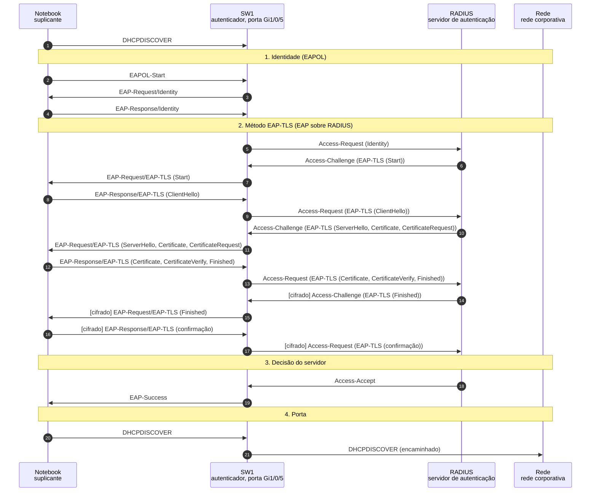

*Figura 6.1.1 (Tipo B, sequência).* Mensagens do cenário "EAP-TLS: certificados nos dois lados", na ordem do tempo, entre Notebook, SW1, RADIUS, Rede: 21 mensagens, numeradas de 1 a 21 na ordem da comunicação (em 5 fases; 4 cifradas). Corresponde ao diagrama de sequência e à aba Captura, no modo "Autenticação", com a configuração aplicada acima.

**Mensagens**

| Mensagem | Significado | Origem |
| --- | --- | --- |
| EAPOL-Start | o suplicante pede a autenticação | Notebook para SW1 |
| EAP-Request/Identity | o switch pede a identidade | SW1 para Notebook |
| Access-Request | o switch repassa o EAP ao servidor | SW1 para RADIUS |
| Access-Challenge | o servidor pede o próximo passo do método | RADIUS para SW1 |
| Access-Accept | o servidor aceita | RADIUS para SW1 |
| EAP-Success | o switch avisa o suplicante | SW1 para Notebook |

**Por que importa.** É a base de todo controle de acesso à rede por porta: nenhum dado entra enquanto o servidor não autorizar.

#### 6.1.2 PEAP: certificado no servidor, senha no cliente

*Um túnel TLS protege a senha.*

**Configuração aplicada:** Método EAP = peap

O servidor prova quem é com um certificado e abre um **túnel TLS**. Dentro dele, o Notebook prova a senha com MSCHAPv2. Só então o servidor aceita e a porta abre.

**Conceito.** O PEAP primeiro autentica o servidor: um handshake TLS em que o servidor apresenta o certificado. Com o túnel de pé, o suplicante prova a senha com MSCHAPv2 dentro dele, protegida de quem observa o enlace. O servidor decide depois da resposta MSCHAPv2 e ainda confirma a autenticação interna antes do Accept. O PEAP não é um padrão da IETF, e o simulador agrupa as mensagens do túnel.

**O que observar**

- As primeiras rodadas (handshake TLS) vão em claro; as seguintes aparecem em verde-azulado, protegidas pelo túnel.
- O servidor decide só depois da resposta MSCHAPv2.
- Um State acompanha cada Access-Request e Access-Challenge.

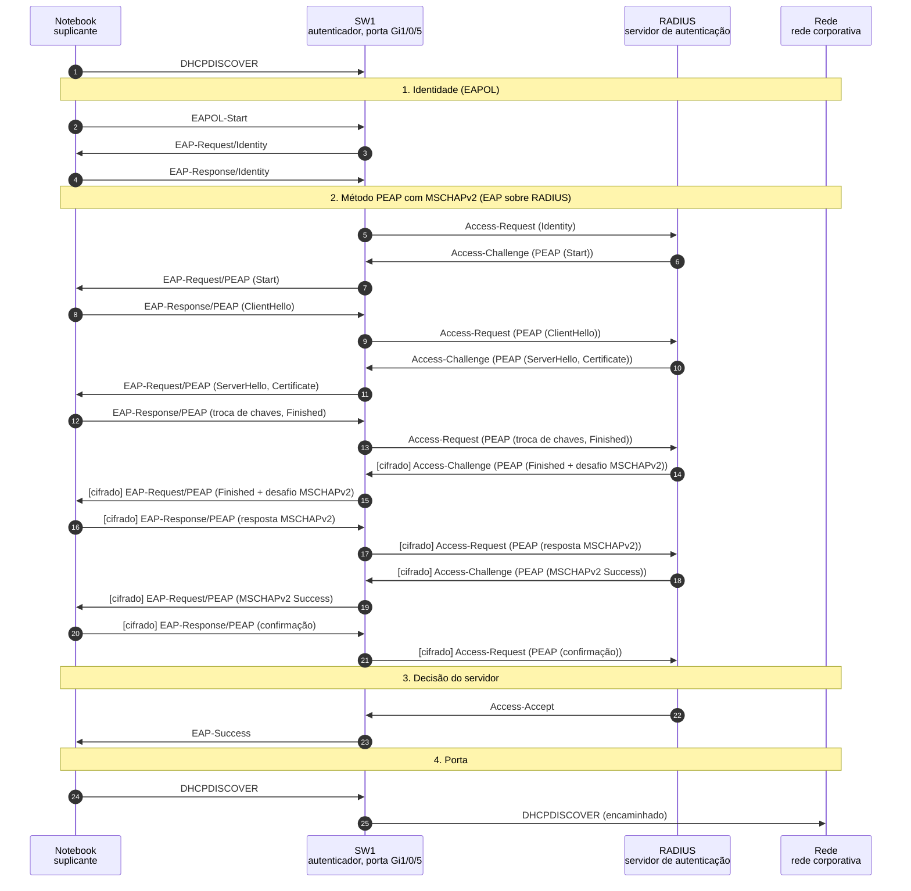

*Figura 6.1.2 (Tipo B, sequência).* Mensagens do cenário "PEAP: certificado no servidor, senha no cliente", na ordem do tempo, entre Notebook, SW1, RADIUS, Rede: 25 mensagens, numeradas de 1 a 25 na ordem da comunicação (em 5 fases; 8 cifradas). Corresponde ao diagrama de sequência e à aba Captura, no modo "Autenticação", com a configuração aplicada acima.

**Mensagens**

| Mensagem | Significado | Origem |
| --- | --- | --- |
| EAP-Request/PEAP (Start) | o servidor abre o túnel | SW1 para Notebook |
| EAP-Response/PEAP (resposta MSCHAPv2) | a prova da senha, dentro do túnel | Notebook para SW1 |
| Access-Accept | o servidor aceita | RADIUS para SW1 |

**Por que importa.** É o método mais comum em redes que não emitem certificados de cliente. Mostra por que a senha só é segura se o suplicante validar o servidor.

#### 6.1.3 EAP-MD5: só desafio e resposta

*Simples, e sem autenticar o servidor.*

**Configuração aplicada:** Método EAP = md5

O método mais simples: um desafio e a resposta calculada com a senha. Funciona e abre a porta, mas **não autentica o servidor**, não protege nada com um túnel e não deriva chaves.

**Conceito.** No EAP-MD5 ([RFC 3748](https://www.rfc-editor.org/rfc/rfc3748), seção 5.4), o servidor envia um desafio de 16 bytes e o suplicante responde com o MD5 do identificador, da senha e do desafio, como no CHAP. A troca tem uma só rodada. O método não oferece autenticação mútua, integridade, confidencialidade nem derivação de chaves, e não protege contra ataques de dicionário.

**O que observar**

- Uma só rodada de desafio e resposta.
- Nada é cifrado.
- Nenhuma verificação do servidor pelo suplicante.

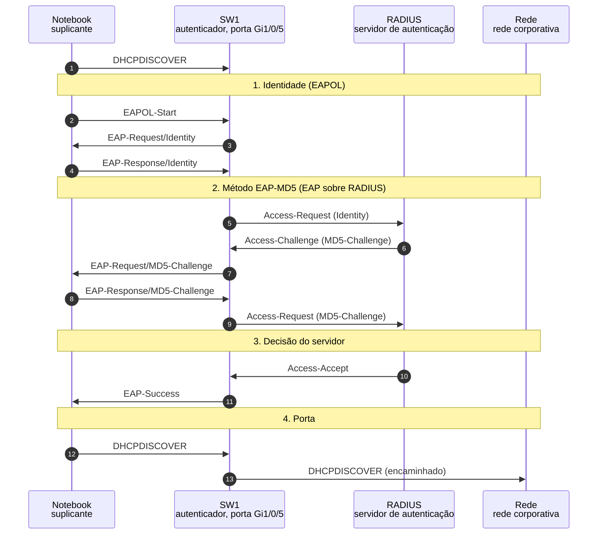

*Figura 6.1.3 (Tipo B, sequência).* Mensagens do cenário "EAP-MD5: só desafio e resposta", na ordem do tempo, entre Notebook, SW1, RADIUS, Rede: 13 mensagens, numeradas de 1 a 13 na ordem da comunicação (em 5 fases). Corresponde ao diagrama de sequência e à aba Captura, no modo "Autenticação", com a configuração aplicada acima.

**Mensagens**

| Mensagem | Significado | Origem |
| --- | --- | --- |
| EAP-Request/MD5-Challenge | o desafio de 16 bytes | SW1 para Notebook |
| EAP-Response/MD5-Challenge | o MD5 de identificador, senha e desafio | Notebook para SW1 |

**Por que importa.** Serve para ver o mínimo que o EAP exige e por que ele não basta em redes reais. O cenário de risco com EAP-MD5 mostra o motivo.

### 6.2 Modo: Falhas

> **Grupo:** Credencial recusada

O servidor foi alcançado e disse não. A recusa é explícita (Access-Reject), e a porta continua fechada.

#### 6.2.1 Senha incorreta (PEAP)

*Reject explícito.*

**Configuração aplicada:** Causa da falha = cred

O túnel TLS se forma normalmente, mas a prova da senha dentro dele **não confere**. O servidor responde com **Access-Reject**, o switch envia EAP-Failure e a porta continua fechada.

**Conceito.** O túnel PEAP se forma e o suplicante envia a prova MSCHAPv2. O servidor compara com o hash da senha do usuário, não confere e responde com Access-Reject, que leva um EAP-Failure. O switch repassa o EAP-Failure ao suplicante e mantém a porta fechada. O quadro de dados seguinte é descartado.

**O que observar**

- O servidor decide depois da resposta MSCHAPv2.
- O Access-Reject leva o EAP-Failure; o EAP-Failure não é confirmado pelo suplicante.
- A porta continua fechada.

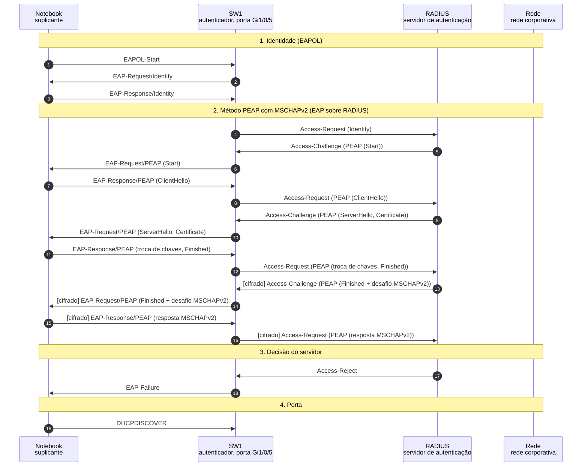

*Figura 6.2.1 (Tipo B, sequência).* Mensagens do cenário "Senha incorreta (PEAP)", na ordem do tempo, entre Notebook, SW1, RADIUS, Rede: 19 mensagens, numeradas de 1 a 19 na ordem da comunicação (em 5 fases; 4 cifradas). Corresponde ao diagrama de sequência e à aba Captura, no modo "Falhas", com a configuração aplicada acima.

**Mensagens**

| Mensagem | Significado | Origem |
| --- | --- | --- |
| Access-Reject | o servidor nega o acesso | RADIUS para SW1 |
| EAP-Failure | o switch informa o suplicante | SW1 para Notebook |

**Por que importa.** A recusa explícita é o caso fácil de diagnosticar: o log do servidor diz o motivo. Compare com os cenários sem resposta.

#### 6.2.2 Certificado do cliente expirado (EAP-TLS)

*Certificado fora da validade.*

**Configuração aplicada:** Causa da falha = cert

O Notebook apresenta um certificado fora da validade. O servidor **recusa** na rodada em que recebe o certificado, e a porta continua fechada.

**Conceito.** No EAP-TLS o servidor decide logo depois de receber o certificado do cliente e a prova de posse da chave. Com o certificado expirado, a validação da cadeia falha (alerta TLS certificate_expired) e o servidor responde com Access-Reject. A porta continua fechada.

**O que observar**

- A decisão vem na segunda rodada, antes do fim do handshake.
- O motivo (certificado expirado) aparece só no servidor; o suplicante recebe um EAP-Failure.

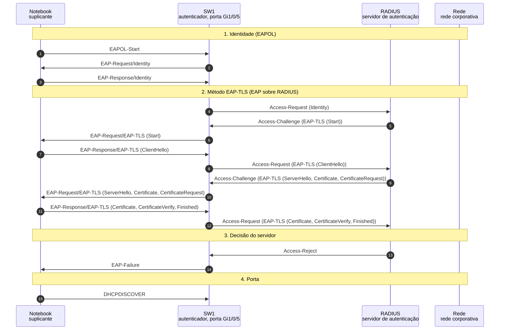

*Figura 6.2.2 (Tipo B, sequência).* Mensagens do cenário "Certificado do cliente expirado (EAP-TLS)", na ordem do tempo, entre Notebook, SW1, RADIUS, Rede: 15 mensagens, numeradas de 1 a 15 na ordem da comunicação (em 5 fases). Corresponde ao diagrama de sequência e à aba Captura, no modo "Falhas", com a configuração aplicada acima.

**Mensagens**

| Mensagem | Significado | Origem |
| --- | --- | --- |
| EAP-Response/EAP-TLS (Certificate, CertificateVerify, Finished) | o certificado do cliente | Notebook para SW1 |
| Access-Reject | o servidor nega o acesso | RADIUS para SW1 |

**Por que importa.** Certificados vencidos são uma das causas mais comuns de falha em redes com EAP-TLS. Vale monitorar a validade deles.

> **Grupo:** Sem resposta

O servidor não respondeu, ou o dispositivo não participou. Nos três casos a porta continua fechada, pois o 802.1X falha de modo seguro. O diagnóstico depende de saber onde a conversa parou.

#### 6.2.3 Servidor RADIUS inalcançável

*O switch retransmite e desiste.*

**Configuração aplicada:** Causa da falha = noserver

O switch envia o Access-Request e não recebe resposta. Ele **retransmite** e, ao fim das tentativas, desiste. A porta continua fechada: o acesso falha de modo seguro.

**Conceito.** O switch envia o Access-Request e não recebe nada. Ele retransmite o mesmo pacote (mesmo Identifier) algumas vezes, com um intervalo, e depois desiste ([RFC 5080](https://www.rfc-editor.org/rfc/rfc5080), seção 2.2.1). O intervalo e o número de tentativas são ajustes do equipamento. Sem resposta, o suplicante recebe EAP-Failure e a porta continua fechada: o acesso falha de modo seguro.

**O que observar**

- Três Access-Request iguais, perdidos, com 5 s de intervalo.
- O EAP-Failure vem do próprio switch, sem Access-Reject.
- A porta continua fechada.


*Figura 6.2.3 (Tipo B, sequência).* Mensagens do cenário "Servidor RADIUS inalcançável", na ordem do tempo, entre Notebook, SW1, RADIUS, Rede: 8 mensagens, numeradas de 1 a 8 na ordem da comunicação (em 4 fases; 3 perdidas). Corresponde ao diagrama de sequência e à aba Captura, no modo "Falhas", com a configuração aplicada acima.

**Mensagens**

| Mensagem | Significado | Origem |
| --- | --- | --- |
| Access-Request | a primeira tentativa, perdida | SW1 para RADIUS |
| Access-Request (retransmissão) | as tentativas seguintes | SW1 para RADIUS |
| EAP-Failure | o switch desiste | SW1 para Notebook |

**Por que importa.** Se o servidor cai, ninguém novo entra. É o preço de falhar fechado, e um motivo para ter mais de um servidor RADIUS.

#### 6.2.4 Segredo compartilhado diferente

*O pacote chega, e o servidor o ignora.*

**Configuração aplicada:** Causa da falha = secret

O pedido **chega** ao servidor, mas o segredo compartilhado é outro. O servidor descarta o pacote em silêncio, sem enviar Reject. Para o switch, é igual a um servidor fora do ar.

**Conceito.** O segredo compartilhado liga o switch ao servidor: ele entra no cálculo do Message-Authenticator. Se o segredo difere, o servidor recalcula o valor, vê que não confere e descarta o pacote em silêncio ([RFC 3579](https://www.rfc-editor.org/rfc/rfc3579), seção 3.2). Nenhuma mensagem de erro volta. O switch vê o mesmo que num servidor fora do ar.

**O que observar**

- Os Access-Request chegam ao servidor (não são perdidos).
- O servidor registra o descarte, mas não responde.
- O sintoma no switch é o mesmo do cenário anterior.

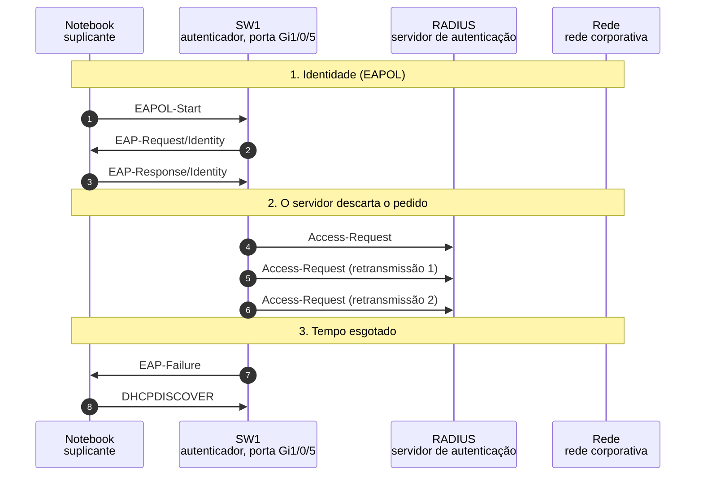

*Figura 6.2.4 (Tipo B, sequência).* Mensagens do cenário "Segredo compartilhado diferente", na ordem do tempo, entre Notebook, SW1, RADIUS, Rede: 8 mensagens, numeradas de 1 a 8 na ordem da comunicação (em 4 fases). Corresponde ao diagrama de sequência e à aba Captura, no modo "Falhas", com a configuração aplicada acima.

**Mensagens**

| Mensagem | Significado | Origem |
| --- | --- | --- |
| Access-Request | chega e é descartado | SW1 para RADIUS |
| EAP-Failure | o switch desiste por tempo | SW1 para Notebook |

**Por que importa.** Quem só olha o switch confunde um segredo errado com um servidor inacessível. O diagnóstico está no log do servidor.

#### 6.2.5 Dispositivo sem suplicante

*Ninguém responde ao EAPOL.*

**Configuração aplicada:** Causa da falha = nosup

Uma impressora sem suplicante 802.1X não responde ao EAP-Request/Identity. O switch repete o pedido, esgota as tentativas e **mantém a porta fechada**.

**Conceito.** Um dispositivo sem suplicante não entende o EAPOL e ignora o EAP-Request/Identity. O autenticador repete o pedido em intervalos fixos (aqui, 30 s) e, esgotadas as repetições, deixa a porta fechada. O servidor RADIUS nem é consultado. Dispositivos assim exigem outra política, que não faz parte do modelo básico do 802.1X.

**O que observar**

- Nenhuma mensagem RADIUS: o servidor não participa.
- O EAP-Request/Identity é repetido três vezes, com 30 s entre elas.
- O quadro de dados é descartado no fim.

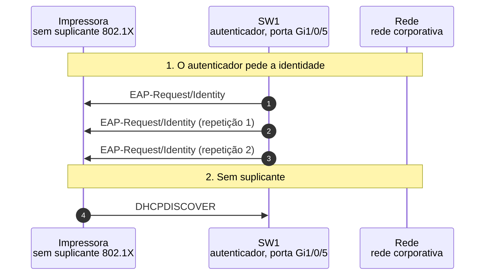

*Figura 6.2.5 (Tipo B, sequência).* Mensagens do cenário "Dispositivo sem suplicante", na ordem do tempo, entre Impressora, SW1, Rede: 4 mensagens, numeradas de 1 a 4 na ordem da comunicação (em 3 fases). Corresponde ao diagrama de sequência e à aba Captura, no modo "Falhas", com a configuração aplicada acima.

**Mensagens**

| Mensagem | Significado | Origem |
| --- | --- | --- |
| EAP-Request/Identity | o pedido, repetido | SW1 para Impressora |

**Por que importa.** Mostra por que impressoras, câmeras e telefones antigos são um desafio em redes com 802.1X.

### 6.3 Modo: Porta e sessão

> **Grupo:** Sessão e estado da porta

Uma porta autorizada não fica assim para sempre. O Session-Timeout força uma nova autenticação, e o suplicante pode encerrar a sessão com o EAPOL-Logoff.

#### 6.3.1 Reautenticação sem cortar a sessão

*A porta segue aberta durante a renovação.*

**Configuração aplicada:** Método EAP = peap; O que acontece com a porta = reauth; Autorização da porta (segundo dispositivo) = none

A sessão já está autorizada, com um **Session-Timeout** de 3600 s. Ao expirar, o switch autentica de novo. A porta **permanece autorizada** durante o processo, e o tráfego não é interrompido.

**Conceito.** O Access-Accept inicial trouxe um Session-Timeout ([RFC 2865](https://www.rfc-editor.org/rfc/rfc2865), seção 5.27). Quando ele expira, o autenticador reautentica o suplicante, começando por um novo EAP-Request/Identity. Durante todo o processo a porta permanece autorizada, e o quadro enviado no meio da troca passa normalmente. Se a reautenticação falhasse, a porta seria fechada.

**O que observar**

- O estado da porta continua autorizado do início ao fim.
- Um quadro de dados passa no meio da reautenticação.
- O novo Access-Accept traz outro Session-Timeout.

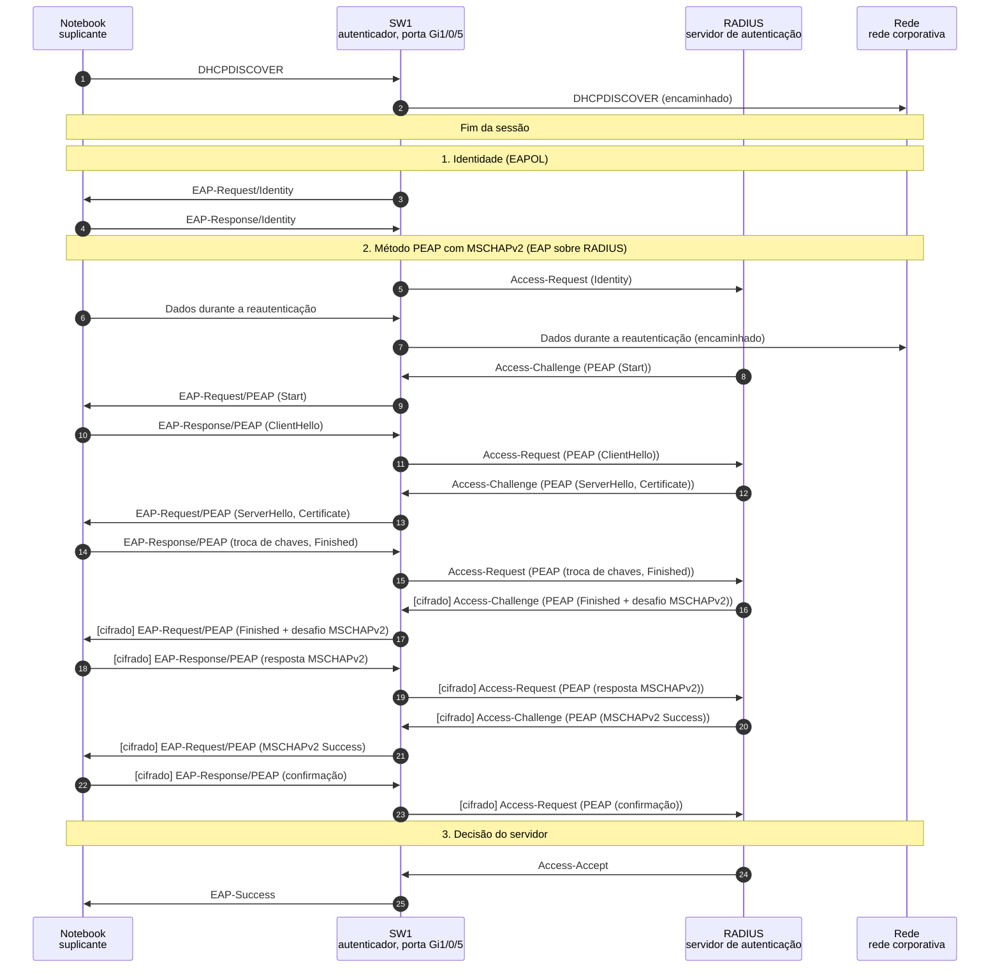

*Figura 6.3.1 (Tipo B, sequência).* Mensagens do cenário "Reautenticação sem cortar a sessão", na ordem do tempo, entre Notebook, SW1, RADIUS, Rede: 25 mensagens, numeradas de 1 a 25 na ordem da comunicação (em 6 fases; 8 cifradas). Corresponde ao diagrama de sequência e à aba Captura, no modo "Porta e sessão", com a configuração aplicada acima.

**Mensagens**

| Mensagem | Significado | Origem |
| --- | --- | --- |
| EAP-Request/Identity | o switch inicia a reautenticação | SW1 para Notebook |
| Dados durante a reautenticação | a porta segue aberta | Notebook para SW1 |
| Access-Accept | a sessão é renovada | RADIUS para SW1 |

**Por que importa.** A reautenticação limita por quanto tempo uma credencial roubada ou revogada continua valendo, sem derrubar o usuário.

#### 6.3.2 EAPOL-Logoff fecha a porta

*O logoff fecha a porta na hora.*

**Configuração aplicada:** Método EAP = peap; O que acontece com a porta = logoff; Autorização da porta (segundo dispositivo) = none

O suplicante envia **EAPOL-Logoff**. O switch fecha a porta de imediato, e o quadro seguinte é descartado. Não há resposta ao Logoff.

**Conceito.** Ao encerrar a sessão, o suplicante envia EAPOL-Logoff. O autenticador volta a porta ao estado não autorizado imediatamente, sem esperar o Session-Timeout. O Logoff não tem resposta e, nas implementações sem MACsec, não é autenticado.

**O que observar**

- A porta passa de autorizada a não autorizada assim que o Logoff chega.
- O quadro de dados seguinte é descartado.
- O servidor RADIUS não participa.

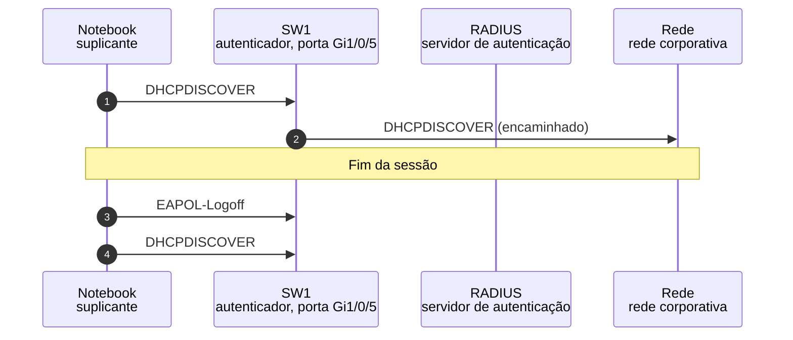

*Figura 6.3.2 (Tipo B, sequência).* Mensagens do cenário "EAPOL-Logoff fecha a porta", na ordem do tempo, entre Notebook, SW1, RADIUS, Rede: 4 mensagens, numeradas de 1 a 4 na ordem da comunicação (em 2 fases). Corresponde ao diagrama de sequência e à aba Captura, no modo "Porta e sessão", com a configuração aplicada acima.

**Mensagens**

| Mensagem | Significado | Origem |
| --- | --- | --- |
| EAPOL-Logoff | o suplicante encerra a sessão | Notebook para SW1 |

**Por que importa.** Fechar a porta ao fim da sessão evita que o próximo dispositivo ligado ao mesmo cabo aproveite a autorização.

> **Grupo:** Mais de um dispositivo na porta

O 802.1X autoriza a porta, não o dispositivo. Se algo mais estiver ligado ao mesmo ponto, o modelo básico não o distingue. Nível defensivo: aviso, efeito e defesa.

#### 6.3.3 Segundo dispositivo aproveita a porta

*A autorização vale para a porta.*

**Configuração aplicada:** Método EAP = peap; O que acontece com a porta = extra; Autorização da porta (segundo dispositivo) = none

Um segundo dispositivo, ligado à mesma porta, **nunca se autenticou**. Como a autorização vale para a porta inteira, o quadro dele é encaminhado.

**Conceito.** No modelo básico do 802.1X, a porta controlada é aberta ou fechada como um todo. Depois que o Notebook se autentica, qualquer dispositivo ligado à mesma porta (por um hub ou um mini-switch) passa a usar a rede sem se autenticar. É o que se chama de carona na autorização.

**O que observar**

- O quadro do Notebook é encaminhado.
- O quadro do segundo dispositivo também, embora ele nunca tenha se autenticado.

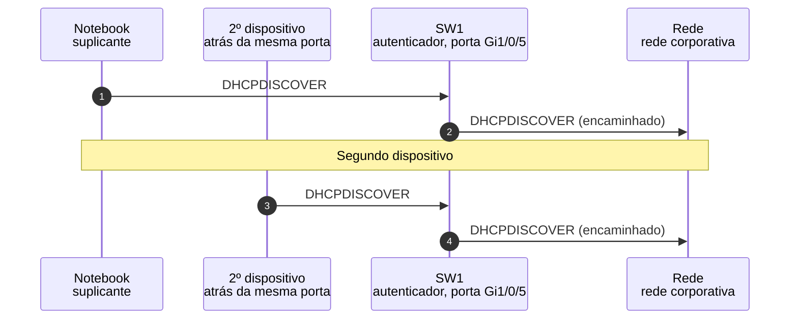

*Figura 6.3.3 (Tipo B, sequência).* Mensagens do cenário "Segundo dispositivo aproveita a porta", na ordem do tempo, entre Notebook, 2º dispositivo, SW1, Rede: 4 mensagens, numeradas de 1 a 4 na ordem da comunicação (em 2 fases). Corresponde ao diagrama de sequência e à aba Captura, no modo "Porta e sessão", com a configuração aplicada acima.

**Mensagens**

| Mensagem | Significado | Origem |
| --- | --- | --- |
| DHCPDISCOVER | do Notebook, encaminhado | Notebook para SW1 |
| DHCPDISCOVER | do segundo dispositivo, também encaminhado | 2º dispositivo para SW1 |

**Por que importa.** O 802.1X controla a porta, não o dispositivo. Por isso a topologia física importa: portas devem ligar um só equipamento.

#### 6.3.4 Defesa: autorização por endereço MAC

*Cada MAC precisa se autenticar.*

**Configuração aplicada:** Método EAP = peap; O que acontece com a porta = extra; Autorização da porta (segundo dispositivo) = permac

O switch autoriza só o endereço MAC que se autenticou. O quadro do segundo dispositivo é **descartado**.

**Conceito.** Com a autorização por endereço MAC, o switch libera só os endereços que passaram pela autenticação. O quadro do segundo dispositivo, de outro MAC, é descartado até que ele próprio se autentique. Os nomes e o comportamento exato desse modo variam por fabricante. O MACsec (IEEE 802.1AE) vai além, pois protege o enlace e ata a sessão à chave negociada.

**O que observar**

- O Notebook continua com acesso.
- O segundo dispositivo tem o quadro descartado.

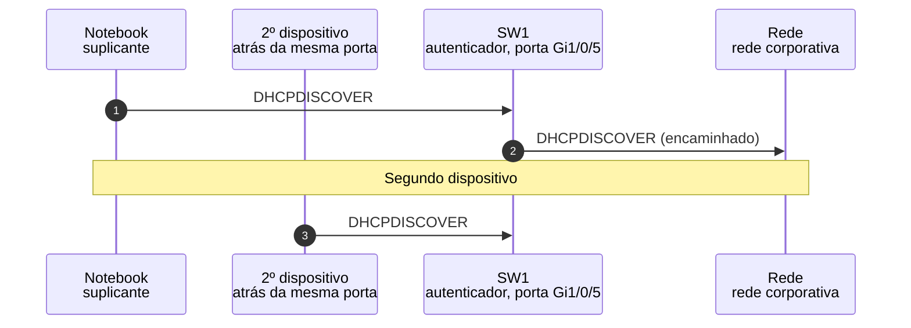

*Figura 6.3.4 (Tipo B, sequência).* Mensagens do cenário "Defesa: autorização por endereço MAC", na ordem do tempo, entre Notebook, 2º dispositivo, SW1, Rede: 3 mensagens, numeradas de 1 a 3 na ordem da comunicação (em 2 fases). Corresponde ao diagrama de sequência e à aba Captura, no modo "Porta e sessão", com a configuração aplicada acima.

**Mensagens**

| Mensagem | Significado | Origem |
| --- | --- | --- |
| DHCPDISCOVER | do Notebook, encaminhado | Notebook para SW1 |
| DHCPDISCOVER | do segundo dispositivo, descartado | 2º dispositivo para SW1 |

**Por que importa.** É a forma comum de dar suporte a mais de um equipamento por porta, como um telefone IP e um computador, sem abrir a porta a todos.

### 6.4 Modo: Riscos e defesas

> **Grupo:** Sem autenticação mútua

Provar quem é o suplicante não basta: o suplicante também precisa saber quem é o servidor. Nível defensivo: aviso, efeito e defesa.

#### 6.4.1 EAP-MD5 aceita um autenticador falso

*O suplicante não confere o servidor.*

**Configuração aplicada:** Risco = md5; Defesa aplicada = none

Um equipamento de terceiro faz o papel do autenticador. Como o EAP-MD5 não autentica o servidor, o Notebook **aceita o Success** e entrega o desafio e a resposta do usuário a quem controla o equipamento.

**Conceito.** Num cenário em que um equipamento de terceiro faz o papel do autenticador e do servidor, o EAP-MD5 não dá ao suplicante meio de desconfiar: o desafio e o Success parecem os de sempre. O suplicante envia a resposta ao desafio, que contém uma prova da senha, para quem controla o equipamento. O método não protege contra ataques de dicionário ([RFC 3748](https://www.rfc-editor.org/rfc/rfc3748), seção 5.4).

**O que observar**

- O Notebook aceita o EAP-Success.
- A resposta MD5 foi entregue a um equipamento que ninguém autenticou.

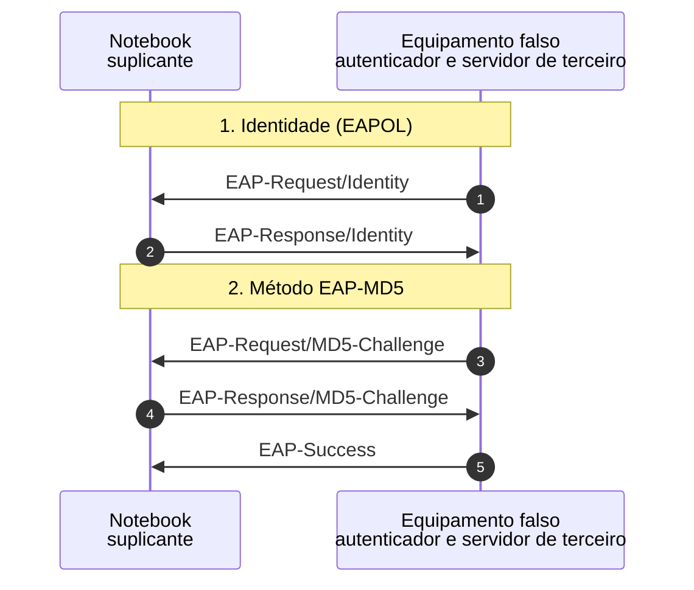

*Figura 6.4.1 (Tipo B, sequência).* Mensagens do cenário "EAP-MD5 aceita um autenticador falso", na ordem do tempo, entre Notebook, Equipamento falso: 5 mensagens, numeradas de 1 a 5 na ordem da comunicação (em 3 fases). Corresponde ao diagrama de sequência e à aba Captura, no modo "Riscos e defesas", com a configuração aplicada acima.

**Mensagens**

| Mensagem | Significado | Origem |
| --- | --- | --- |
| EAP-Request/MD5-Challenge | o desafio do equipamento falso | Equipamento falso para Notebook |
| EAP-Response/MD5-Challenge | a prova da senha | Notebook para Equipamento falso |
| EAP-Success | aceito sem nenhuma prova do servidor | Equipamento falso para Notebook |

**Por que importa.** Autenticar só o cliente não basta. O suplicante também precisa de uma forma de saber com quem está falando.

#### 6.4.2 Defesa: EAP-TLS com autenticação mútua

*O certificado do servidor decide.*

**Configuração aplicada:** Risco = md5; Defesa aplicada = def

Com EAP-TLS, o suplicante valida o certificado do servidor. A cadeia do equipamento falso termina numa CA desconhecida, e o Notebook **interrompe o handshake** antes de enviar qualquer credencial.

**Conceito.** Com EAP-TLS, o servidor apresenta um certificado, e o suplicante valida a cadeia até uma CA em que confia. Como a cadeia do equipamento falso termina numa CA desconhecida, o suplicante envia um alerta TLS unknown_ca (48) e interrompe. Nenhuma credencial foi enviada.

**O que observar**

- O suplicante interrompe antes de enviar o certificado ou a senha.
- O equipamento falso fica sem nada.

```mermaid
sequenceDiagram
  autonumber
  participant n_sup as Notebook<br/>suplicante
  participant n_fake as Equipamento falso<br/>autenticador e servidor de terceiro
  Note over n_sup,n_fake: 1. Identidade (EAPOL)
  n_fake ->> n_sup: EAP-Request/Identity
  n_sup ->> n_fake: EAP-Response/Identity
  Note over n_sup,n_fake: 2. Método EAP-TLS
  n_fake ->> n_sup: EAP-Request/EAP-TLS (Start)
  n_sup ->> n_fake: EAP-Response/EAP-TLS (ClientHello)
  n_fake ->> n_sup: EAP-Request/EAP-TLS (ServerHello, Certificate, CertificateRequest)
  n_sup ->> n_fake: EAP-Response/EAP-TLS (alerta unknown_ca)
  n_fake ->> n_sup: EAP-Failure
```

*Figura 6.4.2 (Tipo B, sequência).* Mensagens do cenário "Defesa: EAP-TLS com autenticação mútua", na ordem do tempo, entre Notebook, Equipamento falso: 7 mensagens, numeradas de 1 a 7 na ordem da comunicação (em 3 fases). Corresponde ao diagrama de sequência e à aba Captura, no modo "Riscos e defesas", com a configuração aplicada acima.

**Mensagens**

| Mensagem | Significado | Origem |
| --- | --- | --- |
| EAP-Request/EAP-TLS (ServerHello, Certificate, CertificateRequest) | o certificado do equipamento falso | Equipamento falso para Notebook |
| EAP-Response/EAP-TLS (alerta unknown_ca) | o suplicante aborta | Notebook para Equipamento falso |

**Por que importa.** A autenticação mútua é o que transforma o suplicante em quem desconfia, e não só em quem obedece.

> **Grupo:** Servidor falso e certificado

Um túnel TLS só protege se o suplicante confere com quem o abriu. Nível defensivo: aviso, efeito e defesa.

#### 6.4.3 PEAP sem validar o certificado do servidor

*O túnel abriu com o interlocutor errado.*

**Configuração aplicada:** Risco = peap; Defesa aplicada = none

O túnel TLS é aberto com qualquer servidor, porque o suplicante não confere o certificado. A prova da senha, mesmo protegida pelo túnel, **chega a quem controla o equipamento falso**.

**Conceito.** O PEAP abre um túnel TLS e protege a senha dentro dele. Mas, se o suplicante não valida o certificado do servidor, o túnel pode ser aberto com qualquer um, e a prova da senha chega a quem controla o equipamento falso. O túnel protegeu o caminho, e não o destino.

**O que observar**

- O suplicante segue com o túnel sem conferir o certificado.
- A prova MSCHAPv2 da senha é entregue ao equipamento falso.

```mermaid
sequenceDiagram
  autonumber
  participant n_sup as Notebook<br/>suplicante
  participant n_fake as Equipamento falso<br/>autenticador e servidor de terceiro
  Note over n_sup,n_fake: 1. Identidade (EAPOL)
  n_fake ->> n_sup: EAP-Request/Identity
  n_sup ->> n_fake: EAP-Response/Identity
  Note over n_sup,n_fake: 2. Método PEAP com MSCHAPv2
  n_fake ->> n_sup: EAP-Request/PEAP (Start)
  n_sup ->> n_fake: EAP-Response/PEAP (ClientHello)
  n_fake ->> n_sup: EAP-Request/PEAP (ServerHello, Certificate)
  n_sup ->> n_fake: EAP-Response/PEAP (troca de chaves, Finished)
  n_fake ->> n_sup: [cifrado] EAP-Request/PEAP (Finished + desafio MSCHAPv2)
  n_sup ->> n_fake: [cifrado] EAP-Response/PEAP (resposta MSCHAPv2)
```

*Figura 6.4.3 (Tipo B, sequência).* Mensagens do cenário "PEAP sem validar o certificado do servidor", na ordem do tempo, entre Notebook, Equipamento falso: 8 mensagens, numeradas de 1 a 8 na ordem da comunicação (em 3 fases; 2 cifradas). Corresponde ao diagrama de sequência e à aba Captura, no modo "Riscos e defesas", com a configuração aplicada acima.

**Mensagens**

| Mensagem | Significado | Origem |
| --- | --- | --- |
| EAP-Request/PEAP (ServerHello, Certificate) | o certificado do equipamento falso | Equipamento falso para Notebook |
| EAP-Response/PEAP (resposta MSCHAPv2) | a prova da senha, dentro do túnel | Notebook para Equipamento falso |

**Por que importa.** É um erro de configuração comum: a validação do certificado do servidor vem desligada ou é deixada a cargo do usuário.

#### 6.4.4 Defesa: validar a CA e o nome do servidor

*Validar a CA e o nome.*

**Configuração aplicada:** Risco = peap; Defesa aplicada = def

O suplicante confere a cadeia do certificado e o nome do servidor RADIUS. Nada coincide, e ele **aborta o túnel** antes de enviar usuário ou senha.

**Conceito.** Com o suplicante configurado para confiar apenas na CA da organização e para conferir o nome do servidor RADIUS, o certificado do equipamento falso é recusado. O suplicante envia um alerta TLS bad_certificate (42) e interrompe o túnel antes de enviar usuário ou senha.

**O que observar**

- O suplicante recusa o certificado.
- Nenhum usuário nem senha saem do Notebook.

```mermaid
sequenceDiagram
  autonumber
  participant n_sup as Notebook<br/>suplicante
  participant n_fake as Equipamento falso<br/>autenticador e servidor de terceiro
  Note over n_sup,n_fake: 1. Identidade (EAPOL)
  n_fake ->> n_sup: EAP-Request/Identity
  n_sup ->> n_fake: EAP-Response/Identity
  Note over n_sup,n_fake: 2. Método PEAP com MSCHAPv2
  n_fake ->> n_sup: EAP-Request/PEAP (Start)
  n_sup ->> n_fake: EAP-Response/PEAP (ClientHello)
  n_fake ->> n_sup: EAP-Request/PEAP (ServerHello, Certificate)
  n_sup ->> n_fake: EAP-Response/PEAP (alerta bad_certificate)
  n_fake ->> n_sup: EAP-Failure
```

*Figura 6.4.4 (Tipo B, sequência).* Mensagens do cenário "Defesa: validar a CA e o nome do servidor", na ordem do tempo, entre Notebook, Equipamento falso: 7 mensagens, numeradas de 1 a 7 na ordem da comunicação (em 3 fases). Corresponde ao diagrama de sequência e à aba Captura, no modo "Riscos e defesas", com a configuração aplicada acima.

**Mensagens**

| Mensagem | Significado | Origem |
| --- | --- | --- |
| EAP-Request/PEAP (ServerHello, Certificate) | o certificado do equipamento falso | Equipamento falso para Notebook |
| EAP-Response/PEAP (alerta bad_certificate) | o suplicante aborta | Notebook para Equipamento falso |

**Por que importa.** A defesa está na configuração do suplicante: confiar só na CA certa, conferir o nome e não deixar o usuário aceitar certificados novos.

## 7. Referência

### 7.1 Para que serve

O **IEEE 802.1X** é o controle de acesso à rede baseado em porta. A porta de um switch (ou um ponto de acesso Wi-Fi) só encaminha dados de um dispositivo depois que ele se autentica. A edição vigente é o IEEE 802.1X-2020, que incorpora as anteriores. Confira o texto oficial do IEEE antes de citar uma cláusula. A autenticação em si usa o **EAP** (Extensible Authentication Protocol, [RFC 3748](https://www.rfc-editor.org/rfc/rfc3748)), e o servidor costuma falar **RADIUS** ([RFC 2865](https://www.rfc-editor.org/rfc/rfc2865)).

### 7.2 Os três papéis

| Papel | Quem é | O que faz |
| --- | --- | --- |
| Suplicante | o dispositivo que quer entrar na rede | responde ao EAP e prova a identidade |
| Autenticador | o switch ou o ponto de acesso (NAS) | mantém a porta fechada, repassa o EAP ao servidor e abre a porta conforme o resultado. Não interpreta o método EAP |
| Servidor de autenticação | o servidor RADIUS | conduz o método EAP e decide entre Accept e Reject |

### 7.3 Porta controlada e não controlada

O autenticador expõe duas portas lógicas. A **não controlada** aceita sempre o EAPOL (EtherType 0x888E). A **controlada** só encaminha os dados depois da autorização. O simulador mostra três estados: **não autorizada**, **em autenticação** (a porta continua fechada para dados) e **autorizada**. O estado é decidido pelo autenticador, e quem o abre é o Access-Accept do servidor, não o EAP-Success enviado ao suplicante.

### 7.4 Duas camadas de transporte do EAP

| Trecho | Transporte | Como o EAP viaja |
| --- | --- | --- |
| Suplicante e autenticador | EAPOL, direto sobre Ethernet (EtherType 0x888E), sem IP | pacote EAP-Packet dentro do quadro. Há também EAPOL-Start e EAPOL-Logoff. O endereço de grupo do PAE é 01:80:c2:00:00:03 |
| Autenticador e servidor | RADIUS sobre UDP, porta 1812 ([RFC 2865](https://www.rfc-editor.org/rfc/rfc2865), seção 3) | atributo EAP-Message (79), em pedaços de até 253 bytes, junto com o Message-Authenticator (80) ([RFC 3579](https://www.rfc-editor.org/rfc/rfc3579), seções 3.1 e 3.2) |

### 7.5 O EAP

- **Códigos** ([RFC 3748](https://www.rfc-editor.org/rfc/rfc3748), seção 4): 1 Request, 2 Response, 3 Success e 4 Failure. O servidor faz pedidos, o suplicante responde, e o resultado final vem como Success ou Failure.
- **Success e Failure não são confirmados** e, por isso, podem se perder (seção 4.2). O autenticador é quem os envia.
- **Tipos** (seção 5): 1 Identity, 2 Notification, 3 Nak e 4 MD5-Challenge. Os métodos têm outros números, atribuídos pela IANA (13 para EAP-TLS e 25 para PEAP).
- O EAP é um arcabouço de **métodos**. Para o EAP-TLS, a [RFC 5216](https://www.rfc-editor.org/rfc/rfc5216) define o método e a [RFC 9190](https://www.rfc-editor.org/rfc/rfc9190) o atualiza para o TLS 1.3. O PEAP não é um padrão da IETF.

### 7.6 RADIUS e EAP no simulador

- **Access-Request** ([RFC 2865](https://www.rfc-editor.org/rfc/rfc2865), seção 4.1): leva User-Name, NAS-IP-Address, NAS-Port, NAS-Port-Type, Calling-Station-Id, o EAP-Message e o Message-Authenticator.
- **Access-Challenge** (seção 4.4): o servidor pede o próximo passo do método e devolve um **State** (seção 5.24), que o autenticador repete no próximo Access-Request.
- **Access-Accept** (seção 4.2) e **Access-Reject** (seção 4.3): o resultado. No Reject só se permitem as mensagens EAP e o Proxy-State ([RFC 5080](https://www.rfc-editor.org/rfc/rfc5080), seção 2.6.1).
- **Session-Timeout** (seção 5.27): por quanto tempo a sessão vale antes de uma nova autenticação.
- **Retransmissão** ([RFC 5080](https://www.rfc-editor.org/rfc/rfc5080), seção 2.2.1): o cliente repete o pedido com o mesmo Identifier; o intervalo e o limite de tentativas são ajustes do equipamento.
- **Segredo compartilhado:** liga o switch ao servidor e entra no cálculo do Message-Authenticator. Se o segredo difere, o servidor descarta o pacote em silêncio ([RFC 3579](https://www.rfc-editor.org/rfc/rfc3579), seção 3.2).

### 7.7 Métodos EAP do simulador

| Método | Referência | Característica |
| --- | --- | --- |
| EAP-MD5 | [RFC 3748](https://www.rfc-editor.org/rfc/rfc3748), seção 5.4 | desafio e resposta com a senha. Sem autenticação mútua, sem integridade, sem confidencialidade, sem derivação de chaves e sem proteção contra ataque de dicionário |
| PEAP com MSCHAPv2 | não é um padrão da IETF | o servidor se autentica por certificado e abre um túnel TLS, dentro do qual o cliente prova a senha. O simulador agrupa as mensagens do túnel |
| EAP-TLS | [RFC 5216](https://www.rfc-editor.org/rfc/rfc5216) e [RFC 9190](https://www.rfc-editor.org/rfc/rfc9190) | autenticação mútua por certificados. O número de rodadas depende da versão do TLS, e o simulador mostra três rodadas esquemáticas |

### 7.8 Temporizadores e valores do simulador

- Repetição do EAP-Request/Identity: a cada 30 s, até 2 repetições. Retransmissão do RADIUS: 3 tentativas, a cada 5 s. Session-Timeout: 3600 s. São valores típicos de implementação, não exigências do padrão.
- Depois de uma falha, muitas implementações mantêm a porta num intervalo de quarentena antes de aceitar outra tentativa. O simulador não representa esse intervalo.

### 7.9 Riscos e defesas (nível defensivo)

| Risco | Efeito | Defesa |
| --- | --- | --- |
| EAP-MD5 | o suplicante não confere quem está do outro lado, e a resposta ao desafio pode ser alvo de tentativas de adivinhar a senha | usar um método com autenticação mútua e túnel, como o EAP-TLS ou o PEAP com validação do servidor |
| PEAP sem validar o certificado | o túnel abre com qualquer servidor, e a credencial chega a quem o controla | configurar a CA confiável e o nome do servidor RADIUS no suplicante e impedir a aceitação manual de certificados |
| Vários dispositivos na mesma porta | a autorização vale para a porta, e quem estiver atrás dela aproveita | uma porta para um equipamento, autorização por endereço MAC (recurso de implementação) ou MACsec (IEEE 802.1AE) |
| RADIUS sobre UDP | o Message-Authenticator e o Response Authenticator usam MD5 e o segredo compartilhado, o que enfraquece a proteção do trecho entre o switch e o servidor | segredos longos e aleatórios, Message-Authenticator em todos os pacotes, rede de gerência isolada e, quando possível, RADIUS sobre TLS ([RFC 6614](https://www.rfc-editor.org/rfc/rfc6614), experimental) ou RADIUS/1.1 ([RFC 9765](https://www.rfc-editor.org/rfc/rfc9765), experimental) |

### 7.10 O que o simulador simplifica

- Um suplicante, um autenticador, um servidor RADIUS e uma rede. Sem proxy RADIUS, sem servidores redundantes e sem contabilização ([RFC 2866](https://www.rfc-editor.org/rfc/rfc2866)).
- Sem fragmentação do EAP-TLS: o voo do servidor, com a cadeia de certificados, ocuparia várias mensagens EAP no mundo real. Os handshakes TLS aparecem agrupados em poucas rodadas.
- Valores de desafios, State e autenticadores são ilustrativos (determinísticos). Não há criptografia real.
- Sem derivação nem uso de chaves (MSK e EMSK, [RFC 5247](https://www.rfc-editor.org/rfc/rfc5247)) e sem MACsec. No Wi-Fi o resultado do EAP serve também para derivar as chaves da rede sem fio, que não é o foco deste simulador.
- Sem autorização por atributos do servidor (VLAN, listas de controle de acesso), sem mudança de autorização durante a sessão e sem verificação de postura do dispositivo. Dispositivos sem suplicante exigem uma política à parte, que não é tratada.
- A autorização por endereço MAC é um recurso das implementações, com nomes e comportamentos que variam por fabricante. O simulador mostra só a ideia.
- Os endereços MAC seguem a faixa de documentação ([RFC 9542](https://www.rfc-editor.org/rfc/rfc9542)) e os endereços IP, as redes de documentação ([RFC 5737](https://www.rfc-editor.org/rfc/rfc5737)).


---

*Simul-Net é um projeto mantido pelo Prof. Dr. Laerte Peotta de Melo, com apoio de IA generativa no processo de desenvolvimento, com sua estrita supervisão, revisão técnica e responsabilidade. Uso exclusivo para fins de ensino e pesquisa. Universidade de Brasília (UnB) - Departamento de Engenharia Elétrica. Código aberto (licença MIT).*
