# FTP, FTPS e SFTP

Transferência de arquivos por dentro: FTP com canais de controle e de dados (modos ativo e passivo, NAT e firewall), FTPS explícito e implícito, SFTP sobre SSH e a comparação do que um observador na rede enxerga em cada um.

- **Categoria:** Protocolos de rede seguros
- **Motor:** nativo (TypeScript puro, apresentado pela bancada genérica)
- **Código-fonte:** `src/sims/ftp/`
- **RFCs e padrões:** [RFC 959](https://www.rfc-editor.org/rfc/rfc959) (FTP), [RFC 4217](https://www.rfc-editor.org/rfc/rfc4217) (FTP sobre TLS), [RFC 2428](https://www.rfc-editor.org/rfc/rfc2428) (EPSV e EPRT), [RFC 4253](https://www.rfc-editor.org/rfc/rfc4253) (SSH (SFTP))
- **Tópicos:** Canais de controle e de dados; Modos ativo e passivo atrás de NAT; FTPS: AUTH TLS, PROT P e PROT C; SFTP e comparação dos três

## Modos

| Modo | Cenário inicial |
| --- | --- |
| FTP | Passivo atrás de NAT |
| FTPS | FTPS explícito (AUTH TLS) |
| SFTP | Download (get) |
| Comparação | Download nos três |

## Abas da bancada

Cenário, Captura, Mensagem, Conexões e portas (modos: FTP; FTPS; SFTP), O que o observador vê, Comparação (modos: Comparação), Experimento, Referência e Log.

## Configurações (campos do painel)

### Rede

- **RTT (ms)**. Valores: 5; 20; 50; 100; 200. Padrão: 20. Modos: todos.
  - Tempo de ida e volta entre cliente e servidor.
  - Cada comando FTP espera uma resposta, então o RTT pesa mais no FTP e no FTPS do que no SFTP, que agrupa pedidos.
  - O TLS acrescenta cerca de 1 RTT por conexão.

### Operação

- **Operação**. Valores: Baixar um arquivo (RETR / get); Enviar um arquivo (STOR / put); Listar o diretório (LIST / ls). Padrão: Baixar um arquivo (RETR / get). Modos: todos.
  - O que o cliente faz depois do login.
  - **Baixar** e **enviar** abrem um canal de dados no FTP e no FTPS.
  - **Listar** também usa o canal de dados: o diretório não vem pelo controle.

### Autenticação

- **Login**. Valores: Usuário e senha válidos; Acesso anônimo (anonymous); Senha incorreta. Padrão: Usuário e senha válidos. Modos: FTP; FTPS.
  - Resultado da autenticação no servidor.
  - **Válidos:** o login funciona (230).
  - **Anônimo:** usuário anonymous e e-mail como senha.
  - **Incorreta:** o servidor responde 530. A senha, mesmo errada, pode já ter sido exposta.

### Canal de dados

- **Modo de dados**. Valores: Passivo (PASV): o cliente conecta; Ativo (PORT): o servidor conecta. Padrão: Passivo (PASV): o cliente conecta. Modos: FTP; FTPS.
  - Quem abre a conexão de dados.
  - **Passivo:** o cliente conecta a uma porta alta do servidor; atravessa NAT de estado.
  - **Ativo:** o servidor conecta ao cliente, a partir da porta 20; costuma falhar atrás de NAT.
- **Firewall/NAT do cliente**. Valores: Sem NAT nem filtro; NAT com firewall de estado; NAT com inspeção de FTP (helper). Padrão: NAT com firewall de estado. Modos: FTP; FTPS.
  - O que existe entre o cliente e a internet.
  - **Sem NAT nem filtro:** conexões de entrada passam.
  - **NAT de estado:** só aceita respostas de conexões iniciadas de dentro.
  - **Helper de FTP:** lê o PORT e abre a porta, mas só se o controle estiver em claro.
- **Faixa passiva liberada no servidor**. Valores: caixa de seleção. Padrão: sim. Modos: FTP; FTPS.
  - Firewall do servidor.
  - No modo passivo o servidor escolhe uma porta de uma faixa. Se o firewall dele não a liberar, o SYN do cliente fica sem resposta.

### TLS

- **Modo FTPS**. Valores: Explícito (AUTH TLS, porta 21); Implícito (porta 990). Padrão: Explícito (AUTH TLS, porta 21). Modos: FTPS.
  - Como o TLS é iniciado.
  - **Explícito:** começa em claro na porta 21 e passa a TLS com AUTH TLS.
  - **Implícito:** TLS desde o primeiro byte, na porta 990 (modo legado).
- **Proteção dos dados (PROT)**. Valores: P: dados cifrados; C: dados em claro. Padrão: P: dados cifrados. Modos: FTPS.
  - Nível de proteção do canal de dados.
  - **P (Private):** o canal de dados usa TLS.
  - **C (Clear):** só o controle é cifrado e o arquivo trafega em claro.
- **Certificado do servidor válido**. Valores: caixa de seleção. Padrão: sim. Modos: FTPS.
  - Validação pelo cliente.
  - Desmarcado, o cliente rejeita o certificado e encerra antes de enviar usuário e senha.

### SSH

- **Autenticação**. Valores: Senha; Chave pública. Padrão: Senha. Modos: SFTP.
  - Como o cliente se autentica.
  - **Senha:** vai dentro do túnel cifrado.
  - **Chave pública:** o cliente assina um desafio, sem enviar segredo.

## Cenários

### Modo: FTP

#### Modos de dados

O FTP usa um canal de controle e um canal de dados separado. Quem abre o canal de dados (cliente ou servidor) decide se o NAT e o firewall deixam passar.

##### Passivo atrás de NAT

*O cliente conecta a uma porta alta do servidor: passa pelo NAT.*

**Configuração aplicada:** Modo de dados = passive; Firewall/NAT do cliente = nat; Faixa passiva liberada no servidor = sim; Operação = get; Login = ok

Download em **modo passivo** com o cliente atrás de NAT. O cliente conecta a uma porta alta do servidor, e o NAT de estado deixa passar: é o modo que funciona na maioria das redes.

**Conceito.** No modo passivo o cliente envia PASV e o servidor responde com um endereço e uma porta. O cliente abre a conexão de dados para lá, de dentro para fora, e o NAT de estado a permite.

**O que observar**

- No 227, a porta vem em dois bytes: 195×256+80 = 50000.
- O SYN dos dados parte do cliente.
- A senha trafega em claro no canal de controle.

**Diagrama de sequência**

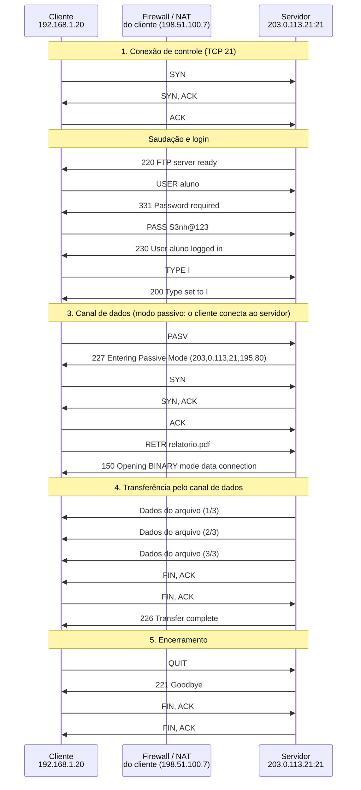

**Mensagens**

| Mensagem | Significado | Origem |
| --- | --- | --- |
| PASV / 227 | o servidor informa onde conectar | cliente / servidor |
| SYN, SYN-ACK, ACK | conexão de dados, iniciada pelo cliente | cliente |
| RETR / 150 / 226 | pedido, início e fim da transferência | cliente / servidor |

**Por que importa.** É por isso que o modo passivo é o padrão na internet: quase todo cliente está atrás de NAT.

##### Ativo sem NAT

*O servidor conecta ao cliente a partir da porta 20.*

**Configuração aplicada:** Modo de dados = active; Firewall/NAT do cliente = none; Faixa passiva liberada no servidor = sim; Operação = get; Login = ok

Download em **modo ativo**, com o cliente em um endereço alcançável e sem filtros. O servidor conecta de volta ao cliente, a partir da porta 20, e funciona.

**Conceito.** No modo ativo o cliente envia PORT com seu endereço e uma porta. O servidor abre a conexão de dados do seu lado (porta 20) para o cliente.

**O que observar**

- O SYN dos dados parte do servidor.
- O PORT carrega 192,168,1,20 e a porta 195,81 (50001).
- Sem NAT nem filtro, o SYN de entrada passa.

**Diagrama de sequência**

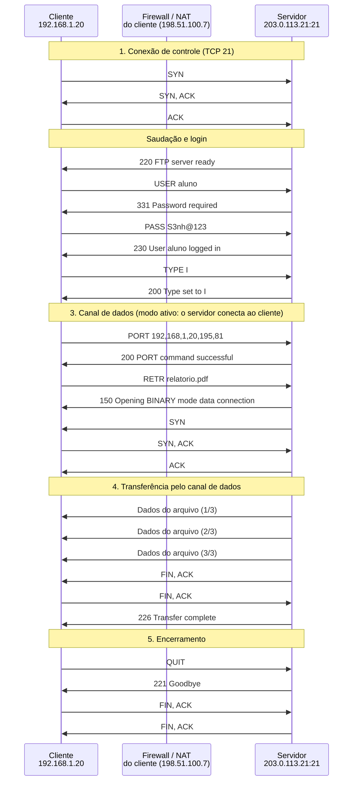

**Mensagens**

| Mensagem | Significado | Origem |
| --- | --- | --- |
| PORT / 200 | o cliente anuncia seu endereço e porta | cliente / servidor |
| SYN, SYN-ACK, ACK | conexão de dados, iniciada pelo servidor | servidor |
| RETR / 150 / 226 | a operação | cliente / servidor |

**Por que importa.** O modo ativo inverte quem inicia a conexão. Em redes modernas, com NAT e firewalls, isso quase sempre quebra.

##### Ativo atrás de NAT (falha)

*O servidor tenta um endereço privado e falha com 425.*

**Configuração aplicada:** Modo de dados = active; Firewall/NAT do cliente = nat; Faixa passiva liberada no servidor = sim; Operação = get; Login = ok

Modo ativo atrás de NAT: o cliente anuncia o endereço **privado** no PORT. O servidor tenta conectar a ele, não consegue e responde **425**. É a falha clássica do FTP.

**Conceito.** O cliente atrás de NAT informa seu endereço privado no PORT. O servidor, na internet, tenta conectar a 192.168.1.20, que não é roteável.

**O que observar**

- O SYN do servidor aparece com ✕ duas vezes (retransmissão).
- O 425 chega pelo canal de controle.
- A senha já foi exposta mesmo sem transferir nada.

**Diagrama de sequência**

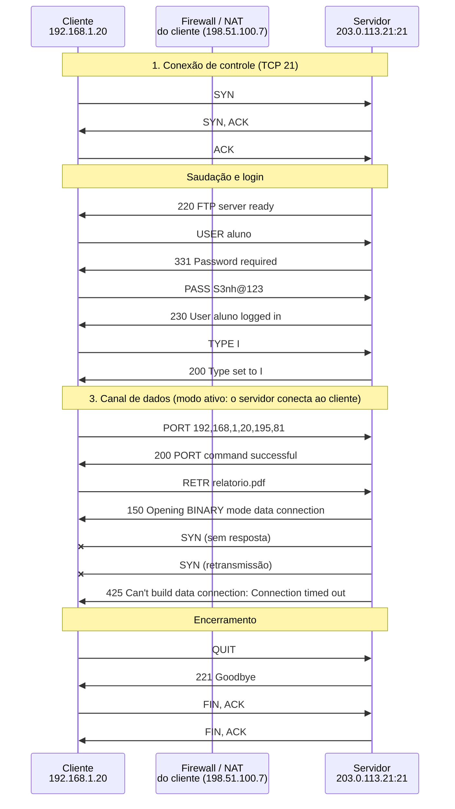

**Mensagens**

| Mensagem | Significado | Origem |
| --- | --- | --- |
| PORT / 200 | anúncio do endereço privado | cliente / servidor |
| SYN (sem resposta) | o servidor tenta o endereço privado | servidor |
| 425 | falha ao abrir o canal de dados | servidor |

**Por que importa.** É a causa mais comum de "o FTP conecta mas não lista nem baixa".

##### Ativo com helper de FTP

*O helper do NAT lê o PORT e abre a porta.*

**Configuração aplicada:** Modo de dados = active; Firewall/NAT do cliente = helper; Faixa passiva liberada no servidor = sim; Operação = get; Login = ok

O NAT com **inspeção de FTP** lê o comando PORT, troca o endereço privado pelo público e abre a porta. Funciona, mas só porque o comando está em claro.

**Conceito.** Alguns firewalls inspecionam o canal de controle do FTP, reescrevem o endereço no PORT e criam uma regra temporária para a conexão de dados.

**O que observar**

- O firewall reescreve 192.168.1.20 para 198.51.100.7.
- A conexão de dados é aceita.
- Isso só funciona com o controle em claro.

**Diagrama de sequência**


**Mensagens**

| Mensagem | Significado | Origem |
| --- | --- | --- |
| PORT | reescrito pelo helper | firewall |
| SYN, SYN-ACK, ACK | agora alcança o cliente | servidor |

**Por que importa.** O helper resolve o NAT, mas obriga o controle a ficar em claro, e por isso não combina com FTPS.

##### Passivo com faixa bloqueada

*A porta passiva está bloqueada no servidor.*

**Configuração aplicada:** Modo de dados = passive; Firewall/NAT do cliente = nat; Faixa passiva liberada no servidor = não; Operação = get; Login = ok

O servidor anuncia a porta passiva **50000**, mas o firewall dele não libera a faixa. O SYN do cliente fica sem resposta e a transferência não acontece.

**Conceito.** No modo passivo o servidor escolhe uma porta de uma faixa. Se o firewall do servidor não liberar a faixa, o cliente não chega a ela.

**O que observar**

- O 227 informa a porta 50000.
- O SYN do cliente é retransmitido sem resposta.
- O cliente desiste do canal de dados.

**Diagrama de sequência**

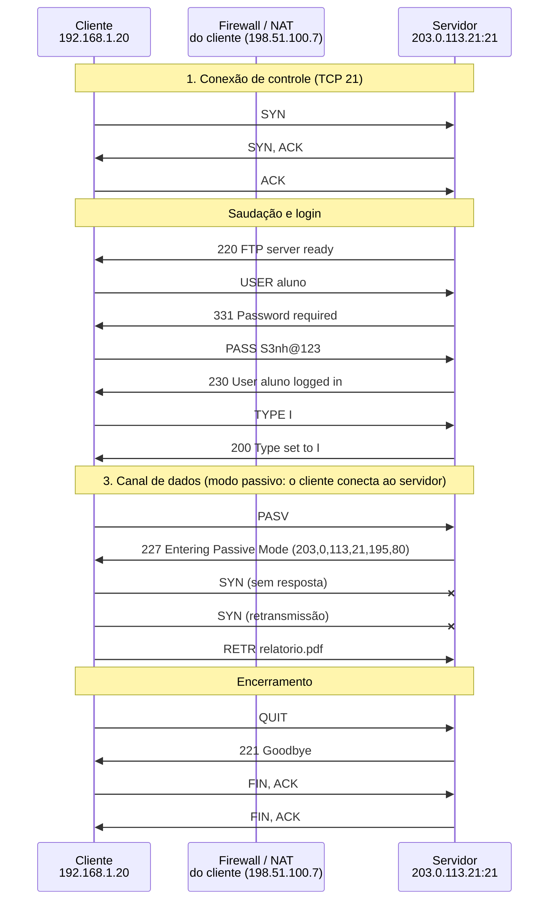

**Mensagens**

| Mensagem | Significado | Origem |
| --- | --- | --- |
| 227 | anuncia a porta 50000 | servidor |
| SYN (sem resposta) | bloqueado no firewall do servidor | cliente |

**Por que importa.** Todo servidor FTP passivo precisa de uma faixa de portas fixa e liberada no firewall.

#### Operações e login

Cada operação (LIST, RETR, STOR) abre um canal de dados novo. O login mostra o que acontece com as credenciais.

##### Listar diretório (LIST)

*Até a listagem abre uma conexão de dados.*

**Configuração aplicada:** Modo de dados = passive; Firewall/NAT do cliente = nat; Faixa passiva liberada no servidor = sim; Operação = list; Login = ok

Até uma **listagem** usa um canal de dados novo: o resultado do LIST não vem pelo canal de controle.

**Conceito.** LIST não devolve o diretório no canal de controle: o servidor o envia por um canal de dados aberto só para isso.

**O que observar**

- O 150 antecede os dados.
- O 226 fecha a operação.

**Diagrama de sequência**

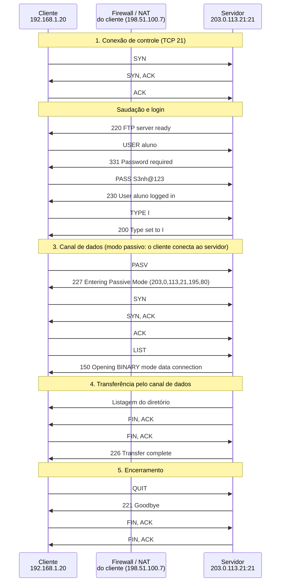

**Mensagens**

| Mensagem | Significado | Origem |
| --- | --- | --- |
| PASV / 227 | prepara o canal | cliente / servidor |
| LIST / 150 | pede e confirma | cliente / servidor |
| listagem | texto do diretório | servidor |
| 226 | concluído | servidor |

**Por que importa.** Entender isso explica por que o FTP "trava" ao listar quando o canal de dados está bloqueado.

##### Enviar arquivo (STOR)

*O arquivo segue do cliente para o servidor.*

**Configuração aplicada:** Modo de dados = passive; Firewall/NAT do cliente = nat; Faixa passiva liberada no servidor = sim; Operação = put; Login = ok

**Upload** com STOR: o arquivo vai do cliente ao servidor pelo canal de dados.

**Conceito.** STOR envia um arquivo: o cliente transmite os dados pelo canal de dados e o servidor confirma com 226.

**O que observar**

- Os segmentos de dados partem do cliente.
- O conteúdo está em claro.

**Diagrama de sequência**

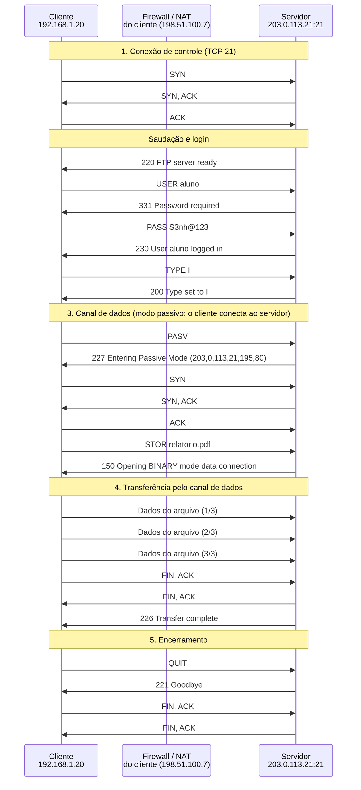

**Mensagens**

| Mensagem | Significado | Origem |
| --- | --- | --- |
| STOR / 150 | pede e confirma | cliente / servidor |
| dados | o arquivo | cliente |
| 226 | concluído | servidor |

**Por que importa.** O upload em FTP deixa o conteúdo legível para quem captura o tráfego.

##### Senha incorreta (530)

*A senha errada também foi exposta.*

**Configuração aplicada:** Modo de dados = passive; Firewall/NAT do cliente = nat; Faixa passiva liberada no servidor = sim; Operação = get; Login = bad

Senha errada: o servidor responde **530**. Repare que a senha, certa ou errada, já trafegou em texto puro.

**Conceito.** O servidor recusa o login com 530. Para um observador, o erro é irrelevante: ele já leu a senha digitada, e pode ser a de outro serviço.

**O que observar**

- O PASS aparece em vermelho na captura.
- Nenhum canal de dados chega a abrir.

**Diagrama de sequência**

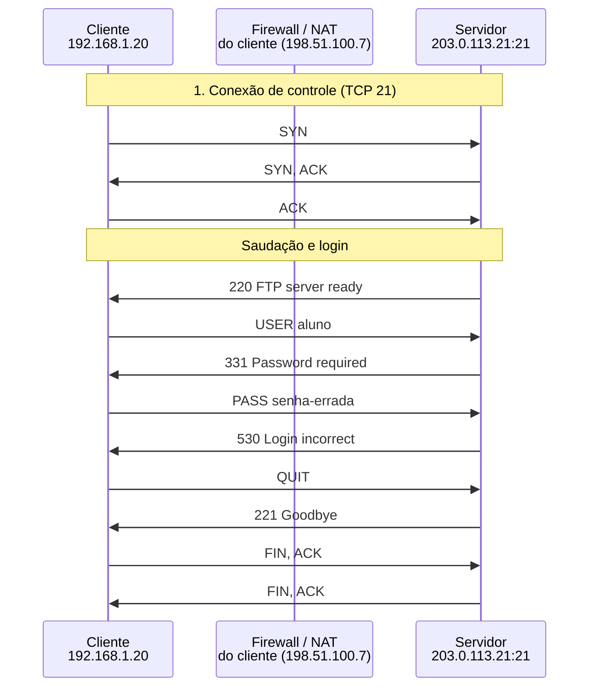

**Mensagens**

| Mensagem | Significado | Origem |
| --- | --- | --- |
| USER / 331 | usuário e pedido de senha | cliente / servidor |
| PASS / 530 | senha recusada | cliente / servidor |

**Por que importa.** Senhas digitadas erradas costumam ser variações da correta: expô-las também é grave.

##### Acesso anônimo

*Login anônimo: o e-mail faz o papel de senha.*

**Configuração aplicada:** Modo de dados = passive; Firewall/NAT do cliente = nat; Faixa passiva liberada no servidor = sim; Operação = get; Login = anon

Login **anonymous**, com o e-mail como senha: comum em repositórios públicos. Sem segredo para proteger, o texto puro é menos grave, mas o conteúdo continua sem integridade.

**Conceito.** Servidores públicos aceitam "anonymous" e pedem um e-mail como senha, por convenção. Não há segredo para proteger.

**O que observar**

- O PASS leva um e-mail.
- O restante é igual ao FTP comum.

**Diagrama de sequência**

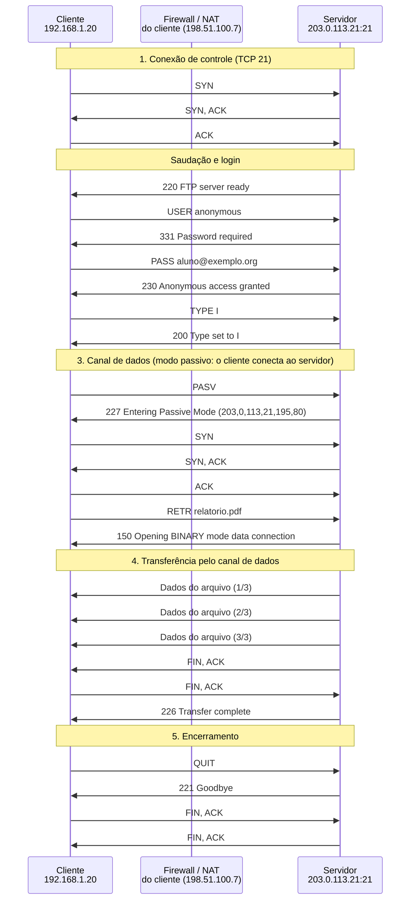

**Mensagens**

| Mensagem | Significado | Origem |
| --- | --- | --- |
| USER anonymous / 331 | login anônimo | cliente / servidor |
| PASS e-mail / 230 | acesso concedido | cliente / servidor |

**Por que importa.** Mesmo sem segredo, o conteúdo sem integridade pode ser alterado por quem estiver no caminho.

### Modo: FTPS

#### FTP sobre TLS

O FTPS põe o TLS sobre o FTP. Protege controle e dados, mas mantém as duas conexões e seus problemas de firewall.

##### FTPS explícito (AUTH TLS)

*AUTH TLS no canal de controle, depois login cifrado.*

**Configuração aplicada:** Modo FTPS = explicit; Proteção dos dados (PROT) = P; Certificado do servidor válido = sim; Modo de dados = passive; Firewall/NAT do cliente = nat; Faixa passiva liberada no servidor = sim; Operação = get; Login = ok

O cliente conecta na porta 21 em claro, envia **AUTH TLS** e só então autentica. Com **PROT P**, o canal de dados também é cifrado.

**Conceito.** No FTPS explícito o cliente conecta em claro, pede AUTH TLS e faz o handshake. Com PBSZ 0 e PROT P, o canal de dados também usa TLS.

**O que observar**

- O AUTH TLS e o Client Hello ainda estão em claro.
- USER e PASS passam cifrados.
- O canal de dados abre outro TLS, reaproveitando a sessão.

**Diagrama de sequência**

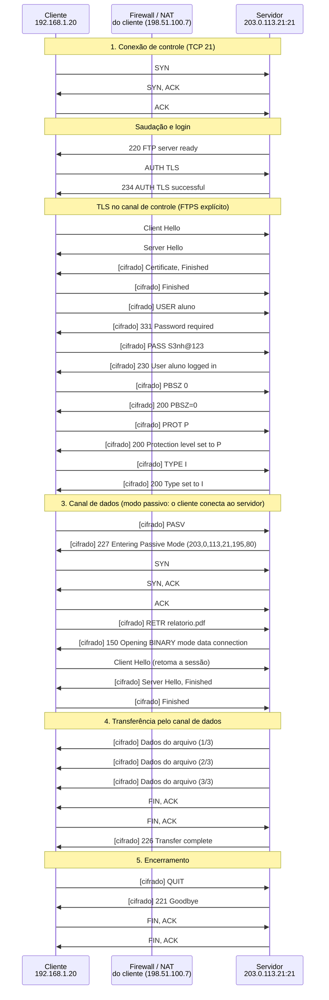

**Mensagens**

| Mensagem | Significado | Origem |
| --- | --- | --- |
| AUTH TLS / 234 | pede e aceita o TLS | cliente / servidor |
| Client Hello ... Finished | handshake TLS | cliente / servidor |
| PBSZ / PROT P | protege também os dados | cliente / servidor |

**Por que importa.** É a forma recomendada de FTPS: padronizada na [RFC 4217](https://www.rfc-editor.org/rfc/rfc4217) e compatível com clientes e servidores comuns.

##### FTPS implícito (porta 990)

*TLS começa antes de qualquer comando FTP.*

**Configuração aplicada:** Modo FTPS = implicit; Proteção dos dados (PROT) = P; Certificado do servidor válido = sim; Modo de dados = passive; Firewall/NAT do cliente = nat; Faixa passiva liberada no servidor = sim; Operação = get; Login = ok

No modo **implícito** o TLS começa no primeiro byte da conexão, na porta 990, sem AUTH TLS. É o modo legado, mas ainda comum.

**Conceito.** No modo implícito o servidor espera TLS desde o primeiro byte, na porta 990. Não há AUTH TLS.

**O que observar**

- O Client Hello é o primeiro pacote depois do TCP.
- O 220 já chega cifrado.

**Diagrama de sequência**

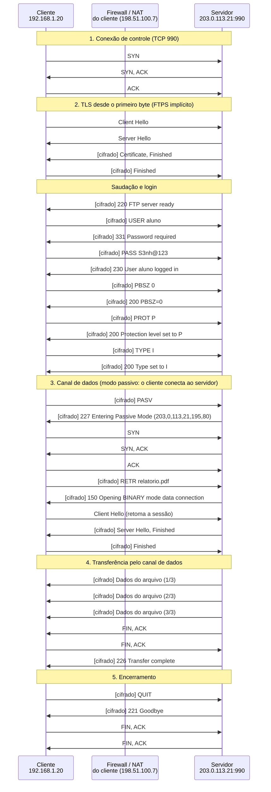

**Mensagens**

| Mensagem | Significado | Origem |
| --- | --- | --- |
| Client Hello ... Finished | handshake TLS | cliente / servidor |
| 220 | saudação, já cifrada | servidor |

**Por que importa.** É o modo legado, não padronizado na [RFC 4217](https://www.rfc-editor.org/rfc/rfc4217), mas ainda comum em ambientes corporativos.

##### PROT C: dados em claro

*A senha é protegida, o arquivo não.*

**Configuração aplicada:** Modo FTPS = explicit; Proteção dos dados (PROT) = C; Certificado do servidor válido = sim; Modo de dados = passive; Firewall/NAT do cliente = nat; Faixa passiva liberada no servidor = sim; Operação = get; Login = ok

Com **PROT C**, só o controle é cifrado: a senha fica protegida, mas o **arquivo trafega em claro**. É uma configuração insegura que parece segura.

**Conceito.** Com PROT C o canal de dados não usa TLS. O controle (login e comandos) segue cifrado, mas o arquivo trafega em claro.

**O que observar**

- O DADOS aparece em vermelho na captura.
- O PROT C vai dentro do TLS e passa despercebido.

**Diagrama de sequência**

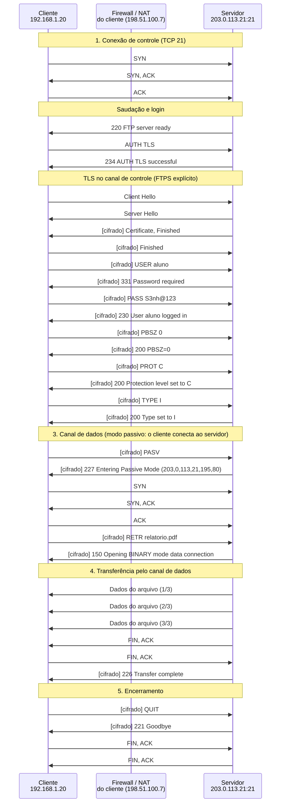

**Mensagens**

| Mensagem | Significado | Origem |
| --- | --- | --- |
| PROT C / 200 | dados sem proteção | cliente / servidor |
| dados | arquivo em claro | servidor |

**Por que importa.** É uma falsa sensação de segurança: sempre confira se PROT P está ativo.

##### Ativo com helper (falha)

*O helper do NAT não lê comandos cifrados.*

**Configuração aplicada:** Modo FTPS = explicit; Proteção dos dados (PROT) = P; Certificado do servidor válido = sim; Modo de dados = active; Firewall/NAT do cliente = helper; Faixa passiva liberada no servidor = sim; Operação = get; Login = ok

Com o controle cifrado, o **helper de FTP do NAT não consegue ler o PORT**. O servidor tenta conectar ao endereço privado e falha: por isso o FTPS costuma exigir modo passivo.

**Conceito.** Com o controle cifrado, o firewall não consegue reescrever o PORT. O servidor tenta conectar ao endereço privado e falha com 425.

**O que observar**

- O PORT segue cifrado.
- O SYN do servidor é descartado.

**Diagrama de sequência**

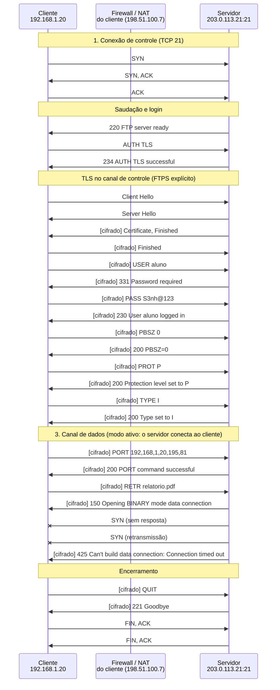

**Mensagens**

| Mensagem | Significado | Origem |
| --- | --- | --- |
| PORT | cifrado | cliente |
| SYN (sem resposta) | o servidor tenta o endereço privado | servidor |
| 425 | falha | servidor |

**Por que importa.** É por isso que o FTPS costuma exigir modo passivo e uma faixa de portas liberada.

##### Certificado inválido

*O cliente rejeita o certificado antes de autenticar.*

**Configuração aplicada:** Modo FTPS = explicit; Proteção dos dados (PROT) = P; Certificado do servidor válido = não; Modo de dados = passive; Firewall/NAT do cliente = nat; Faixa passiva liberada no servidor = sim; Operação = get; Login = ok

O certificado não é confiável. O cliente envia o alerta **unknown_ca** e encerra **antes** de mandar a senha.

**Conceito.** No TLS, o cliente valida o certificado do servidor (cadeia, nome e validade). Se falhar, envia um alerta e encerra, sem enviar nenhuma credencial.

**O que observar**

- O alerta unknown_ca é o último pacote.
- Nenhum USER ou PASS foi enviado.

**Diagrama de sequência**

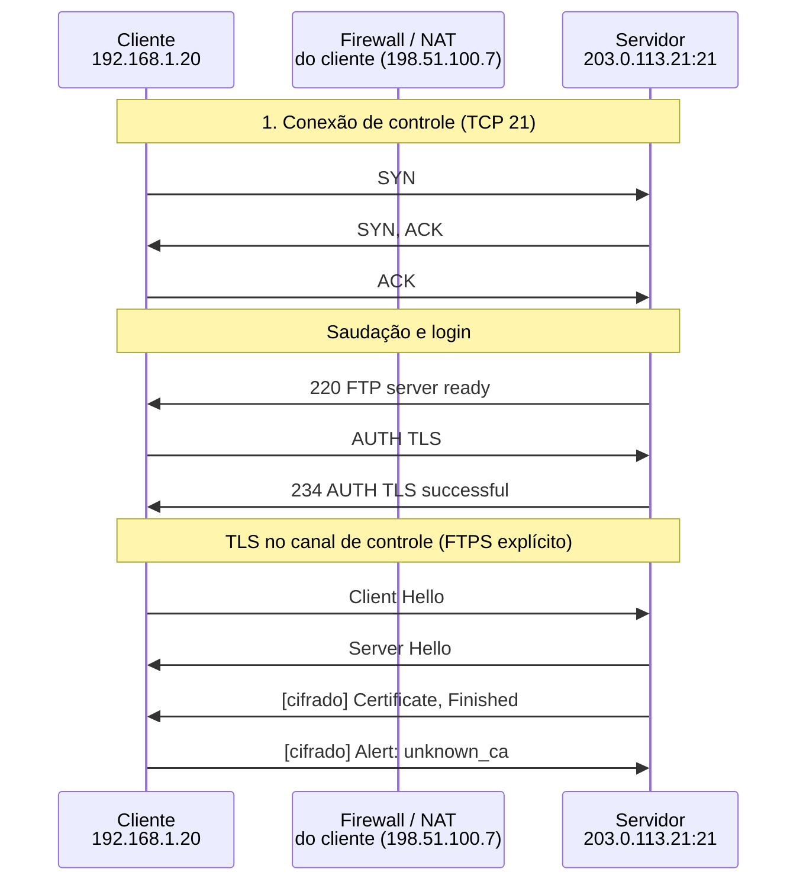

**Mensagens**

| Mensagem | Significado | Origem |
| --- | --- | --- |
| Certificate | certificado do servidor | servidor |
| Alert unknown_ca | cliente recusa | cliente |

**Por que importa.** É a diferença para o FTP comum: aqui o cliente consegue evitar entregar a senha a um servidor falso.

### Modo: SFTP

#### SFTP

O SFTP é um subsistema do SSH: uma conexão, uma porta, tudo cifrado e autenticado.

##### Download (get)

*Uma conexão TCP, uma porta, tudo cifrado.*

**Configuração aplicada:** Autenticação = password; Operação = get

Download por SFTP: TCP na porta 22, troca de chaves, autenticação e o subsistema **sftp**, tudo na mesma conexão.

**Conceito.** O SFTP roda como subsistema do SSH. Depois da troca de chaves e da autenticação, o cliente abre um canal e pede o subsistema sftp. Os pedidos e os dados dos arquivos usam o mesmo canal.

**O que observar**

- Só os banners e o KEXINIT estão em claro.
- A chave do host é conferida em known_hosts.
- Não há canal de dados separado.

**Diagrama de sequência**

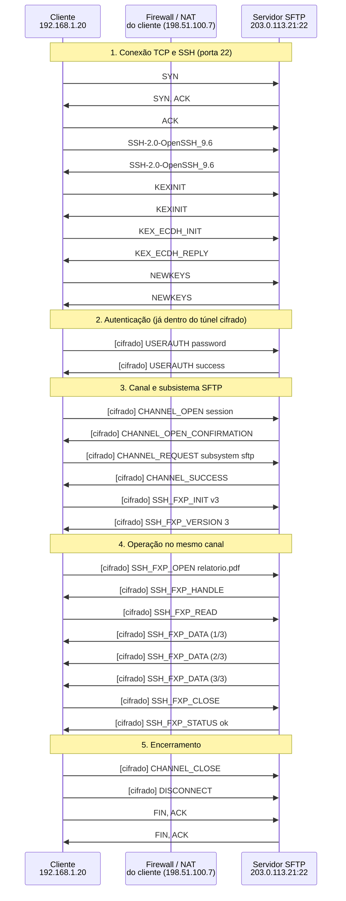

**Mensagens**

| Mensagem | Significado | Origem |
| --- | --- | --- |
| KEXINIT ... NEWKEYS | negocia e ativa as chaves | cliente / servidor |
| USERAUTH | autentica dentro do túnel | cliente / servidor |
| SSH_FXP_OPEN / READ / DATA | lê o arquivo | cliente / servidor |

**Por que importa.** Uma porta só e criptografia de ponta a ponta tornam o SFTP a opção mais simples de operar com firewalls.

##### Chave pública

*A chave privada nunca sai do cliente.*

**Configuração aplicada:** Autenticação = key; Operação = get

A autenticação por **chave pública** não envia segredo algum: o cliente assina um desafio com a chave privada.

**Conceito.** O cliente assina um desafio com a chave privada e o servidor verifica a assinatura com a chave pública cadastrada.

**O que observar**

- Não há senha para capturar.
- O restante é igual ao SFTP comum.

**Diagrama de sequência**

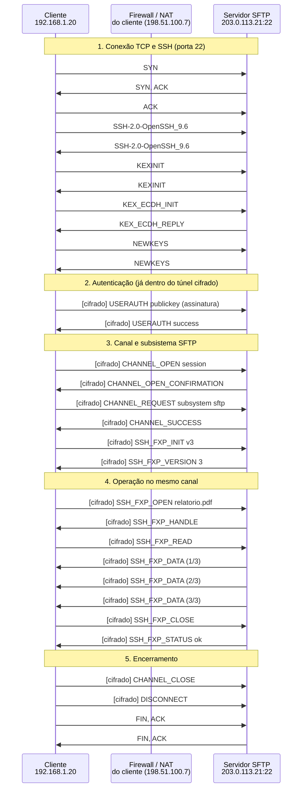

**Mensagens**

| Mensagem | Significado | Origem |
| --- | --- | --- |
| USERAUTH publickey | assinatura | cliente |
| USERAUTH success | aceito | servidor |

**Por que importa.** Chaves eliminam o risco de senhas fracas ou reutilizadas e permitem automação.

##### Upload (put)

*Upload por pedidos WRITE.*

**Configuração aplicada:** Autenticação = password; Operação = put

Upload por SFTP: pedidos **WRITE** dentro do túnel cifrado, na mesma conexão do login.

**Conceito.** O cliente grava o arquivo em blocos com SSH_FXP_WRITE e o servidor confirma cada gravação.

**O que observar**

- Os blocos partem do cliente.
- O STATUS confirma o fim.

**Diagrama de sequência**

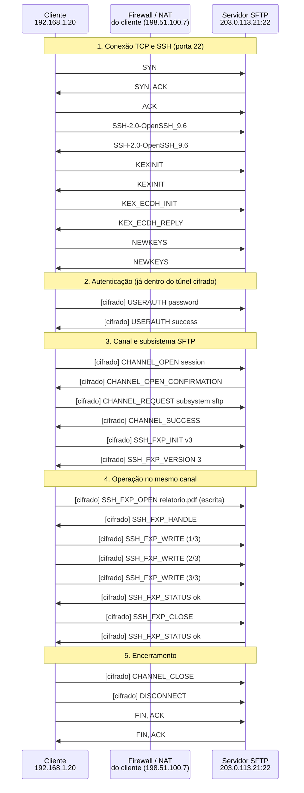

**Mensagens**

| Mensagem | Significado | Origem |
| --- | --- | --- |
| SSH_FXP_OPEN | abre para escrita | cliente |
| SSH_FXP_WRITE | grava os blocos | cliente |
| SSH_FXP_STATUS | confirma | servidor |

**Por que importa.** O upload usa a mesma conexão e as mesmas proteções do login.

##### Listar (ls)

*Listagem por OPENDIR e READDIR.*

**Configuração aplicada:** Autenticação = password; Operação = list

Listagem por SFTP: **OPENDIR**, **READDIR** e **NAME**, sem canal de dados separado.

**Conceito.** O cliente abre o diretório e lê as entradas, tudo pelo canal do SFTP.

**O que observar**

- Nenhuma conexão extra.

**Diagrama de sequência**

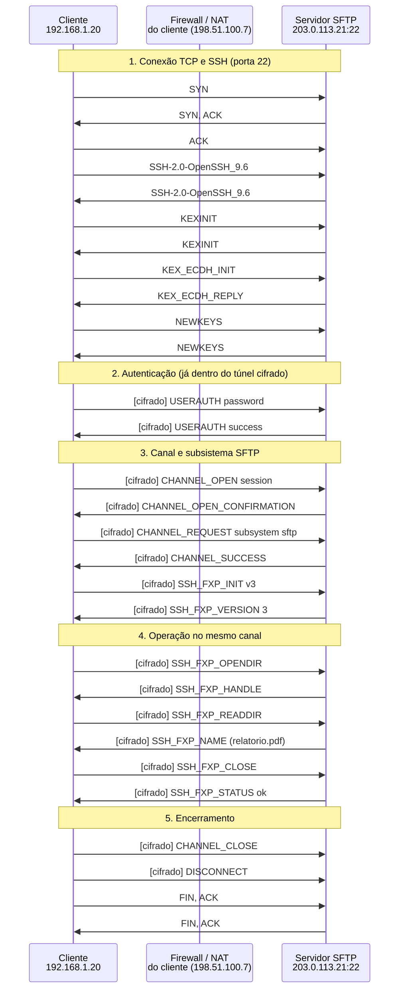

**Mensagens**

| Mensagem | Significado | Origem |
| --- | --- | --- |
| SSH_FXP_OPENDIR | abre o diretório | cliente |
| SSH_FXP_READDIR | lê as entradas | cliente |
| SSH_FXP_NAME | devolve a lista | servidor |

**Por que importa.** Sem conexão extra, listar não falha por causa de firewall.

### Modo: Comparação

#### FTP, FTPS e SFTP

A mesma ação nos três protocolos, com um observador na rede, para comparar exposição, conexões e custo.

##### Download nos três

*O mesmo download nos três protocolos.*

**Configuração aplicada:** Operação = get

O mesmo download feito em **FTP**, **FTPS** e **SFTP**, com um observador na rede, para comparar o que cada protocolo expõe.

**Conceito.** Três execuções em sequência, na mesma rede e com o mesmo observador: FTP em claro, FTPS com TLS e SFTP sobre SSH.

**O que observar**

- No FTP o observador lê a senha e o arquivo.
- No FTPS vê só o nome do servidor e o tamanho dos registros.
- No SFTP vê só pacotes cifrados na porta 22.

**Diagrama de sequência**

```mermaid
sequenceDiagram
  participant n_c as Cliente<br/>192.168.1.20
  participant n_o as Observador na rede<br/>Wi-Fi público ou provedor
  participant n_s as Servidor<br/>203.0.113.21
  Note over n_c,n_s: A. FTP (sem proteção)
  Note over n_c,n_s: 1. Conexão de controle (TCP 21)
  n_c ->> n_s: SYN
  n_s ->> n_c: SYN, ACK
  n_c ->> n_s: ACK
  Note over n_c,n_s: Saudação e login
  n_s ->> n_c: 220 FTP server ready
  n_c ->> n_s: USER aluno
  n_s ->> n_c: 331 Password required
  n_c ->> n_s: PASS S3nh@123
  n_s ->> n_c: 230 User aluno logged in
  n_c ->> n_s: TYPE I
  n_s ->> n_c: 200 Type set to I
  Note over n_c,n_s: 3. Canal de dados (modo passivo: o cliente conecta ao servidor)
  n_c ->> n_s: PASV
  n_s ->> n_c: 227 Entering Passive Mode (203,0,113,21,195,80)
  n_c ->> n_s: SYN
  n_s ->> n_c: SYN, ACK
  n_c ->> n_s: ACK
  n_c ->> n_s: RETR relatorio.pdf
  n_s ->> n_c: 150 Opening BINARY mode data connection
  Note over n_c,n_s: 4. Transferência pelo canal de dados
  n_s ->> n_c: Dados do arquivo (1/3)
  n_s ->> n_c: Dados do arquivo (2/3)
  n_s ->> n_c: Dados do arquivo (3/3)
  n_s ->> n_c: FIN, ACK
  n_c ->> n_s: FIN, ACK
  n_s ->> n_c: 226 Transfer complete
  Note over n_c,n_s: 5. Encerramento
  n_c ->> n_s: QUIT
  n_s ->> n_c: 221 Goodbye
  n_c ->> n_s: FIN, ACK
  n_s ->> n_c: FIN, ACK
  Note over n_c,n_s: B. FTPS explícito (AUTH TLS, PROT P)
  Note over n_c,n_s: 1. Conexão de controle (TCP 21)
  n_c ->> n_s: SYN
  n_s ->> n_c: SYN, ACK
  n_c ->> n_s: ACK
  Note over n_c,n_s: Saudação e login
  n_s ->> n_c: 220 FTP server ready
  n_c ->> n_s: AUTH TLS
  n_s ->> n_c: 234 AUTH TLS successful
  Note over n_c,n_s: TLS no canal de controle (FTPS explícito)
  n_c ->> n_s: Client Hello
  n_s ->> n_c: Server Hello
  n_s ->> n_c: [cifrado] Certificate, Finished
  n_c ->> n_s: [cifrado] Finished
  n_c ->> n_s: [cifrado] USER aluno
  n_s ->> n_c: [cifrado] 331 Password required
  n_c ->> n_s: [cifrado] PASS S3nh@123
  n_s ->> n_c: [cifrado] 230 User aluno logged in
  n_c ->> n_s: [cifrado] PBSZ 0
  n_s ->> n_c: [cifrado] 200 PBSZ=0
  n_c ->> n_s: [cifrado] PROT P
  n_s ->> n_c: [cifrado] 200 Protection level set to P
  n_c ->> n_s: [cifrado] TYPE I
  n_s ->> n_c: [cifrado] 200 Type set to I
  Note over n_c,n_s: 3. Canal de dados (modo passivo: o cliente conecta ao servidor)
  n_c ->> n_s: [cifrado] PASV
  n_s ->> n_c: [cifrado] 227 Entering Passive Mode (203,0,113,21,195,80)
  n_c ->> n_s: SYN
  n_s ->> n_c: SYN, ACK
  n_c ->> n_s: ACK
  n_c ->> n_s: [cifrado] RETR relatorio.pdf
  n_s ->> n_c: [cifrado] 150 Opening BINARY mode data connection
  n_c ->> n_s: Client Hello (retoma a sessão)
  n_s ->> n_c: [cifrado] Server Hello, Finished
  n_c ->> n_s: [cifrado] Finished
  Note over n_c,n_s: 4. Transferência pelo canal de dados
  n_s ->> n_c: [cifrado] Dados do arquivo (1/3)
  n_s ->> n_c: [cifrado] Dados do arquivo (2/3)
  n_s ->> n_c: [cifrado] Dados do arquivo (3/3)
  n_s ->> n_c: FIN, ACK
  n_c ->> n_s: FIN, ACK
  n_s ->> n_c: [cifrado] 226 Transfer complete
  Note over n_c,n_s: 5. Encerramento
  n_c ->> n_s: [cifrado] QUIT
  n_s ->> n_c: [cifrado] 221 Goodbye
  n_c ->> n_s: FIN, ACK
  n_s ->> n_c: FIN, ACK
  Note over n_c,n_s: C. SFTP (SSH, porta 22)
  Note over n_c,n_s: 1. Conexão TCP e SSH (porta 22)
  n_c ->> n_s: SYN
  n_s ->> n_c: SYN, ACK
  n_c ->> n_s: ACK
  n_c ->> n_s: SSH-2.0-OpenSSH_9.6
  n_s ->> n_c: SSH-2.0-OpenSSH_9.6
  n_c ->> n_s: KEXINIT
  n_s ->> n_c: KEXINIT
  n_c ->> n_s: KEX_ECDH_INIT
  n_s ->> n_c: KEX_ECDH_REPLY
  n_c ->> n_s: NEWKEYS
  n_s ->> n_c: NEWKEYS
  Note over n_c,n_s: 2. Autenticação (já dentro do túnel cifrado)
  n_c ->> n_s: [cifrado] USERAUTH password
  n_s ->> n_c: [cifrado] USERAUTH success
  Note over n_c,n_s: 3. Canal e subsistema SFTP
  n_c ->> n_s: [cifrado] CHANNEL_OPEN session
  n_s ->> n_c: [cifrado] CHANNEL_OPEN_CONFIRMATION
  n_c ->> n_s: [cifrado] CHANNEL_REQUEST subsystem sftp
  n_s ->> n_c: [cifrado] CHANNEL_SUCCESS
  n_c ->> n_s: [cifrado] SSH_FXP_INIT v3
  n_s ->> n_c: [cifrado] SSH_FXP_VERSION 3
  Note over n_c,n_s: 4. Operação no mesmo canal
  n_c ->> n_s: [cifrado] SSH_FXP_OPEN relatorio.pdf
  n_s ->> n_c: [cifrado] SSH_FXP_HANDLE
  n_c ->> n_s: [cifrado] SSH_FXP_READ
  n_s ->> n_c: [cifrado] SSH_FXP_DATA (1/3)
  n_s ->> n_c: [cifrado] SSH_FXP_DATA (2/3)
  n_s ->> n_c: [cifrado] SSH_FXP_DATA (3/3)
  n_c ->> n_s: [cifrado] SSH_FXP_CLOSE
  n_s ->> n_c: [cifrado] SSH_FXP_STATUS ok
  Note over n_c,n_s: 5. Encerramento
  n_c ->> n_s: [cifrado] CHANNEL_CLOSE
  n_c ->> n_s: [cifrado] DISCONNECT
  n_c ->> n_s: FIN, ACK
  n_s ->> n_c: FIN, ACK
```

**Mensagens**

| Mensagem | Significado | Origem |
| --- | --- | --- |
| A. FTP | tudo em claro | - |
| B. FTPS | AUTH TLS e PROT P | - |
| C. SFTP | subsistema do SSH | - |

**Por que importa.** A tabela da aba Comparação mostra também conexões, portas, integridade e tempo.

##### Upload nos três

*O mesmo upload nos três protocolos.*

**Configuração aplicada:** Operação = put

O mesmo upload nos três protocolos, com o observador na rede.

**Conceito.** O arquivo sai do cliente. No FTP, o observador o reconstrói; nos outros dois, vê só bytes cifrados.

**O que observar**

- No FTP o conteúdo também é legível.
- O custo do TLS é de cerca de 1 RTT extra.

**Diagrama de sequência**

```mermaid
sequenceDiagram
  participant n_c as Cliente<br/>192.168.1.20
  participant n_o as Observador na rede<br/>Wi-Fi público ou provedor
  participant n_s as Servidor<br/>203.0.113.21
  Note over n_c,n_s: A. FTP (sem proteção)
  Note over n_c,n_s: 1. Conexão de controle (TCP 21)
  n_c ->> n_s: SYN
  n_s ->> n_c: SYN, ACK
  n_c ->> n_s: ACK
  Note over n_c,n_s: Saudação e login
  n_s ->> n_c: 220 FTP server ready
  n_c ->> n_s: USER aluno
  n_s ->> n_c: 331 Password required
  n_c ->> n_s: PASS S3nh@123
  n_s ->> n_c: 230 User aluno logged in
  n_c ->> n_s: TYPE I
  n_s ->> n_c: 200 Type set to I
  Note over n_c,n_s: 3. Canal de dados (modo passivo: o cliente conecta ao servidor)
  n_c ->> n_s: PASV
  n_s ->> n_c: 227 Entering Passive Mode (203,0,113,21,195,80)
  n_c ->> n_s: SYN
  n_s ->> n_c: SYN, ACK
  n_c ->> n_s: ACK
  n_c ->> n_s: STOR relatorio.pdf
  n_s ->> n_c: 150 Opening BINARY mode data connection
  Note over n_c,n_s: 4. Transferência pelo canal de dados
  n_c ->> n_s: Dados do arquivo (1/3)
  n_c ->> n_s: Dados do arquivo (2/3)
  n_c ->> n_s: Dados do arquivo (3/3)
  n_c ->> n_s: FIN, ACK
  n_s ->> n_c: FIN, ACK
  n_s ->> n_c: 226 Transfer complete
  Note over n_c,n_s: 5. Encerramento
  n_c ->> n_s: QUIT
  n_s ->> n_c: 221 Goodbye
  n_c ->> n_s: FIN, ACK
  n_s ->> n_c: FIN, ACK
  Note over n_c,n_s: B. FTPS explícito (AUTH TLS, PROT P)
  Note over n_c,n_s: 1. Conexão de controle (TCP 21)
  n_c ->> n_s: SYN
  n_s ->> n_c: SYN, ACK
  n_c ->> n_s: ACK
  Note over n_c,n_s: Saudação e login
  n_s ->> n_c: 220 FTP server ready
  n_c ->> n_s: AUTH TLS
  n_s ->> n_c: 234 AUTH TLS successful
  Note over n_c,n_s: TLS no canal de controle (FTPS explícito)
  n_c ->> n_s: Client Hello
  n_s ->> n_c: Server Hello
  n_s ->> n_c: [cifrado] Certificate, Finished
  n_c ->> n_s: [cifrado] Finished
  n_c ->> n_s: [cifrado] USER aluno
  n_s ->> n_c: [cifrado] 331 Password required
  n_c ->> n_s: [cifrado] PASS S3nh@123
  n_s ->> n_c: [cifrado] 230 User aluno logged in
  n_c ->> n_s: [cifrado] PBSZ 0
  n_s ->> n_c: [cifrado] 200 PBSZ=0
  n_c ->> n_s: [cifrado] PROT P
  n_s ->> n_c: [cifrado] 200 Protection level set to P
  n_c ->> n_s: [cifrado] TYPE I
  n_s ->> n_c: [cifrado] 200 Type set to I
  Note over n_c,n_s: 3. Canal de dados (modo passivo: o cliente conecta ao servidor)
  n_c ->> n_s: [cifrado] PASV
  n_s ->> n_c: [cifrado] 227 Entering Passive Mode (203,0,113,21,195,80)
  n_c ->> n_s: SYN
  n_s ->> n_c: SYN, ACK
  n_c ->> n_s: ACK
  n_c ->> n_s: [cifrado] STOR relatorio.pdf
  n_s ->> n_c: [cifrado] 150 Opening BINARY mode data connection
  n_c ->> n_s: Client Hello (retoma a sessão)
  n_s ->> n_c: [cifrado] Server Hello, Finished
  n_c ->> n_s: [cifrado] Finished
  Note over n_c,n_s: 4. Transferência pelo canal de dados
  n_c ->> n_s: [cifrado] Dados do arquivo (1/3)
  n_c ->> n_s: [cifrado] Dados do arquivo (2/3)
  n_c ->> n_s: [cifrado] Dados do arquivo (3/3)
  n_c ->> n_s: FIN, ACK
  n_s ->> n_c: FIN, ACK
  n_s ->> n_c: [cifrado] 226 Transfer complete
  Note over n_c,n_s: 5. Encerramento
  n_c ->> n_s: [cifrado] QUIT
  n_s ->> n_c: [cifrado] 221 Goodbye
  n_c ->> n_s: FIN, ACK
  n_s ->> n_c: FIN, ACK
  Note over n_c,n_s: C. SFTP (SSH, porta 22)
  Note over n_c,n_s: 1. Conexão TCP e SSH (porta 22)
  n_c ->> n_s: SYN
  n_s ->> n_c: SYN, ACK
  n_c ->> n_s: ACK
  n_c ->> n_s: SSH-2.0-OpenSSH_9.6
  n_s ->> n_c: SSH-2.0-OpenSSH_9.6
  n_c ->> n_s: KEXINIT
  n_s ->> n_c: KEXINIT
  n_c ->> n_s: KEX_ECDH_INIT
  n_s ->> n_c: KEX_ECDH_REPLY
  n_c ->> n_s: NEWKEYS
  n_s ->> n_c: NEWKEYS
  Note over n_c,n_s: 2. Autenticação (já dentro do túnel cifrado)
  n_c ->> n_s: [cifrado] USERAUTH password
  n_s ->> n_c: [cifrado] USERAUTH success
  Note over n_c,n_s: 3. Canal e subsistema SFTP
  n_c ->> n_s: [cifrado] CHANNEL_OPEN session
  n_s ->> n_c: [cifrado] CHANNEL_OPEN_CONFIRMATION
  n_c ->> n_s: [cifrado] CHANNEL_REQUEST subsystem sftp
  n_s ->> n_c: [cifrado] CHANNEL_SUCCESS
  n_c ->> n_s: [cifrado] SSH_FXP_INIT v3
  n_s ->> n_c: [cifrado] SSH_FXP_VERSION 3
  Note over n_c,n_s: 4. Operação no mesmo canal
  n_c ->> n_s: [cifrado] SSH_FXP_OPEN relatorio.pdf (escrita)
  n_s ->> n_c: [cifrado] SSH_FXP_HANDLE
  n_c ->> n_s: [cifrado] SSH_FXP_WRITE (1/3)
  n_c ->> n_s: [cifrado] SSH_FXP_WRITE (2/3)
  n_c ->> n_s: [cifrado] SSH_FXP_WRITE (3/3)
  n_s ->> n_c: [cifrado] SSH_FXP_STATUS ok
  n_c ->> n_s: [cifrado] SSH_FXP_CLOSE
  n_s ->> n_c: [cifrado] SSH_FXP_STATUS ok
  Note over n_c,n_s: 5. Encerramento
  n_c ->> n_s: [cifrado] CHANNEL_CLOSE
  n_c ->> n_s: [cifrado] DISCONNECT
  n_c ->> n_s: FIN, ACK
  n_s ->> n_c: FIN, ACK
```

**Mensagens**

| Mensagem | Significado | Origem |
| --- | --- | --- |
| A. FTP | upload em claro | - |
| B. FTPS | upload cifrado | - |
| C. SFTP | upload cifrado | - |

**Por que importa.** O mesmo vale para quem envia arquivos sensíveis: o FTP simples não deve ser usado em redes não confiáveis.

##### Listagem nos três

*A mesma listagem nos três protocolos.*

**Configuração aplicada:** Operação = list

A mesma listagem de diretório nos três protocolos.

**Conceito.** Até a listagem expõe nomes de arquivos. No FTP o observador lê o diretório; nos outros dois, não.

**O que observar**

- No FTP a listagem aparece em vermelho.

**Diagrama de sequência**

```mermaid
sequenceDiagram
  participant n_c as Cliente<br/>192.168.1.20
  participant n_o as Observador na rede<br/>Wi-Fi público ou provedor
  participant n_s as Servidor<br/>203.0.113.21
  Note over n_c,n_s: A. FTP (sem proteção)
  Note over n_c,n_s: 1. Conexão de controle (TCP 21)
  n_c ->> n_s: SYN
  n_s ->> n_c: SYN, ACK
  n_c ->> n_s: ACK
  Note over n_c,n_s: Saudação e login
  n_s ->> n_c: 220 FTP server ready
  n_c ->> n_s: USER aluno
  n_s ->> n_c: 331 Password required
  n_c ->> n_s: PASS S3nh@123
  n_s ->> n_c: 230 User aluno logged in
  n_c ->> n_s: TYPE I
  n_s ->> n_c: 200 Type set to I
  Note over n_c,n_s: 3. Canal de dados (modo passivo: o cliente conecta ao servidor)
  n_c ->> n_s: PASV
  n_s ->> n_c: 227 Entering Passive Mode (203,0,113,21,195,80)
  n_c ->> n_s: SYN
  n_s ->> n_c: SYN, ACK
  n_c ->> n_s: ACK
  n_c ->> n_s: LIST
  n_s ->> n_c: 150 Opening BINARY mode data connection
  Note over n_c,n_s: 4. Transferência pelo canal de dados
  n_s ->> n_c: Listagem do diretório
  n_s ->> n_c: FIN, ACK
  n_c ->> n_s: FIN, ACK
  n_s ->> n_c: 226 Transfer complete
  Note over n_c,n_s: 5. Encerramento
  n_c ->> n_s: QUIT
  n_s ->> n_c: 221 Goodbye
  n_c ->> n_s: FIN, ACK
  n_s ->> n_c: FIN, ACK
  Note over n_c,n_s: B. FTPS explícito (AUTH TLS, PROT P)
  Note over n_c,n_s: 1. Conexão de controle (TCP 21)
  n_c ->> n_s: SYN
  n_s ->> n_c: SYN, ACK
  n_c ->> n_s: ACK
  Note over n_c,n_s: Saudação e login
  n_s ->> n_c: 220 FTP server ready
  n_c ->> n_s: AUTH TLS
  n_s ->> n_c: 234 AUTH TLS successful
  Note over n_c,n_s: TLS no canal de controle (FTPS explícito)
  n_c ->> n_s: Client Hello
  n_s ->> n_c: Server Hello
  n_s ->> n_c: [cifrado] Certificate, Finished
  n_c ->> n_s: [cifrado] Finished
  n_c ->> n_s: [cifrado] USER aluno
  n_s ->> n_c: [cifrado] 331 Password required
  n_c ->> n_s: [cifrado] PASS S3nh@123
  n_s ->> n_c: [cifrado] 230 User aluno logged in
  n_c ->> n_s: [cifrado] PBSZ 0
  n_s ->> n_c: [cifrado] 200 PBSZ=0
  n_c ->> n_s: [cifrado] PROT P
  n_s ->> n_c: [cifrado] 200 Protection level set to P
  n_c ->> n_s: [cifrado] TYPE I
  n_s ->> n_c: [cifrado] 200 Type set to I
  Note over n_c,n_s: 3. Canal de dados (modo passivo: o cliente conecta ao servidor)
  n_c ->> n_s: [cifrado] PASV
  n_s ->> n_c: [cifrado] 227 Entering Passive Mode (203,0,113,21,195,80)
  n_c ->> n_s: SYN
  n_s ->> n_c: SYN, ACK
  n_c ->> n_s: ACK
  n_c ->> n_s: [cifrado] LIST
  n_s ->> n_c: [cifrado] 150 Opening BINARY mode data connection
  n_c ->> n_s: Client Hello (retoma a sessão)
  n_s ->> n_c: [cifrado] Server Hello, Finished
  n_c ->> n_s: [cifrado] Finished
  Note over n_c,n_s: 4. Transferência pelo canal de dados
  n_s ->> n_c: [cifrado] Listagem do diretório
  n_s ->> n_c: FIN, ACK
  n_c ->> n_s: FIN, ACK
  n_s ->> n_c: [cifrado] 226 Transfer complete
  Note over n_c,n_s: 5. Encerramento
  n_c ->> n_s: [cifrado] QUIT
  n_s ->> n_c: [cifrado] 221 Goodbye
  n_c ->> n_s: FIN, ACK
  n_s ->> n_c: FIN, ACK
  Note over n_c,n_s: C. SFTP (SSH, porta 22)
  Note over n_c,n_s: 1. Conexão TCP e SSH (porta 22)
  n_c ->> n_s: SYN
  n_s ->> n_c: SYN, ACK
  n_c ->> n_s: ACK
  n_c ->> n_s: SSH-2.0-OpenSSH_9.6
  n_s ->> n_c: SSH-2.0-OpenSSH_9.6
  n_c ->> n_s: KEXINIT
  n_s ->> n_c: KEXINIT
  n_c ->> n_s: KEX_ECDH_INIT
  n_s ->> n_c: KEX_ECDH_REPLY
  n_c ->> n_s: NEWKEYS
  n_s ->> n_c: NEWKEYS
  Note over n_c,n_s: 2. Autenticação (já dentro do túnel cifrado)
  n_c ->> n_s: [cifrado] USERAUTH password
  n_s ->> n_c: [cifrado] USERAUTH success
  Note over n_c,n_s: 3. Canal e subsistema SFTP
  n_c ->> n_s: [cifrado] CHANNEL_OPEN session
  n_s ->> n_c: [cifrado] CHANNEL_OPEN_CONFIRMATION
  n_c ->> n_s: [cifrado] CHANNEL_REQUEST subsystem sftp
  n_s ->> n_c: [cifrado] CHANNEL_SUCCESS
  n_c ->> n_s: [cifrado] SSH_FXP_INIT v3
  n_s ->> n_c: [cifrado] SSH_FXP_VERSION 3
  Note over n_c,n_s: 4. Operação no mesmo canal
  n_c ->> n_s: [cifrado] SSH_FXP_OPENDIR
  n_s ->> n_c: [cifrado] SSH_FXP_HANDLE
  n_c ->> n_s: [cifrado] SSH_FXP_READDIR
  n_s ->> n_c: [cifrado] SSH_FXP_NAME (relatorio.pdf)
  n_c ->> n_s: [cifrado] SSH_FXP_CLOSE
  n_s ->> n_c: [cifrado] SSH_FXP_STATUS ok
  Note over n_c,n_s: 5. Encerramento
  n_c ->> n_s: [cifrado] CHANNEL_CLOSE
  n_c ->> n_s: [cifrado] DISCONNECT
  n_c ->> n_s: FIN, ACK
  n_s ->> n_c: FIN, ACK
```

**Mensagens**

| Mensagem | Significado | Origem |
| --- | --- | --- |
| A. FTP | listagem em claro | - |
| B. FTPS | listagem cifrada | - |
| C. SFTP | listagem cifrada | - |

**Por que importa.** Nomes de arquivos também podem ser informação sensível.

## Referência

### Os três protocolos

- **FTP ([RFC 959](https://www.rfc-editor.org/rfc/rfc959)):** canal de controle na porta 21 e um canal de dados por transferência. Usuário, senha, comandos e arquivos viajam em texto puro.
- **FTPS ([RFC 4217](https://www.rfc-editor.org/rfc/rfc4217), com [RFC 2228](https://www.rfc-editor.org/rfc/rfc2228)):** o FTP com TLS. No modo **explícito**, o cliente envia `AUTH TLS` na porta 21. No modo **implícito**, o TLS começa no primeiro byte, por convenção na porta 990 (não padronizado na [RFC 4217](https://www.rfc-editor.org/rfc/rfc4217)). Os comandos `PBSZ 0` e `PROT P` ou `PROT C` escolhem se os dados também são cifrados.
- **SFTP:** não é "FTP sobre SSH". É um protocolo próprio de acesso a arquivos, que roda como subsistema do SSH ([RFC 4251](https://www.rfc-editor.org/rfc/rfc4251) a [4254](https://www.rfc-editor.org/rfc/rfc4254)) em uma única conexão na porta 22. A especificação é o rascunho do IETF *SSH File Transfer Protocol*; a versão 3 é a mais usada.

### Modos de dados do FTP

- **Passivo (`PASV` ou `EPSV`, [RFC 2428](https://www.rfc-editor.org/rfc/rfc2428)):** o servidor abre uma porta de uma faixa e o cliente conecta nela. É o modo que atravessa NAT e firewalls de estado, desde que a faixa de portas esteja liberada no servidor.
- **Ativo (`PORT` ou `EPRT`):** o cliente anuncia seu endereço e uma porta, e o **servidor** conecta, a partir da porta 20. Atrás de NAT, o endereço anunciado é privado e a conexão falha, a menos que um helper do firewall reescreva o comando.
- O helper de FTP precisa ler o canal de controle. Com FTPS o canal é cifrado e o helper não consegue fazer isso.

### Códigos de resposta

| Código | Significado |
| --- | --- |
| 150 | arquivo OK, abrindo o canal de dados |
| 200 | comando aceito |
| 220 | servidor pronto |
| 226 | transferência concluída |
| 227 e 229 | modo passivo (PASV e EPSV) |
| 230 e 530 | login aceito e login recusado |
| 234 | AUTH TLS aceito |
| 331 | usuário aceito, falta a senha |
| 425 | não foi possível abrir o canal de dados |

### Hardening

- Prefira SFTP. Se precisar de FTP, use FTPS explícito com TLS 1.2 ou superior e **PROT P**.
- Em FTPS, use modo passivo com uma faixa de portas fixa, pequena e liberada no firewall.
- Exija a validação do certificado no cliente e desative contas anônimas que não forem necessárias.
- No SFTP, desative a senha e use chaves; considere restringir os usuários ao seu diretório (chroot) e desativar o shell.
- Registre e limite tentativas de login (por exemplo, com fail2ban).

### Limitações do simulador

As chaves, os hashes e os conteúdos são ilustrativos. Os tempos são didáticos, o certificado e o TLS são simplificados e não há criptografia real.


---

*Simulador desenvolvido pelo Prof. Dr. Laerte Peotta de Melo. Conteúdo elaborado com apoio de IA generativa, sob revisão do autor. Uso exclusivo para fins de ensino e pesquisa.*
