# Wi-Fi: operação (802.11)

Como uma rede local sem fio funciona: varredura passiva e ativa, autenticação e associação, acesso ao meio com CSMA/CA, ACK, RTS/CTS e nó oculto, roaming, economia de energia e planejamento de canais.

- **Categoria:** Camada de enlace e redes locais
- **Motor:** nativo (TypeScript puro, apresentado pela bancada genérica)
- **Código-fonte:** `src/sims/wifi/`
- **RFCs e padrões:** [RFC 9542](https://www.rfc-editor.org/rfc/rfc9542) (Endereços MAC de documentação)
- **Tópicos:** Beacon, Probe e os três estados do cliente; Autenticação aberta, associação e recusa; CSMA/CA: DIFS, backoff, ACK e retransmissão; Colisões, nó oculto e RTS/CTS; Roaming, 802.11r e 802.11v; Economia de energia: TIM e PS-Poll; Canais em 2,4 GHz e interferência

## 1. Modos

| Modo | Cenário inicial | Cenários |
| --- | --- | --- |
| Descoberta e associação | Varredura passiva e rede aberta | 6.1.1 a 6.1.5 |
| Acesso ao meio | Esperar, sortear o backoff, transmitir e receber o ACK | 6.2.1 a 6.2.6 |
| Roaming e energia | O cliente se afasta e troca de AP | 6.3.1 a 6.3.6 |
| Canais | Canais 1 e 6: independentes | 6.4.1 a 6.4.4 |

## 2. Como ler os diagramas

Este documento usa até dois tipos de diagrama. Cada figura traz uma legenda com o tipo, o que mostra e a que modo ou cenário se refere.

| Tipo | O que é | Vale para | Equivale, no simulador, a |
| --- | --- | --- | --- |
| A, topologia | Os elementos da rede e os enlaces que os ligam. É estático. | Um modo inteiro | A visão "Topologia" do quadro principal |
| B, sequência | As mensagens na ordem do tempo, entre os participantes. É dinâmico. | Um único cenário, com a configuração indicada | Ao diagrama de sequência e à aba Captura |

### 2.1 Legenda dos diagramas

**Tipo A (topologia)**

- Retângulo: host (computador ou servidor final).
- Hexágono: switch.
- Retângulo arredondado: roteador, ou dispositivo que encaminha ou traduz.
- Estádio (cantos bem arredondados): servidor ou rede externa.
- Retângulo vermelho: atacante (quando existe no modo).
- Linha contínua: enlace. Linha tracejada: enlace alternativo, forjado ou caído, ou ainda relação de peering (no BGP), conforme o rótulo e o cenário.
- O Mermaid posiciona os elementos automaticamente: o layout difere do simulador, as ligações não.

**Tipo B (sequência)**

- Cada coluna é um participante (cliente, servidor, roteador ou outro). O tempo corre de cima para baixo.
- Seta cheia: mensagem enviada. Seta com X: mensagem perdida.
- `[cifrado]` no início do rótulo: a mensagem viaja cifrada.
- Faixa horizontal com texto: início de uma fase do cenário.
- A ordem é a da aba Captura; os intervalos de tempo não são desenhados em escala.

### 2.2 Lista de figuras

**Tipo A (topologia)**

- [Figura 3.1a](#31-descoberta-e-associação): topologia do modo "Descoberta e associação", variante a
- [Figura 3.1b](#31-descoberta-e-associação): topologia do modo "Descoberta e associação", variante b
- [Figura 3.2a](#32-acesso-ao-meio): topologia do modo "Acesso ao meio", variante a
- [Figura 3.2b](#32-acesso-ao-meio): topologia do modo "Acesso ao meio", variante b
- [Figura 3.3a](#33-roaming-e-energia): topologia do modo "Roaming e energia", variante a
- [Figura 3.3b](#33-roaming-e-energia): topologia do modo "Roaming e energia", variante b
- [Figura 3.4a](#34-canais): topologia do modo "Canais", variante a
- [Figura 3.4b](#34-canais): topologia do modo "Canais", variante b
- [Figura 3.4c](#34-canais): topologia do modo "Canais", variante c
- [Figura 3.4d](#34-canais): topologia do modo "Canais", variante d

**Tipo B (sequência)**

- [Figura 6.1.1](#611-varredura-passiva-e-rede-aberta): sequência de "Varredura passiva e rede aberta"
- [Figura 6.1.2](#612-varredura-ativa-com-probe-request): sequência de "Varredura ativa com Probe Request"
- [Figura 6.1.3](#613-rede-com-ssid-oculto): sequência de "Rede com SSID oculto"
- [Figura 6.1.4](#614-rede-protegida-a-associação-não-basta): sequência de "Rede protegida: a associação não basta"
- [Figura 6.1.5](#615-ap-lotado-recusa-a-associação): sequência de "AP lotado recusa a associação"
- [Figura 6.2.1](#621-esperar-sortear-o-backoff-transmitir-e-receber-o-ack): sequência de "Esperar, sortear o backoff, transmitir e receber o ACK"
- [Figura 6.2.2](#622-o-ack-se-perde-e-o-quadro-é-repetido): sequência de "O ACK se perde e o quadro é repetido"
- [Figura 6.2.3](#623-dois-clientes-escolhem-o-mesmo-slot): sequência de "Dois clientes escolhem o mesmo slot"
- [Figura 6.2.4](#624-a-mesma-colisão-agora-com-rtscts): sequência de "A mesma colisão, agora com RTS/CTS"
- [Figura 6.2.5](#625-nó-oculto-sem-rtscts): sequência de "Nó oculto sem RTS/CTS"
- [Figura 6.2.6](#626-nó-oculto-com-rtscts): sequência de "Nó oculto com RTS/CTS"
- [Figura 6.3.1](#631-o-cliente-se-afasta-e-troca-de-ap): sequência de "O cliente se afasta e troca de AP"
- [Figura 6.3.2](#632-roaming-rápido-com-80211r): sequência de "Roaming rápido com 802.11r"
- [Figura 6.3.3](#633-o-cliente-não-troca-de-ap): sequência de "O cliente não troca de AP"
- [Figura 6.3.4](#634-o-ap-sugere-a-troca-80211v): sequência de "O AP sugere a troca (802.11v)"
- [Figura 6.3.5](#635-cliente-que-acorda-a-cada-beacon): sequência de "Cliente que acorda a cada beacon"
- [Figura 6.3.6](#636-cliente-que-acorda-a-cada-5-beacons): sequência de "Cliente que acorda a cada 5 beacons"
- [Figura 6.4.1](#641-canais-1-e-6-independentes): sequência de "Canais 1 e 6: independentes"
- [Figura 6.4.2](#642-mesmo-canal-as-redes-dividem-o-tempo): sequência de "Mesmo canal: as redes dividem o tempo"
- [Figura 6.4.3](#643-canais-1-e-3-sobrepostos): sequência de "Canais 1 e 3: sobrepostos"
- [Figura 6.4.4](#644-canais-de-40-mhz-em-24-ghz): sequência de "Canais de 40 MHz em 2,4 GHz"

## 3. Topologia

Figuras do Tipo A, uma por modo (e uma por variante do desenho, quando a rede muda entre cenários). Foram geradas a partir da mesma definição de topologia que a bancada usa.

### 3.1 Descoberta e associação


*Figura 3.1a (Tipo A, topologia).* Elementos do modo "Descoberta e associação": Notebook (cliente (STA)); AP-01 (LabRedes, canal 6); Rede cabeada (sistema de distribuição). Linhas tracejadas: enlaces alternativos, forjados ou caídos. Vale para os cenários (6.1.1 e 6.1.2; 6.1.4 e 6.1.5).


*Figura 3.1b (Tipo A, topologia).* Elementos do modo "Descoberta e associação": Notebook (cliente (STA)); AP-01 (SSID oculto, canal 6); Rede cabeada (sistema de distribuição). Linhas tracejadas: enlaces alternativos, forjados ou caídos. Vale para os cenários (6.1.3).

### 3.2 Acesso ao meio

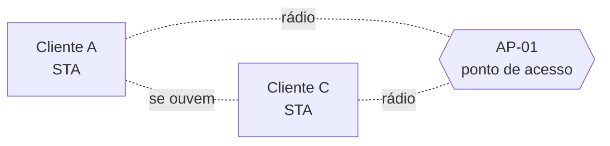

*Figura 3.2a (Tipo A, topologia).* Elementos do modo "Acesso ao meio": AP-01 (ponto de acesso); Cliente A (STA); Cliente C (STA). Linhas tracejadas: enlaces alternativos, forjados ou caídos. Vale para os cenários (6.2.1 a 6.2.4).

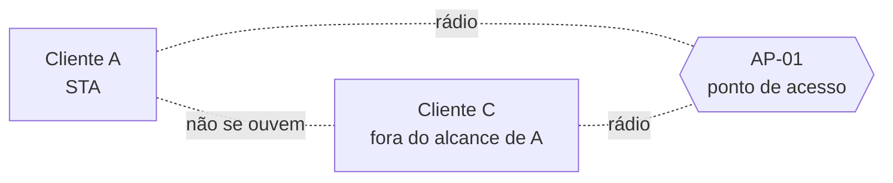

*Figura 3.2b (Tipo A, topologia).* Elementos do modo "Acesso ao meio": AP-01 (ponto de acesso); Cliente A (STA); Cliente C (fora do alcance de A). Linhas tracejadas: enlaces alternativos, forjados ou caídos. Vale para os cenários (6.2.5 e 6.2.6).

### 3.3 Roaming e energia

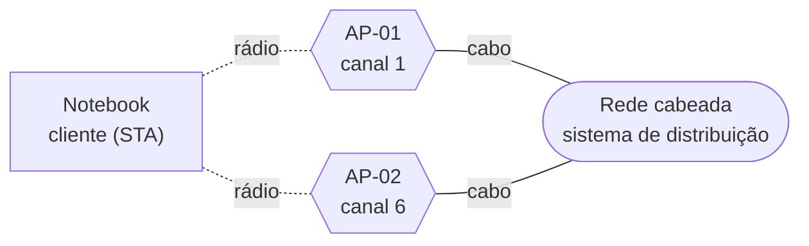

*Figura 3.3a (Tipo A, topologia).* Elementos do modo "Roaming e energia": Rede cabeada (sistema de distribuição); AP-01 (canal 1); AP-02 (canal 6); Notebook (cliente (STA)). Linhas tracejadas: enlaces alternativos, forjados ou caídos. Vale para os cenários (6.3.1 a 6.3.4).


*Figura 3.3b (Tipo A, topologia).* Elementos do modo "Roaming e energia": Notebook (cliente (STA)); AP-01 (ponto de acesso); Rede cabeada (origem do pacote). Linhas tracejadas: enlaces alternativos, forjados ou caídos. Vale para os cenários (6.3.5 e 6.3.6).

### 3.4 Canais

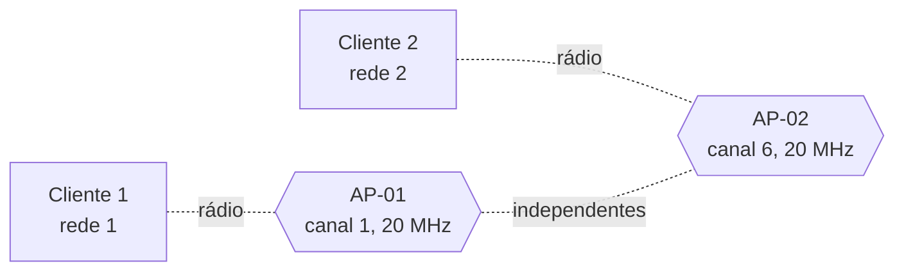

*Figura 3.4a (Tipo A, topologia).* Elementos do modo "Canais": Cliente 1 (rede 1); AP-01 (canal 1, 20 MHz); AP-02 (canal 6, 20 MHz); Cliente 2 (rede 2). Linhas tracejadas: enlaces alternativos, forjados ou caídos. Vale para os cenários (6.4.1).


*Figura 3.4b (Tipo A, topologia).* Elementos do modo "Canais": Cliente 1 (rede 1); AP-01 (canal 1, 20 MHz); AP-02 (canal 1, 20 MHz); Cliente 2 (rede 2). Linhas tracejadas: enlaces alternativos, forjados ou caídos. Vale para os cenários (6.4.2).

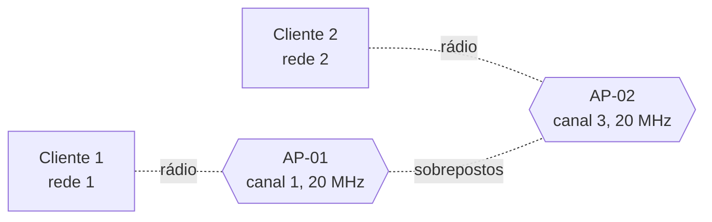

*Figura 3.4c (Tipo A, topologia).* Elementos do modo "Canais": Cliente 1 (rede 1); AP-01 (canal 1, 20 MHz); AP-02 (canal 3, 20 MHz); Cliente 2 (rede 2). Linhas tracejadas: enlaces alternativos, forjados ou caídos. Vale para os cenários (6.4.3).


*Figura 3.4d (Tipo A, topologia).* Elementos do modo "Canais": Cliente 1 (rede 1); AP-01 (canal 1, 40 MHz); AP-02 (canal 6, 40 MHz); Cliente 2 (rede 2). Linhas tracejadas: enlaces alternativos, forjados ou caídos. Vale para os cenários (6.4.4).

## 4. Abas da bancada

Cenário, Captura, Mensagem, Estados (modos: Descoberta e associação; Roaming e energia), Temporização (modos: Acesso ao meio; Canais), Canais (modos: Descoberta e associação; Canais), Energia (modos: Roaming e energia), Experimento, Referência e Log.

## 5. Configurações (campos do painel)

### 5.1 Descoberta

- **Tipo de varredura**. Valores: Passiva: só escuta os beacons; Ativa: envia Probe Request. Padrão: Passiva: só escuta os beacons. Modos: Descoberta e associação.
  - Como o cliente descobre os APs ao redor.
  - **Passiva:** o cliente sintoniza um canal e espera ouvir um beacon, que o AP envia a cada 102,4 ms. Não transmite nada, e por isso gasta menos energia e não anuncia a presença do cliente, mas é mais lenta.
  - **Ativa:** o cliente pergunta com um Probe Request e o AP responde na hora. É mais rápida, mas o cliente revela a si mesmo (e as redes que procura) a quem estiver escutando.
- **Nome da rede (SSID)**. Valores: Divulgado no beacon; Oculto (comprimento 0). Padrão: Divulgado no beacon. Modos: Descoberta e associação.
  - Um AP pode omitir o nome da rede no beacon.
  - Com o SSID oculto, o beacon traz o campo de nome vazio e o AP não responde a Probe Request com nome curinga. O cliente só descobre a rede se já souber o nome e perguntar por ele.
  - **Isto não é segurança:** o nome passa em claro nos Probe Requests do cliente e nos pedidos de associação. Quem escuta o ar o descobre assim que um cliente legítimo se conecta.

### 5.2 Rede

- **Canal do AP (2,4 GHz)**. Valores: 1; 6; 11. Padrão: 6. Modos: Descoberta e associação.
  - Em qual canal o AP opera.
  - O cliente precisa procurar em todos os canais, um de cada vez. Quanto mais longe do primeiro canal o AP estiver, mais a varredura demora até achá-lo. Os canais 1, 6 e 11 são os que não se sobrepõem na faixa de 2,4 GHz com 20 MHz de largura.

### 5.3 Associação

- **Segurança da rede**. Valores: Aberta, sem proteção; Protegida (WPA2 ou WPA3). Padrão: Aberta, sem proteção. Modos: Descoberta e associação.
  - Define o que o AP anuncia e o que acontece depois da associação.
  - **Aberta:** depois de associar, os dados já passam. Qualquer pessoa pode entrar e ver o tráfego em claro.
  - **Protegida:** o AP anuncia o elemento RSN. A autenticação 802.11 continua sendo "aberta" (um ritual), e a verificação de verdade é o **handshake de quatro vias**, que vem depois da associação e abre a porta de dados. Este simulador para na associação; os detalhes ficarão no simulador Wi-Fi: segurança (WPA2 e WPA3).
- **Resposta do AP à associação**. Valores: Aceita (status 0); Recusada: AP lotado (status 17). Padrão: Aceita (status 0). Modos: Descoberta e associação.
  - O AP pode recusar e diz o motivo no Status Code.
  - O Status Code da Association Response informa o resultado. O código 0 é sucesso. O código 17 significa que o AP não consegue tratar mais estações associadas, o que acontece quando a tabela de clientes enche ou o AP aplica um limite.
  - O cliente que recebe uma recusa continua no estado 2 e deve procurar outro AP.

### 5.4 Situação

- **O que acontece**. Valores: Um cliente, transmissão normal; O ACK se perde; Dois clientes escolhem o mesmo slot; Nó oculto: os clientes não se ouvem. Padrão: Um cliente, transmissão normal. Modos: Acesso ao meio.
  - Quatro casos do acesso ao meio.
  - **Normal:** o cliente espera o meio livre, faz o backoff, transmite e recebe o ACK.
  - **ACK perdido:** o quadro chega, mas o ACK não volta. O cliente repete e o AP descarta a duplicata.
  - **Mesmo slot:** dois clientes sorteiam o mesmo valor de backoff e transmitem juntos.
  - **Nó oculto:** dois clientes ouvem o AP, mas não ouvem um ao outro (obstáculo ou distância). Não detectam a transmissão do outro e colidem no AP.
- **Usar RTS/CTS**. Valores: caixa de seleção. Padrão: não. Modos: Acesso ao meio.
  - Reserva o meio antes de enviar o quadro de dados.
  - Com o RTS/CTS, o cliente envia um quadro curto (RTS), o AP responde com outro (CTS) e só então vêm os dados. Quem ouve o CTS adia a transmissão (NAV), mesmo que não ouça o cliente.
  - Custa dois quadros a mais em cada transmissão. Compensa quando os quadros são longos e há colisões, como no nó oculto, porque uma colisão de RTS desperdiça muito menos tempo que uma de dados.
- **O que acontece**. Valores: Roaming: o cliente troca de AP; Cliente preso ao AP distante; O AP sugere a troca (802.11v); Economia de energia. Padrão: Roaming: o cliente troca de AP. Modos: Roaming e energia.
  - Mobilidade e economia de energia.
  - **Roaming:** o cliente se afasta do AP-01, procura o AP-02 e se reassocia.
  - **Preso ao AP distante:** o cliente não troca de AP enquanto ainda tem conexão, e a taxa cai.
  - **O AP sugere a troca:** o AP-01 pede, com o 802.11v, que o cliente vá para o AP-02.
  - **Economia de energia:** o cliente dorme e o AP guarda os quadros até ele acordar.

### 5.5 Roaming

- **Fast BSS Transition (802.11r)**. Valores: caixa de seleção. Padrão: não. Modos: Roaming e energia.
  - Uma troca de AP mais rápida em redes protegidas.
  - Sem o 802.11r, depois de reassociar o cliente refaz o handshake de quatro vias com o novo AP, e a conexão fica parada nesse tempo.
  - Com o FT, o cliente já leva ao novo AP o material para derivar as chaves, dentro da própria autenticação e reassociação, e o handshake completo some. É mais rápido, mas exige que o AP e o cliente suportem o recurso.

### 5.6 Energia

- **Intervalo de escuta (beacons)**. Valores: 1 (acorda a cada beacon); 3; 5. Padrão: 1 (acorda a cada beacon). Modos: Roaming e energia.
  - De quantos em quantos beacons o cliente dormindo acorda.
  - O cliente informa esse valor na associação, e o AP precisa guardar os quadros por pelo menos esse tempo.
  - Um valor maior economiza energia, porque o rádio fica desligado mais tempo, mas o cliente demora mais a receber o que chegou durante o sono.

### 5.7 Canais

- **Canal da segunda rede**. Valores: 1 (o mesmo da primeira); 3 (sobreposto); 6; 11. Padrão: 6. Modos: Canais.
  - A primeira rede usa sempre o canal 1.
  - Na faixa de 2,4 GHz, os centros dos canais ficam a 5 MHz um do outro, mas cada canal ocupa 20 MHz. Por isso o canal 1 se sobrepõe aos canais 2 a 4, e só o 6 e o 11 ficam livres de sobreposição.
  - Mesmo canal significa dividir o tempo de ar, o que é ruim, mas funciona. Canais parcialmente sobrepostos interferem sem dividir, o que costuma ser pior.
- **Largura do canal (MHz)**. Valores: 20; 40. Padrão: 20. Modos: Canais.
  - Quanto da faixa cada rede ocupa.
  - Canais mais largos dão taxas maiores, mas ocupam mais faixa. Na faixa de 2,4 GHz, que tem espaço para só três canais de 20 MHz sem sobreposição, usar 40 MHz faz as redes vizinhas se sobreporem.

## 6. Cenários

### 6.1 Modo: Descoberta e associação

> **Grupo:** Descobrir e entrar na rede

Um cliente Wi-Fi passa por três passos antes de usar a rede: descobrir os APs (varredura passiva ou ativa), autenticar (no 802.11, um passo de sistema aberto) e associar. O padrão descreve isso como três estados do cliente em relação ao AP.

#### 6.1.1 Varredura passiva e rede aberta

*Escutar, autenticar, associar e só então enviar dados.*

**Configuração aplicada:** Tipo de varredura = passivo; Nome da rede (SSID) = visivel; Canal do AP (2,4 GHz) = 6; Segurança da rede = aberta; Resposta do AP à associação = ok

O Notebook liga o rádio e **só escuta**, canal por canal, até ouvir o **beacon** do AP. Depois passa pelos três passos do padrão: **autenticação** (sistema aberto), **associação** e o primeiro quadro de dados, que a rede aberta deixa passar.

**Conceito.** Na varredura passiva, o cliente não transmite: sintoniza cada canal por cerca de 110 ms, o bastante para ouvir pelo menos um beacon (enviado a cada 102,4 ms), e aprende o nome da rede, o canal, as taxas e a segurança. Depois vêm dois passos de gerência: a autenticação, que na prática é um ritual de sistema aberto, e a associação, em que o AP atribui um AID ao cliente. Só no estado 3 (autenticado e associado) os quadros de dados são aceitos. Todo quadro unicast é confirmado com ACK.

**O que observar**

- O canal 1 sem beacon, pois o AP está no canal 6.
- O Beacon em broadcast, sem ACK.
- O estado do cliente passando de 1 para 2 e para 3.
- Um ACK depois de cada quadro unicast.
- O DHCPDISCOVER sendo encaminhado ao fio como Ethernet.

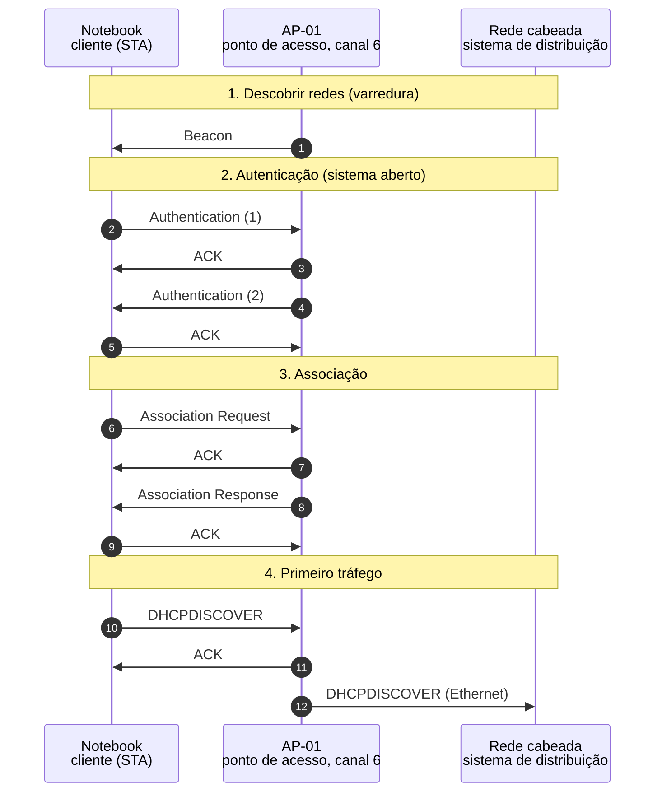

*Figura 6.1.1 (Tipo B, sequência).* Mensagens do cenário "Varredura passiva e rede aberta", na ordem do tempo, entre Notebook, AP-01, Rede cabeada: 12 mensagens, numeradas de 1 a 12 na ordem da comunicação (em 5 fases). Corresponde ao diagrama de sequência e à aba Captura, no modo "Descoberta e associação", com a configuração aplicada acima.

**Mensagens**

| Mensagem | Significado | Origem |
| --- | --- | --- |
| Beacon | anuncia a rede | AP para o cliente |
| Authentication (1 e 2) | ritual do sistema aberto | cliente e AP |
| Association Request | pede um lugar no BSS | cliente para o AP |
| Association Response | aceita e atribui o AID | AP para o cliente |
| DHCPDISCOVER | primeiro tráfego de dados | cliente para o AP |

**Por que importa.** É o caminho que todo cliente Wi-Fi percorre. Entender os três estados explica por que um cliente "conectado" ainda pode estar sem acesso.

#### 6.1.2 Varredura ativa com Probe Request

*Perguntar em vez de esperar.*

**Configuração aplicada:** Tipo de varredura = ativo; Nome da rede (SSID) = visivel; Canal do AP (2,4 GHz) = 6; Segurança da rede = aberta; Resposta do AP à associação = ok

Em vez de esperar o beacon, o cliente **pergunta** com um Probe Request em cada canal e espera 20 ms pela resposta. Acha o AP mais rápido, mas anuncia a própria presença.

**Conceito.** Na varredura ativa, o cliente envia um Probe Request, em broadcast e com SSID curinga, em cada canal e espera um tempo curto (MinChannelTime, aqui 20 ms) por respostas. O AP que o ouve responde com um Probe Response por unicast, que é confirmado com ACK. O resultado é o mesmo do beacon, obtido mais depressa, ao custo de o cliente transmitir e, com isso, revelar a própria presença.

**O que observar**

- Os canais sem AP: o Probe Request fica sem resposta e o cliente passa ao próximo.
- O Probe Request vai em broadcast e não tem ACK; o Probe Response é unicast e tem.
- A resposta traz o mesmo conteúdo do beacon.

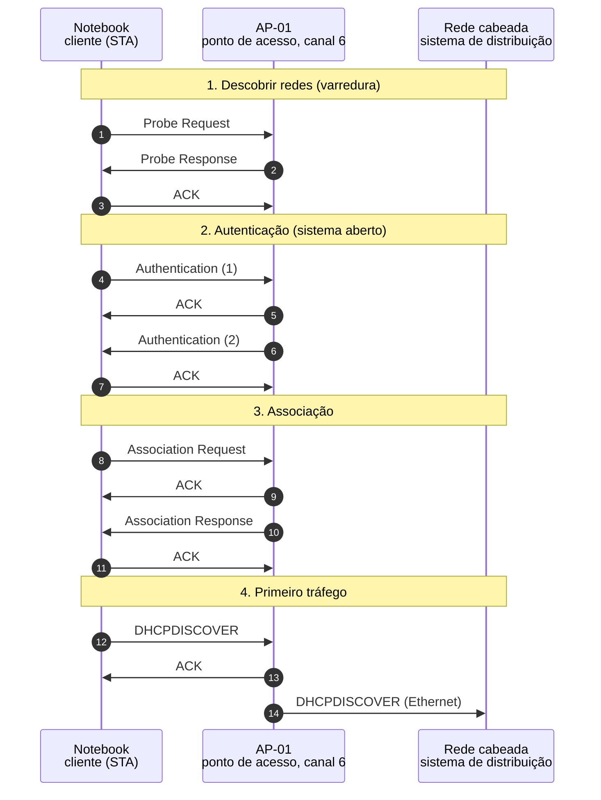

*Figura 6.1.2 (Tipo B, sequência).* Mensagens do cenário "Varredura ativa com Probe Request", na ordem do tempo, entre Notebook, AP-01, Rede cabeada: 14 mensagens, numeradas de 1 a 14 na ordem da comunicação (em 5 fases). Corresponde ao diagrama de sequência e à aba Captura, no modo "Descoberta e associação", com a configuração aplicada acima.

**Mensagens**

| Mensagem | Significado | Origem |
| --- | --- | --- |
| Probe Request | pergunta quem está por perto | cliente em broadcast |
| Probe Response | responde com o conteúdo do beacon | AP para o cliente |
| ACK | confirma o Probe Response | cliente para o AP |

**Por que importa.** Os celulares usam a varredura ativa para reconectar-se depressa. O efeito colateral é que os Probe Requests denunciam as redes que o aparelho já conhece.

#### 6.1.3 Rede com SSID oculto

*Esconder o nome não esconde a rede.*

**Configuração aplicada:** Tipo de varredura = passivo; Nome da rede (SSID) = oculto; Canal do AP (2,4 GHz) = 6; Segurança da rede = aberta; Resposta do AP à associação = ok

O beacon chega com o **nome vazio**. O cliente, que tem o perfil salvo, pergunta pelo nome com um Probe Request dirigido, e o AP responde. O nome da rede aparece **em claro** no ar: ocultar o SSID não protege nada.

**Conceito.** Num AP com SSID oculto, o beacon traz o elemento SSID com comprimento zero. O cliente ouve o beacon, mas não sabe o nome da rede. Se já conhecer o nome (perfil salvo), pergunta por ele com um Probe Request dirigido, e o AP responde revelando-o. O nome passa em claro nesse pedido e na Association Request. Ocultar o SSID reduz o ruído na lista de redes, mas não protege nada: a defesa é a criptografia e a autenticação.

**O que observar**

- O campo SSID do beacon, com comprimento zero.
- O Probe Request dirigido, com o nome LabRedes em claro.
- O Probe Response revelando o nome.

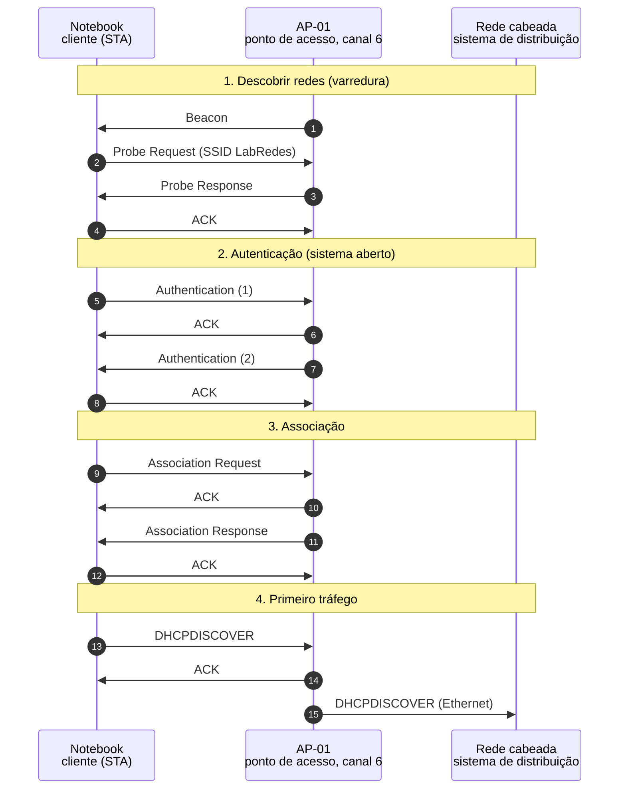

*Figura 6.1.3 (Tipo B, sequência).* Mensagens do cenário "Rede com SSID oculto", na ordem do tempo, entre Notebook, AP-01, Rede cabeada: 15 mensagens, numeradas de 1 a 15 na ordem da comunicação (em 5 fases). Corresponde ao diagrama de sequência e à aba Captura, no modo "Descoberta e associação", com a configuração aplicada acima.

**Mensagens**

| Mensagem | Significado | Origem |
| --- | --- | --- |
| Beacon | anuncia a rede sem nome | AP para o cliente |
| Probe Request (SSID) | pergunta pelo nome salvo | cliente para o AP |
| Probe Response | revela o nome da rede | AP para o cliente |

**Por que importa.** É um erro comum tratar o SSID oculto como proteção. Além de ineficaz, ele obriga o cliente a procurar a rede por nome, o que o expõe em qualquer lugar.

#### 6.1.4 Rede protegida: a associação não basta

*Associado não é autorizado.*

**Configuração aplicada:** Tipo de varredura = passivo; Nome da rede (SSID) = visivel; Canal do AP (2,4 GHz) = 6; Segurança da rede = rsn; Resposta do AP à associação = ok

O AP anuncia o elemento **RSN**. A autenticação 802.11 continua "aberta", e o cliente se associa, mas o primeiro quadro de dados é **descartado**: a porta só abre depois do handshake de quatro vias (WPA2 ou WPA3).

**Conceito.** Em redes WPA2 e WPA3, o beacon e o Probe Response trazem o elemento RSN, e o bit Privacy fica ligado. A autenticação 802.11 continua de sistema aberto (nas redes WPA3 com SAE ela é substituída pelo próprio SAE), e o cliente se associa normalmente, chegando ao estado 3. Mas a porta de dados (controlada, como no 802.1X) só abre depois do handshake de quatro vias, que deriva as chaves. Por isso o primeiro quadro de dados é descartado.

**O que observar**

- O elemento RSN no Beacon (aba Mensagem).
- A Association Request também leva o RSN.
- O AP confirma o quadro de dados com ACK, no nível do MAC, mas o descarta logo depois.

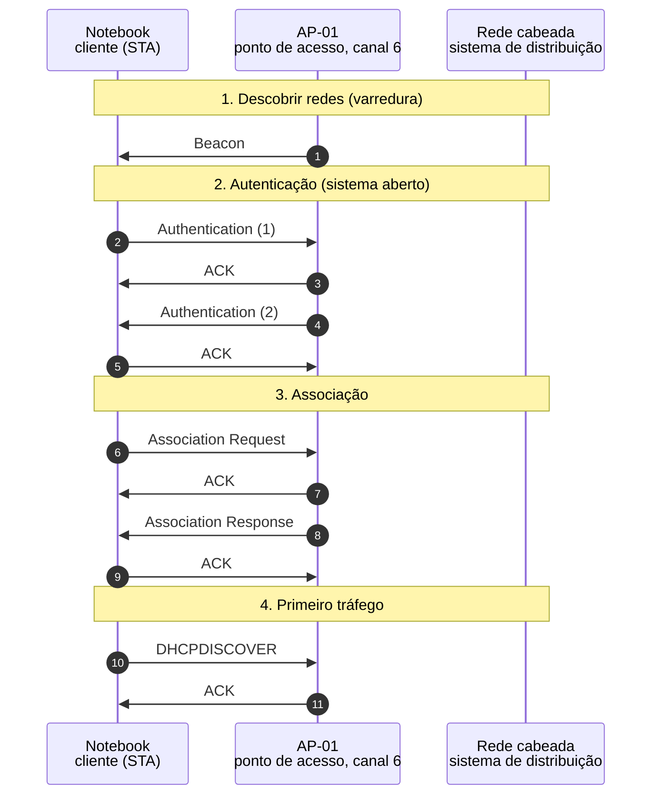

*Figura 6.1.4 (Tipo B, sequência).* Mensagens do cenário "Rede protegida: a associação não basta", na ordem do tempo, entre Notebook, AP-01, Rede cabeada: 11 mensagens, numeradas de 1 a 11 na ordem da comunicação (em 5 fases). Corresponde ao diagrama de sequência e à aba Captura, no modo "Descoberta e associação", com a configuração aplicada acima.

**Mensagens**

| Mensagem | Significado | Origem |
| --- | --- | --- |
| Beacon | anuncia a rede com o elemento RSN | AP para o cliente |
| Association Request | leva o RSN escolhido pelo cliente | cliente para o AP |
| DHCPDISCOVER | descartado: a porta está fechada | cliente para o AP |

**Por que importa.** Mostra a separação entre associar (receber um AID) e ser autorizado (ter chaves). O assunto continua no simulador Wi-Fi: segurança, quando publicado.

> **Grupo:** Quando a associação falha

O AP pode recusar a associação e diz o motivo no Status Code. O cliente continua no estado intermediário e precisa tentar outro AP.

#### 6.1.5 AP lotado recusa a associação

*O AP pode dizer não.*

**Configuração aplicada:** Tipo de varredura = passivo; Nome da rede (SSID) = visivel; Canal do AP (2,4 GHz) = 6; Segurança da rede = aberta; Resposta do AP à associação = cheio

O AP responde à Association Request com o **Status Code 17**: não consegue tratar mais estações. O cliente continua no **estado 2** (autenticado, mas não associado) e precisa procurar outro AP.

**Conceito.** O AP responde à Association Request com um Status Code. O código 0 é sucesso; o 17 informa que o AP não consegue tratar mais estações associadas. O cliente permanece no estado 2 (autenticado, não associado), no qual só quadros de gerência são aceitos, e deve procurar outro AP ou esperar. Em redes com muitos APs, é assim que se distribui a carga.

**O que observar**

- O campo Status Code da Association Response, com 17.
- Nenhum AID atribuído.
- O estado do cliente parado em 2.

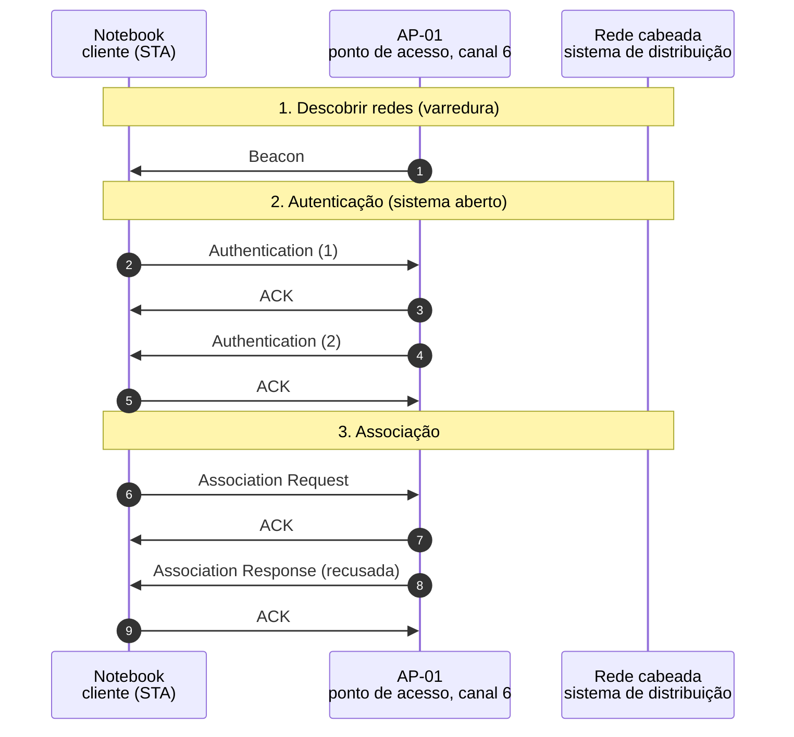

*Figura 6.1.5 (Tipo B, sequência).* Mensagens do cenário "AP lotado recusa a associação", na ordem do tempo, entre Notebook, AP-01, Rede cabeada: 9 mensagens, numeradas de 1 a 9 na ordem da comunicação (em 4 fases). Corresponde ao diagrama de sequência e à aba Captura, no modo "Descoberta e associação", com a configuração aplicada acima.

**Mensagens**

| Mensagem | Significado | Origem |
| --- | --- | --- |
| Association Request | pede um lugar no BSS | cliente para o AP |
| Association Response | recusa com status 17 | AP para o cliente |

**Por que importa.** Explica por que um aparelho pode "ver" a rede e não conseguir entrar nela em locais lotados, como auditórios e estádios.

### 6.2 Modo: Acesso ao meio

> **Grupo:** CSMA/CA: o acesso normal

O meio de rádio é compartilhado e o cliente não consegue ouvir enquanto fala. Por isso o Wi-Fi evita colisões (CSMA/CA) em vez de detectá-las: espera, sorteia um atraso aleatório e exige a confirmação de cada quadro.

#### 6.2.1 Esperar, sortear o backoff, transmitir e receber o ACK

*Escutar antes de falar, e esperar o ACK.*

**Configuração aplicada:** O que acontece = basico; Usar RTS/CTS = não

O cliente **escuta antes de falar**: espera o meio ficar livre por um DIFS (34 µs), sorteia um backoff e conta os slots de 9 µs. Só então transmite, e o AP confirma com um **ACK** um SIFS (16 µs) depois.

**Conceito.** O rádio não consegue ouvir enquanto transmite, então o Wi-Fi não detecta colisões: evita-as (CSMA/CA). O cliente que quer transmitir espera o meio ficar livre por um DIFS (SIFS mais dois slots, 34 µs na camada física OFDM) e sorteia um backoff entre 0 e CW (inicialmente 15). Conta os slots de 9 µs só enquanto o meio está livre e transmite quando chega a zero. O AP confirma com um ACK um SIFS (16 µs) depois, sem disputar o meio, já que o SIFS é menor que o DIFS.

**O que observar**

- O meio ocupado até 200 µs e a espera do DIFS.
- O backoff de 5 slots (45 µs).
- O ACK chegando um SIFS depois do quadro.
- O estado do meio mudando de ocupado para livre.

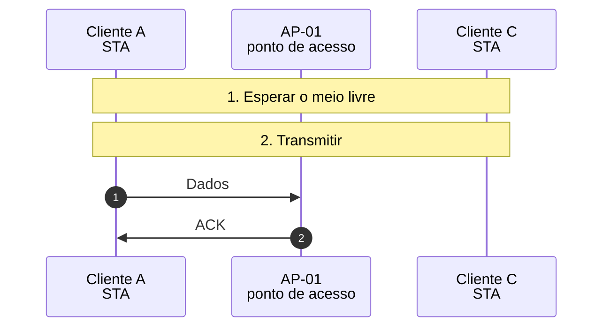

*Figura 6.2.1 (Tipo B, sequência).* Mensagens do cenário "Esperar, sortear o backoff, transmitir e receber o ACK", na ordem do tempo, entre Cliente A, AP-01, Cliente C: 2 mensagens, numeradas de 1 a 2 na ordem da comunicação (em 3 fases). Corresponde ao diagrama de sequência e à aba Captura, no modo "Acesso ao meio", com a configuração aplicada acima.

**Mensagens**

| Mensagem | Significado | Origem |
| --- | --- | --- |
| Dados | quadro de 1500 bytes | cliente para o AP |
| ACK | confirmação, um SIFS depois | AP para o cliente |

**Por que importa.** Todo o desempenho do Wi-Fi decorre dessas esperas: elas são a "taxa" que se paga para dividir o ar. Por isso a vazão real fica bem abaixo da taxa anunciada.

#### 6.2.2 O ACK se perde e o quadro é repetido

*Sem ACK, o quadro é repetido e a duplicata é descartada.*

**Configuração aplicada:** O que acontece = ack; Usar RTS/CTS = não

O quadro chega, mas o **ACK não volta**. Sem ele, o cliente presume falha, **dobra a janela de contenção** (15 para 31), sorteia outro backoff e repete. O AP reconhece a duplicata pelo número de sequência e não a entrega duas vezes.

**Conceito.** Um quadro unicast só é considerado entregue se o ACK voltar. Se o ACK se perde, o transmissor não sabe se o quadro chegou: ele espera o ACKTimeout, dobra a janela de contenção (backoff exponencial, até 1023) e retransmite com o bit Retry ligado e o mesmo número de sequência. O receptor usa esse número para reconhecer a duplicata: confirma de novo, mas não entrega o quadro duas vezes à rede. Há um limite de tentativas (7 para quadros curtos, por padrão), depois do qual o quadro é descartado.

**O que observar**

- O ACK perdido (vermelho).
- A mensagem no AP: quadro recebido, ACK enviado.
- O ACKTimeout no cliente e a janela passando de 15 para 31.
- O quadro repetido com Retry=1 e o mesmo número de sequência (aba Mensagem).

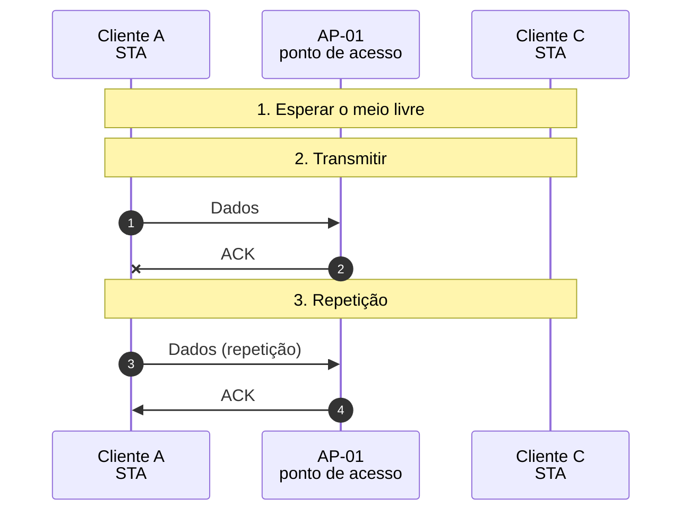

*Figura 6.2.2 (Tipo B, sequência).* Mensagens do cenário "O ACK se perde e o quadro é repetido", na ordem do tempo, entre Cliente A, AP-01, Cliente C: 4 mensagens, numeradas de 1 a 4 na ordem da comunicação (em 4 fases; 1 perdida). Corresponde ao diagrama de sequência e à aba Captura, no modo "Acesso ao meio", com a configuração aplicada acima.

**Mensagens**

| Mensagem | Significado | Origem |
| --- | --- | --- |
| Dados | primeira tentativa | cliente para o AP |
| ACK (perdido) | confirmação que não chega | AP para o cliente |
| Dados (repetição) | Retry=1, mesmo número de sequência | cliente para o AP |
| ACK | confirmação da repetição | AP para o cliente |

**Por que importa.** É a confiabilidade do Wi-Fi na camada de enlace, que o Ethernet cabeado não tem. Também explica por que uma rede congestionada tem latência variável.

> **Grupo:** Colisões entre clientes

Quando dois clientes sorteiam o mesmo slot, os quadros colidem. A resposta é o backoff exponencial: a janela dobra a cada falha, e a chance de repetir o mesmo sorteio cai.

#### 6.2.3 Dois clientes escolhem o mesmo slot

*Mesmo slot, mesma colisão.*

**Configuração aplicada:** O que acontece = colisao; Usar RTS/CTS = não

Os dois sorteiam **3 slots** e transmitem juntos: o AP não decodifica nenhum quadro. Cada um espera o ACK, desiste, dobra a janela e sorteia de novo. Na segunda rodada os valores diferem e **um passa à frente do outro**, que congela a contagem.

**Conceito.** Se dois clientes sorteiam o mesmo backoff, eles transmitem no mesmo instante e os quadros colidem no AP. Nenhum dos dois ouve o ACK. Cada um espera o timeout, dobra a janela (15 para 31) e sorteia de novo, agora entre 0 e 31. Na rodada seguinte os valores são diferentes: quem sorteou o menor transmite primeiro, e o outro, que ouve a transmissão, congela o contador e só o retoma quando o meio ficar livre de novo (por um DIFS).

**O que observar**

- Os dois quadros de dados em vermelho, sobrepostos.
- O tempo perdido (quadro inteiro mais o timeout).
- O Cliente C congelando o contador depois que o Cliente A transmite.
- A aba Temporização com as rodadas e as janelas.

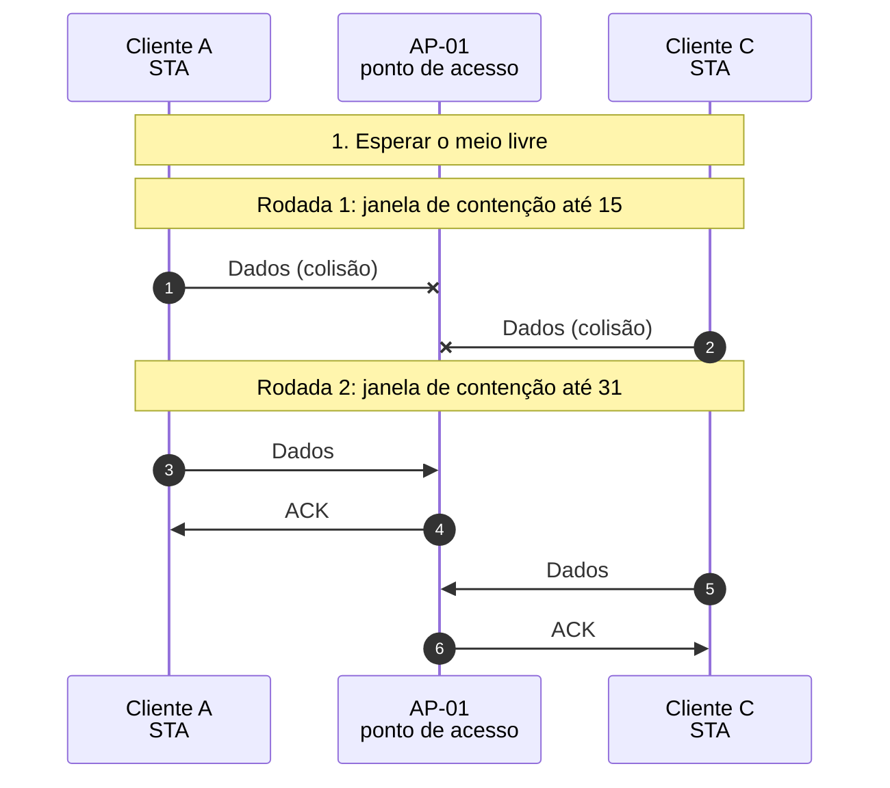

*Figura 6.2.3 (Tipo B, sequência).* Mensagens do cenário "Dois clientes escolhem o mesmo slot", na ordem do tempo, entre Cliente A, AP-01, Cliente C: 6 mensagens, numeradas de 1 a 6 na ordem da comunicação (em 4 fases; 2 perdidas). Corresponde ao diagrama de sequência e à aba Captura, no modo "Acesso ao meio", com a configuração aplicada acima.

**Mensagens**

| Mensagem | Significado | Origem |
| --- | --- | --- |
| Dados (colisão) | os dois quadros sobrepostos | Cliente A e Cliente C |
| Dados | quadro do primeiro, na segunda rodada | Cliente A para o AP |
| ACK | confirmação | AP para o Cliente A |
| Dados | quadro do segundo | Cliente C para o AP |

**Por que importa.** O backoff exponencial é o que mantém a rede estável sob carga. Quanto mais clientes, mais colisões e mais tempo desperdiçado.

#### 6.2.4 A mesma colisão, agora com RTS/CTS

*Colidir com um quadro curto custa pouco.*

**Configuração aplicada:** O que acontece = colisao; Usar RTS/CTS = sim

A colisão agora acontece entre dois **RTS** de 52 µs, e não entre dois quadros de dados de 250 µs. O tempo desperdiçado é bem menor. Depois, quem ouve o RTS ou o CTS ajusta o **NAV** e espera.

**Conceito.** Com o RTS/CTS, a colisão acontece entre dois RTS de 20 bytes, que duram 52 µs, e não entre dois quadros de 1500 bytes, que duram 250 µs. Quem recebe o RTS ou o CTS preenche o NAV (Network Allocation Vector) com o valor do campo Duration/ID e considera o meio ocupado pelo tempo da troca inteira, mesmo sem ouvir a transmissão: é a escuta virtual de portadora. O custo é o tráfego extra de RTS e CTS em toda transmissão.

**O que observar**

- A colisão de RTS (52 µs) e o tempo perdido, menor que o do cenário sem RTS.
- O NAV ativo no cliente que ouviu o RTS (quadro Topologia).
- O campo Duration/ID do RTS, de 386 µs.

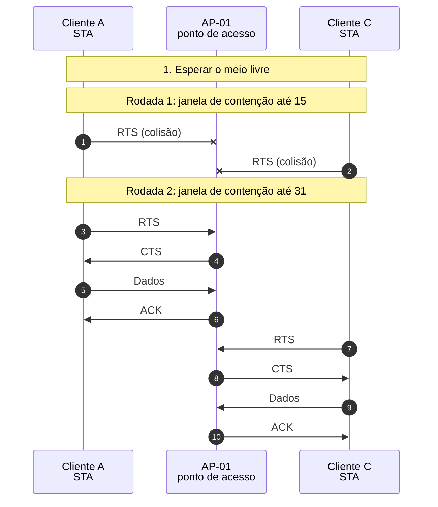

*Figura 6.2.4 (Tipo B, sequência).* Mensagens do cenário "A mesma colisão, agora com RTS/CTS", na ordem do tempo, entre Cliente A, AP-01, Cliente C: 10 mensagens, numeradas de 1 a 10 na ordem da comunicação (em 4 fases; 2 perdidas). Corresponde ao diagrama de sequência e à aba Captura, no modo "Acesso ao meio", com a configuração aplicada acima.

**Mensagens**

| Mensagem | Significado | Origem |
| --- | --- | --- |
| RTS (colisão) | os dois pedidos se sobrepõem | Cliente A e Cliente C |
| RTS | pedido do primeiro | cliente para o AP |
| CTS | autorização e reserva | AP para o cliente |
| Dados | o quadro | cliente para o AP |
| ACK | confirmação | AP para o cliente |

**Por que importa.** Mostra a troca entre custo fixo e custo de colisão. Em redes com quadros curtos o RTS/CTS não compensa; com quadros longos e muita disputa, sim.

> **Grupo:** O problema do nó oculto

Dois clientes podem ouvir o AP sem ouvir um ao outro. Cada um acha que o meio está livre, e os quadros colidem no AP. O RTS/CTS reduz o custo dessas colisões.

#### 6.2.5 Nó oculto sem RTS/CTS

*Quem não se ouve, colide.*

**Configuração aplicada:** O que acontece = oculto; Usar RTS/CTS = não

O Cliente A e o Cliente C **não se ouvem**. Cada um acha o meio livre e transmite; os quadros chegam juntos ao AP e **colidem repetidamente**, a cada tentativa com um quadro inteiro de dados perdido, até a sorte do backoff separá-los.

**Conceito.** No problema do nó oculto, o Cliente A e o Cliente C alcançam o AP, mas um não alcança o outro. A escuta de portadora de cada um não percebe a transmissão do outro, e os dois transmitem sem saber. No AP, os sinais se sobrepõem, e um quadro inteiro de dados se perde a cada colisão. Como o backoff sorteia só até CW, vários slots depois do início do outro quadro ainda caem dentro dos 250 µs que ele dura, e a colisão se repete até que a diferença entre os sorteios seja maior que o quadro.

**O que observar**

- A Topologia: o enlace entre os clientes caído.
- Três rodadas: duas colisões e depois sucesso.
- O tempo perdido, bem maior que o do cenário com RTS/CTS.
- O Cliente C congelando ao ouvir o ACK do AP, que ele alcança.

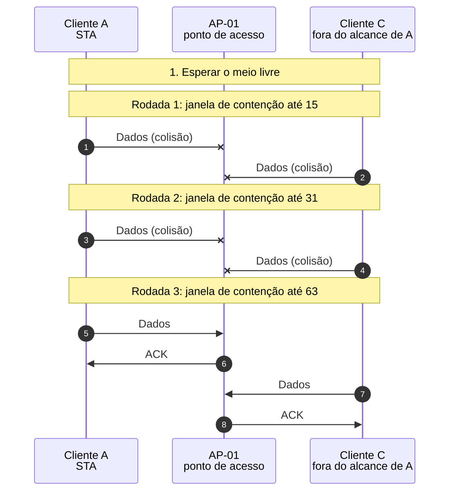

*Figura 6.2.5 (Tipo B, sequência).* Mensagens do cenário "Nó oculto sem RTS/CTS", na ordem do tempo, entre Cliente A, AP-01, Cliente C: 8 mensagens, numeradas de 1 a 8 na ordem da comunicação (em 5 fases; 4 perdidas). Corresponde ao diagrama de sequência e à aba Captura, no modo "Acesso ao meio", com a configuração aplicada acima.

**Mensagens**

| Mensagem | Significado | Origem |
| --- | --- | --- |
| Dados (colisão) | os quadros se sobrepõem no AP | Cliente A e Cliente C |
| Dados | quadro do primeiro, na terceira rodada | Cliente A para o AP |
| ACK | confirmação | AP para o Cliente A |
| Dados | quadro do segundo | Cliente C para o AP |

**Por que importa.** É o problema clássico das redes sem fio. Aparece em salas grandes, depósitos e escritórios com divisórias, e se resolve com RTS/CTS, posicionamento dos APs ou mais APs.

#### 6.2.6 Nó oculto com RTS/CTS

*O AP avisa quem o cliente não ouve.*

**Configuração aplicada:** O que acontece = oculto; Usar RTS/CTS = sim

Com o RTS/CTS, o Cliente C não ouve o RTS do Cliente A, mas **ouve o CTS do AP** e fica em silêncio pelo tempo reservado (NAV). As colisões que restam são só entre RTS curtos.

**Conceito.** Com o RTS/CTS, o Cliente C continua sem ouvir o RTS do Cliente A, mas ouve o CTS do AP, que o AP envia para todos. O CTS traz o campo Duration/ID, e o Cliente C o grava no NAV, adiando a transmissão pelo tempo restante da troca. As colisões que sobram são entre os próprios RTS, curtos, e custam pouco. O RTS/CTS não elimina o problema do nó oculto, mas reduz muito o seu custo.

**O que observar**

- A colisão de RTS (52 µs) nas duas primeiras rodadas.
- O evento no Cliente C: ouve o CTS e ajusta o NAV.
- O NAV ativo no Cliente C na Topologia.
- Os dados do Cliente A sem interferência.

```mermaid
sequenceDiagram
  autonumber
  participant n_a as Cliente A<br/>STA
  participant n_ap as AP-01<br/>ponto de acesso
  participant n_c as Cliente C<br/>fora do alcance de A
  Note over n_a,n_c: 1. Esperar o meio livre
  Note over n_a,n_c: Rodada 1: janela de contenção até 15
  n_a -x n_ap: RTS (colisão)
  n_c -x n_ap: RTS (colisão)
  Note over n_a,n_c: Rodada 2: janela de contenção até 31
  n_a -x n_ap: RTS (colisão)
  n_c -x n_ap: RTS (colisão)
  Note over n_a,n_c: Rodada 3: janela de contenção até 63
  n_a ->> n_ap: RTS
  n_ap ->> n_a: CTS
  n_a ->> n_ap: Dados
  n_ap ->> n_a: ACK
  n_c ->> n_ap: RTS
  n_ap ->> n_c: CTS
  n_c ->> n_ap: Dados
  n_ap ->> n_c: ACK
```

*Figura 6.2.6 (Tipo B, sequência).* Mensagens do cenário "Nó oculto com RTS/CTS", na ordem do tempo, entre Cliente A, AP-01, Cliente C: 12 mensagens, numeradas de 1 a 12 na ordem da comunicação (em 5 fases; 4 perdidas). Corresponde ao diagrama de sequência e à aba Captura, no modo "Acesso ao meio", com a configuração aplicada acima.

**Mensagens**

| Mensagem | Significado | Origem |
| --- | --- | --- |
| RTS (colisão) | os pedidos se sobrepõem | Cliente A e Cliente C |
| RTS | pedido do primeiro | cliente para o AP |
| CTS | o AP reserva o meio, ouvido pelos dois clientes | AP para o cliente |
| Dados | o quadro, protegido pela reserva | cliente para o AP |
| ACK | confirmação | AP para o cliente |

**Por que importa.** Mostra que o AP é o ponto em comum que enxerga todos os clientes, e por isso é quem pode coordenar quem não se ouve.

### 6.3 Modo: Roaming e energia

> **Grupo:** Roaming: trocar de AP

Numa rede com vários APs, quem decide trocar de AP é o cliente. A troca exige procurar, autenticar, reassociar e, em redes protegidas, refazer as chaves, e a conexão fica parada durante esse tempo.

#### 6.3.1 O cliente se afasta e troca de AP

*Para o AP novo, o cliente começa do zero.*

**Configuração aplicada:** O que acontece = roam; Fast BSS Transition (802.11r) = não; Intervalo de escuta (beacons) = 1

O sinal do AP-01 enfraquece. O cliente procura o AP-02 (Probe), **autentica**, envia uma **Reassociation Request** com o endereço do AP anterior e refaz o **handshake de quatro vias**. A conexão fica parada durante a troca.

**Conceito.** O cliente, e não a rede, decide quando trocar de AP. Quando o sinal do AP atual cai abaixo de um limiar do driver (valor de implementação), ele procura outro: envia um Probe Request no canal do candidato, autentica e envia uma Reassociation Request, que carrega o endereço do AP anterior. O novo AP avisa o antigo pelo sistema de distribuição (o mecanismo depende do fabricante). Em redes protegidas, o cliente ainda precisa do handshake de quatro vias para ter as chaves do novo AP, e o AP novo anuncia o endereço do cliente à rede cabeada para atualizar a tabela do switch.

**O que observar**

- O sinal do AP-01 caindo para -78 dBm (Topologia).
- A Reassociation Request com o Current AP Address.
- Os quatro quadros EAPOL-Key do handshake, resumidos.
- O quadro de anúncio ao switch.
- A interrupção medida no Experimento.

```mermaid
sequenceDiagram
  autonumber
  participant n_sta as Notebook<br/>cliente (STA)
  participant n_ap1 as AP-01<br/>canal 1
  participant n_ap2 as AP-02<br/>canal 6
  participant n_lan as Rede cabeada<br/>sistema de distribuição
  Note over n_sta,n_lan: 1. Conectado ao AP-01
  n_sta ->> n_ap1: Dados (54 Mb/s)
  n_ap1 ->> n_sta: ACK
  n_ap1 ->> n_lan: Dados (Ethernet)
  Note over n_sta,n_lan: Procurar o AP-02 (canal 6)
  n_sta ->> n_ap2: Probe Request (SSID LabRedes)
  n_ap2 ->> n_sta: Probe Response
  n_sta ->> n_ap2: ACK
  Note over n_sta,n_lan: Autenticar e reassociar no AP-02
  n_sta ->> n_ap2: Authentication (1)
  n_ap2 ->> n_sta: ACK
  n_ap2 ->> n_sta: Authentication (2)
  n_sta ->> n_ap2: ACK
  n_sta ->> n_ap2: Reassociation Request
  n_ap2 ->> n_sta: ACK
  n_ap2 ->> n_sta: Reassociation Response
  n_sta ->> n_ap2: ACK
  Note over n_sta,n_lan: Handshake de quatro vias (resumido)
  n_ap2 ->> n_sta: EAPOL-Key 1/4
  n_sta ->> n_ap2: EAPOL-Key 2/4
  n_ap2 ->> n_sta: EAPOL-Key 3/4
  n_sta ->> n_ap2: EAPOL-Key 4/4
  Note over n_sta,n_lan: Tráfego pelo AP-02
  n_ap2 ->> n_lan: Anúncio do MAC do cliente
  n_sta ->> n_ap2: Dados (54 Mb/s)
  n_ap2 ->> n_sta: ACK
```

*Figura 6.3.1 (Tipo B, sequência).* Mensagens do cenário "O cliente se afasta e troca de AP", na ordem do tempo, entre Notebook, AP-01, AP-02, Rede cabeada: 21 mensagens, numeradas de 1 a 21 na ordem da comunicação (em 6 fases). Corresponde ao diagrama de sequência e à aba Captura, no modo "Roaming e energia", com a configuração aplicada acima.

**Mensagens**

| Mensagem | Significado | Origem |
| --- | --- | --- |
| Probe Request e Response | procura o AP-02 | cliente e AP-02 |
| Authentication | sistema aberto | cliente e AP-02 |
| Reassociation Request | traz o endereço do AP antigo | cliente para o AP-02 |
| EAPOL-Key 1 a 4 | handshake que deriva as chaves | AP-02 e cliente |
| Dados | volta a trafegar | cliente para o AP-02 |

**Por que importa.** Quem usa chamadas de voz ou vídeo sente cada milissegundo da troca. Por isso os recursos de roaming rápido existem.

#### 6.3.2 Roaming rápido com 802.11r

*As chaves viajam junto com a reassociação.*

**Configuração aplicada:** O que acontece = roam; Fast BSS Transition (802.11r) = sim; Intervalo de escuta (beacons) = 1

Com o **Fast BSS Transition**, o material das chaves já viaja nos quadros de Authentication e Reassociation, e o handshake de quatro vias **desaparece**. A interrupção encurta.

**Conceito.** O Fast BSS Transition (IEEE 802.11r) usa um algoritmo de autenticação próprio (FT). Na associação inicial, o cliente e a rede derivam uma chave de topo do domínio de mobilidade, e os APs do domínio recebem dela chaves próprias (PMK-R1). Na troca de AP, o cliente envia ao novo AP, dentro da Authentication e da Reassociation, os nonces e os identificadores necessários, e as chaves ficam prontas sem o handshake de quatro vias separado. A interrupção cai, o que importa para voz e vídeo.

**O que observar**

- O algoritmo 2 (Fast BSS Transition) na Authentication, com os FT IEs.
- A ausência do handshake de quatro vias.
- A interrupção menor que a do roaming comum.

```mermaid
sequenceDiagram
  autonumber
  participant n_sta as Notebook<br/>cliente (STA)
  participant n_ap1 as AP-01<br/>canal 1
  participant n_ap2 as AP-02<br/>canal 6
  participant n_lan as Rede cabeada<br/>sistema de distribuição
  Note over n_sta,n_lan: 1. Conectado ao AP-01
  n_sta ->> n_ap1: Dados (54 Mb/s)
  n_ap1 ->> n_sta: ACK
  n_ap1 ->> n_lan: Dados (Ethernet)
  Note over n_sta,n_lan: Procurar o AP-02 (canal 6)
  n_sta ->> n_ap2: Probe Request (SSID LabRedes)
  n_ap2 ->> n_sta: Probe Response
  n_sta ->> n_ap2: ACK
  Note over n_sta,n_lan: Autenticar e reassociar no AP-02
  n_sta ->> n_ap2: Authentication FT (1)
  n_ap2 ->> n_sta: ACK
  n_ap2 ->> n_sta: Authentication FT (2)
  n_sta ->> n_ap2: ACK
  n_sta ->> n_ap2: Reassociation Request
  n_ap2 ->> n_sta: ACK
  n_ap2 ->> n_sta: Reassociation Response
  n_sta ->> n_ap2: ACK
  Note over n_sta,n_lan: Tráfego pelo AP-02
  n_ap2 ->> n_lan: Anúncio do MAC do cliente
  n_sta ->> n_ap2: Dados (54 Mb/s)
  n_ap2 ->> n_sta: ACK
```

*Figura 6.3.2 (Tipo B, sequência).* Mensagens do cenário "Roaming rápido com 802.11r", na ordem do tempo, entre Notebook, AP-01, AP-02, Rede cabeada: 17 mensagens, numeradas de 1 a 17 na ordem da comunicação (em 5 fases). Corresponde ao diagrama de sequência e à aba Captura, no modo "Roaming e energia", com a configuração aplicada acima.

**Mensagens**

| Mensagem | Significado | Origem |
| --- | --- | --- |
| Authentication FT (1 e 2) | leva o material das chaves | cliente e AP-02 |
| Reassociation Request e Response | confirmam as chaves | cliente e AP-02 |
| Dados | tráfego logo em seguida | cliente para o AP-02 |

**Por que importa.** O padrão corporativo para dispositivos móveis em andamento. Só funciona se o AP e o cliente suportarem o recurso, que costuma vir desativado por padrão.

> **Grupo:** Cliente preso ao AP distante

Um cliente que não troca de AP, mesmo com sinal ruim, pesa na rede toda: o quadro lento ocupa o meio por mais tempo. Os recursos 802.11k e 802.11v ajudam o AP a empurrar o cliente.

#### 6.3.3 O cliente não troca de AP

*Um cliente lento atrasa todos.*

**Configuração aplicada:** O que acontece = sticky; Fast BSS Transition (802.11r) = não; Intervalo de escuta (beacons) = 1

O cliente fica no AP-01 mesmo com o AP-02 mais perto. A taxa cai de 54 para 6 Mb/s e o mesmo quadro passa a **ocupar o meio mais de oito vezes mais tempo**, atrasando todos os outros clientes do AP.

**Conceito.** Muitos clientes só procuram outro AP quando perdem a conexão. Enquanto isso, o sinal fraco obriga a taxa a cair (de 54 para 24 e depois 6 Mb/s no exemplo). O mesmo quadro de 1500 bytes passa a ocupar o meio por muito mais tempo, e como o acesso ao meio dá a mesma chance de transmitir a cada cliente, o cliente lento consome uma parte desproporcional do tempo de ar. É a chamada anomalia de desempenho do Wi-Fi: todos os clientes do AP passam a ter a vazão do mais lento.

**O que observar**

- A duração do quadro de dados subindo de 250 µs para cerca de 2 ms.
- O AP-02 a -58 dBm, mais perto, mas ignorado.
- O evento no AP-01 sobre o tempo de ar consumido.

```mermaid
sequenceDiagram
  autonumber
  participant n_sta as Notebook<br/>cliente (STA)
  participant n_ap1 as AP-01<br/>canal 1
  participant n_ap2 as AP-02<br/>canal 6
  participant n_lan as Rede cabeada<br/>sistema de distribuição
  Note over n_sta,n_lan: 1. Conectado ao AP-01
  n_sta ->> n_ap1: Dados (54 Mb/s)
  n_ap1 ->> n_sta: ACK
  n_ap1 ->> n_lan: Dados (Ethernet)
  n_sta ->> n_ap1: Dados (24 Mb/s)
  n_ap1 ->> n_sta: ACK
  Note over n_sta,n_lan: 2. Preso ao AP distante
  n_sta ->> n_ap1: Dados (6 Mb/s)
  n_ap1 ->> n_sta: ACK
```

*Figura 6.3.3 (Tipo B, sequência).* Mensagens do cenário "O cliente não troca de AP", na ordem do tempo, entre Notebook, AP-01, AP-02, Rede cabeada: 7 mensagens, numeradas de 1 a 7 na ordem da comunicação (em 3 fases). Corresponde ao diagrama de sequência e à aba Captura, no modo "Roaming e energia", com a configuração aplicada acima.

**Mensagens**

| Mensagem | Significado | Origem |
| --- | --- | --- |
| Dados (54 Mb/s) | sinal bom | cliente para o AP-01 |
| Dados (24 Mb/s) | sinal médio | cliente para o AP-01 |
| Dados (6 Mb/s) | sinal ruim: ocupa o meio por mais de 8 vezes o tempo | cliente para o AP-01 |

**Por que importa.** Explica por que "uma pessoa com sinal fraco deixa a rede lenta para todos" e por que as redes corporativas empurram os clientes distantes para outro AP.

#### 6.3.4 O AP sugere a troca (802.11v)

*O AP empurra o cliente, sem forçá-lo.*

**Configuração aplicada:** O que acontece = btm; Fast BSS Transition (802.11r) = não; Intervalo de escuta (beacons) = 1

O AP-01 percebe o sinal fraco e envia um **BSS Transition Management Request** com o AP-02 como candidato. O cliente aceita e troca. É uma sugestão: o cliente ainda decide.

**Conceito.** O IEEE 802.11v define a gerência de transição de BSS: o AP envia ao cliente um BSS Transition Management Request com uma lista de APs candidatos, no formato do Neighbor Report do 802.11k, e o cliente responde aceitando ou recusando. A sugestão não obriga; um cliente pode ignorá-la. Em geral o AP também avisa que vai desassociar o cliente em breve (Disassociation Imminent), o que dá força ao pedido.

**O que observar**

- A lista de candidatos no BTM Request.
- O BTM Response com status 0 e o BSSID de destino.
- O roaming que se segue, igual ao do cenário comum.

```mermaid
sequenceDiagram
  autonumber
  participant n_sta as Notebook<br/>cliente (STA)
  participant n_ap1 as AP-01<br/>canal 1
  participant n_ap2 as AP-02<br/>canal 6
  participant n_lan as Rede cabeada<br/>sistema de distribuição
  Note over n_sta,n_lan: 1. Conectado ao AP-01
  n_sta ->> n_ap1: Dados (54 Mb/s)
  n_ap1 ->> n_sta: ACK
  n_ap1 ->> n_lan: Dados (Ethernet)
  Note over n_sta,n_lan: 2. O AP-01 sugere a troca (802.11v)
  n_ap1 ->> n_sta: BTM Request
  n_sta ->> n_ap1: ACK
  n_sta ->> n_ap1: BTM Response
  n_ap1 ->> n_sta: ACK
  Note over n_sta,n_lan: Procurar o AP-02 (canal 6)
  n_sta ->> n_ap2: Probe Request (SSID LabRedes)
  n_ap2 ->> n_sta: Probe Response
  n_sta ->> n_ap2: ACK
  Note over n_sta,n_lan: Autenticar e reassociar no AP-02
  n_sta ->> n_ap2: Authentication (1)
  n_ap2 ->> n_sta: ACK
  n_ap2 ->> n_sta: Authentication (2)
  n_sta ->> n_ap2: ACK
  n_sta ->> n_ap2: Reassociation Request
  n_ap2 ->> n_sta: ACK
  n_ap2 ->> n_sta: Reassociation Response
  n_sta ->> n_ap2: ACK
  Note over n_sta,n_lan: Handshake de quatro vias (resumido)
  n_ap2 ->> n_sta: EAPOL-Key 1/4
  n_sta ->> n_ap2: EAPOL-Key 2/4
  n_ap2 ->> n_sta: EAPOL-Key 3/4
  n_sta ->> n_ap2: EAPOL-Key 4/4
  Note over n_sta,n_lan: Tráfego pelo AP-02
  n_ap2 ->> n_lan: Anúncio do MAC do cliente
  n_sta ->> n_ap2: Dados (54 Mb/s)
  n_ap2 ->> n_sta: ACK
```

*Figura 6.3.4 (Tipo B, sequência).* Mensagens do cenário "O AP sugere a troca (802.11v)", na ordem do tempo, entre Notebook, AP-01, AP-02, Rede cabeada: 25 mensagens, numeradas de 1 a 25 na ordem da comunicação (em 7 fases). Corresponde ao diagrama de sequência e à aba Captura, no modo "Roaming e energia", com a configuração aplicada acima.

**Mensagens**

| Mensagem | Significado | Origem |
| --- | --- | --- |
| BTM Request | sugere o AP-02 | AP-01 para o cliente |
| BTM Response | aceita e informa o destino | cliente para o AP-01 |
| Reassociation Request | a troca em si | cliente para o AP-02 |

**Por que importa.** É a ferramenta que o administrador tem para resolver clientes presos ao AP distante, junto com limites mínimos de sinal para manter a associação.

> **Grupo:** Economia de energia

O rádio é um dos maiores consumidores de energia de um celular ou notebook. O cliente dorme e o AP guarda os quadros até ele acordar para ouvir o beacon.

#### 6.3.5 Cliente que acorda a cada beacon

*Dormir entre os beacons, acordar só para o que importa.*

**Configuração aplicada:** O que acontece = ps; Fast BSS Transition (802.11r) = não; Intervalo de escuta (beacons) = 1

O cliente avisa o AP que vai dormir (**PM=1**). Um pacote chega durante o sono e o AP o **guarda**. No próximo beacon, o **TIM** marca o cliente, que acorda, pede o quadro com um **PS-Poll** e o recebe.

**Conceito.** O cliente avisa o AP, com o bit Power Management ligado num quadro Null, que vai dormir. O AP passa a guardar os quadros dele e, em cada beacon, indica no TIM (Traffic Indication Map) quais clientes dormindo têm quadros guardados. O cliente acorda para os beacons (aqui, todos), confere o bit do seu AID e, se estiver marcado, envia um PS-Poll. O AP responde com o quadro, e o bit More Data diz se há mais. Depois o cliente volta a dormir, ainda em modo de economia.

**O que observar**

- O Null Data com PM=1.
- O pacote da rede cabeada chegando entre dois beacons.
- O TIM do beacon seguinte, com o AID 1 marcado.
- O PS-Poll e o quadro entregue, com More Data=0.
- A aba Energia, comparando intervalos de escuta.

```mermaid
sequenceDiagram
  autonumber
  participant n_sta as Notebook<br/>cliente (STA)
  participant n_ap1 as AP-01<br/>ponto de acesso
  participant n_lan as Rede cabeada<br/>sistema de distribuição
  Note over n_sta,n_lan: 1. Avisar o AP que vai dormir
  n_sta ->> n_ap1: Null Data (PM=1)
  n_ap1 ->> n_sta: ACK
  Note over n_sta,n_lan: 2. Os beacons passam e chega um pacote
  n_ap1 ->> n_sta: Beacon 1
  n_lan ->> n_ap1: Pacote IP para o cliente
  n_ap1 ->> n_sta: Beacon 2
  Note over n_sta,n_lan: 3. Buscar o quadro guardado
  n_sta ->> n_ap1: PS-Poll
  n_ap1 ->> n_sta: Dados guardados
  n_sta ->> n_ap1: ACK
```

*Figura 6.3.5 (Tipo B, sequência).* Mensagens do cenário "Cliente que acorda a cada beacon", na ordem do tempo, entre Notebook, AP-01, Rede cabeada: 8 mensagens, numeradas de 1 a 8 na ordem da comunicação (em 4 fases). Corresponde ao diagrama de sequência e à aba Captura, no modo "Roaming e energia", com a configuração aplicada acima.

**Mensagens**

| Mensagem | Significado | Origem |
| --- | --- | --- |
| Null Data (PM=1) | avisa que vai dormir | cliente para o AP |
| Beacon (TIM) | indica quem tem quadros guardados | AP para o cliente |
| PS-Poll | pede o quadro guardado | cliente para o AP |
| Dados guardados | a entrega | AP para o cliente |

**Por que importa.** É o que permite a um celular ficar horas conectado sem esgotar a bateria. O preço é a latência: o pacote espera o próximo beacon.

#### 6.3.6 Cliente que acorda a cada 5 beacons

*Mais sono, mais espera.*

**Configuração aplicada:** O que acontece = ps; Fast BSS Transition (802.11r) = não; Intervalo de escuta (beacons) = 5

Com o intervalo de escuta de 5 beacons, o rádio fica desligado por mais tempo e **gasta menos energia**, mas o pacote que chegou durante o sono espera **cerca de 360 ms** até a entrega.

**Conceito.** O Listen Interval é o número de beacons que o cliente aceita deixar passar dormindo. Com 5, o rádio liga só a cada 512 ms. O AP precisa guardar os quadros por pelo menos esse tempo. O pacote que chegou logo depois de um beacon espera boa parte do intervalo até a entrega, o que não serve para voz ou jogos, mas funciona para sensores e dispositivos que enviam dados de vez em quando.

**O que observar**

- Os beacons 1 a 4 passando sem o cliente acordar.
- O pacote guardado por mais de 350 ms.
- A comparação da aba Energia entre os intervalos 1, 3 e 5.

```mermaid
sequenceDiagram
  autonumber
  participant n_sta as Notebook<br/>cliente (STA)
  participant n_ap1 as AP-01<br/>ponto de acesso
  participant n_lan as Rede cabeada<br/>sistema de distribuição
  Note over n_sta,n_lan: 1. Avisar o AP que vai dormir
  n_sta ->> n_ap1: Null Data (PM=1)
  n_ap1 ->> n_sta: ACK
  Note over n_sta,n_lan: 2. Os beacons passam e chega um pacote
  n_lan ->> n_ap1: Pacote IP para o cliente
  n_ap1 ->> n_sta: Beacon 5
  Note over n_sta,n_lan: 3. Buscar o quadro guardado
  n_sta ->> n_ap1: PS-Poll
  n_ap1 ->> n_sta: Dados guardados
  n_sta ->> n_ap1: ACK
```

*Figura 6.3.6 (Tipo B, sequência).* Mensagens do cenário "Cliente que acorda a cada 5 beacons", na ordem do tempo, entre Notebook, AP-01, Rede cabeada: 7 mensagens, numeradas de 1 a 7 na ordem da comunicação (em 4 fases). Corresponde ao diagrama de sequência e à aba Captura, no modo "Roaming e energia", com a configuração aplicada acima.

**Mensagens**

| Mensagem | Significado | Origem |
| --- | --- | --- |
| Null Data (PM=1) | avisa que vai dormir | cliente para o AP |
| Beacon 5 (TIM) | o primeiro que o cliente ouve | AP para o cliente |
| PS-Poll | pede o quadro | cliente para o AP |
| Dados guardados | a entrega, bem depois da chegada | AP para o cliente |

**Por que importa.** Mostra a troca direta entre energia e latência, que o projetista de um dispositivo alimentado por bateria precisa escolher.

### 6.4 Modo: Canais

> **Grupo:** Planejamento de canais

Na faixa de 2,4 GHz só há três canais de 20 MHz que não se sobrepõem (1, 6 e 11). Escolher o canal de cada AP é uma decisão de planejamento que afeta a capacidade de todos os vizinhos.

#### 6.4.1 Canais 1 e 6: independentes

*Canais separados, redes independentes.*

**Configuração aplicada:** Canal da segunda rede = 6; Largura do canal (MHz) = 20

Com 20 MHz, os canais 1 e 6 **não se sobrepõem**. As duas redes transmitem ao mesmo tempo, cada uma no seu canal, sem se atrapalhar.

**Conceito.** Na faixa de 2,4 GHz, os canais de 20 MHz têm centros a 5 MHz uns dos outros. Dois canais só deixam de se sobrepor quando os centros estão a pelo menos 25 MHz, ou seja, 5 canais de distância: o 1, o 6 e o 11. Com a primeira rede no canal 1 e a segunda no 6, cada uma transmite no próprio canal, sem que uma perceba a outra, e as duas usam a capacidade inteira do seu canal ao mesmo tempo.

**O que observar**

- Os dois quadros de dados em paralelo.
- Os dois ACKs sem interferência.
- O tempo total, igual ao de uma só rede.
- A aba Canais mostrando as frequências.

```mermaid
sequenceDiagram
  autonumber
  participant n_sta1 as Cliente 1<br/>STA da rede 1
  participant n_ap1 as AP-01<br/>canal 1, 20 MHz
  participant n_sta2 as Cliente 2<br/>STA da rede 2
  participant n_ap2 as AP-02<br/>canal 6, 20 MHz
  Note over n_sta1,n_ap2: Transmissão das duas redes
  n_sta1 ->> n_ap1: Dados
  n_sta2 ->> n_ap2: Dados
  n_ap1 ->> n_sta1: ACK
  n_ap2 ->> n_sta2: ACK
```

*Figura 6.4.1 (Tipo B, sequência).* Mensagens do cenário "Canais 1 e 6: independentes", na ordem do tempo, entre Cliente 1, AP-01, Cliente 2, AP-02: 4 mensagens, numeradas de 1 a 4 na ordem da comunicação (em 2 fases). Corresponde ao diagrama de sequência e à aba Captura, no modo "Canais", com a configuração aplicada acima.

**Mensagens**

| Mensagem | Significado | Origem |
| --- | --- | --- |
| Dados (rede 1) | canal 1 | Cliente 1 para o AP-01 |
| Dados (rede 2) | canal 6 | Cliente 2 para o AP-02 |

**Por que importa.** É a regra prática de planejamento em 2,4 GHz: use 1, 6 e 11. Em 5 GHz há muito mais canais independentes.

#### 6.4.2 Mesmo canal: as redes dividem o tempo

*Mesmo canal: uma rede espera pela outra.*

**Configuração aplicada:** Canal da segunda rede = 1; Largura do canal (MHz) = 20

As duas redes no canal 1 **se ouvem** e usam o CSMA/CA entre si: uma espera a outra. Funciona, mas a capacidade do canal é dividida.

**Conceito.** Duas redes no mesmo canal conseguem decodificar o preâmbulo uma da outra. Assim, o CSMA/CA funciona entre elas, como se fossem uma rede só: uma espera a outra terminar. Não há colisões em excesso, mas o tempo de ar do canal é dividido entre as duas redes e os seus clientes. É a interferência cocanal, e em ambientes densos é a mais comum.

**O que observar**

- O Cliente 2 ouvindo a transmissão do Cliente 1 e congelando o contador.
- Os quadros em sequência, e não em paralelo.
- O tempo total, quase o dobro do cenário independente.

```mermaid
sequenceDiagram
  autonumber
  participant n_sta1 as Cliente 1<br/>STA da rede 1
  participant n_ap1 as AP-01<br/>canal 1, 20 MHz
  participant n_sta2 as Cliente 2<br/>STA da rede 2
  participant n_ap2 as AP-02<br/>canal 1, 20 MHz
  Note over n_sta1,n_ap2: Transmissão das duas redes
  n_sta1 ->> n_ap1: Dados
  n_ap1 ->> n_sta1: ACK
  n_sta2 ->> n_ap2: Dados
  n_ap2 ->> n_sta2: ACK
```

*Figura 6.4.2 (Tipo B, sequência).* Mensagens do cenário "Mesmo canal: as redes dividem o tempo", na ordem do tempo, entre Cliente 1, AP-01, Cliente 2, AP-02: 4 mensagens, numeradas de 1 a 4 na ordem da comunicação (em 2 fases). Corresponde ao diagrama de sequência e à aba Captura, no modo "Canais", com a configuração aplicada acima.

**Mensagens**

| Mensagem | Significado | Origem |
| --- | --- | --- |
| Dados (rede 1) | transmite primeiro | Cliente 1 para o AP-01 |
| Dados (rede 2) | espera a vez | Cliente 2 para o AP-02 |

**Por que importa.** Mostra que dois APs no mesmo canal não dobram a capacidade, mesmo estando em salas diferentes. Planeje canais diferentes para vizinhos.

#### 6.4.3 Canais 1 e 3: sobrepostos

*Meio-termo é pior que o mesmo canal.*

**Configuração aplicada:** Canal da segunda rede = 3; Largura do canal (MHz) = 20

Os canais 1 e 3 se sobrepõem em frequência. Os clientes **não reconhecem** a outra rede para esperar a vez, e os sinais se misturam: os quadros chegam corrompidos até o backoff separá-los. Costuma ser pior que o mesmo canal.

**Conceito.** Os canais 1 e 3 se sobrepõem em boa parte da faixa. Os clientes de cada rede não conseguem decodificar o preâmbulo da outra, então o CSMA/CA não os faz esperar, e os sinais chegam misturados aos receptores, que recebem os quadros com erros (FCS inválido). Sem ACK, os dois repetem, e só depois de algumas rodadas os sorteios os separam no tempo. Na prática o efeito depende da potência e da distância; o simulador mostra o caso desfavorável.

**O que observar**

- Os dois quadros corrompidos, em vermelho.
- A janela de contenção dobrando a cada rodada.
- O tempo total, maior que no mesmo canal.

```mermaid
sequenceDiagram
  autonumber
  participant n_sta1 as Cliente 1<br/>STA da rede 1
  participant n_ap1 as AP-01<br/>canal 1, 20 MHz
  participant n_sta2 as Cliente 2<br/>STA da rede 2
  participant n_ap2 as AP-02<br/>canal 3, 20 MHz
  Note over n_sta1,n_ap2: Transmissão das duas redes
  Note over n_sta1,n_ap2: Rodada 2: janela até 31
  Note over n_sta1,n_ap2: Rodada 3: janela até 63
  n_sta1 -x n_ap1: Dados (corrompido)
  n_sta2 -x n_ap2: Dados (corrompido)
  n_sta1 -x n_ap1: Dados (corrompido)
  n_sta2 -x n_ap2: Dados (corrompido)
  n_sta1 ->> n_ap1: Dados (repetição)
  n_ap1 ->> n_sta1: ACK
  n_sta2 ->> n_ap2: Dados (repetição)
  n_ap2 ->> n_sta2: ACK
```

*Figura 6.4.3 (Tipo B, sequência).* Mensagens do cenário "Canais 1 e 3: sobrepostos", na ordem do tempo, entre Cliente 1, AP-01, Cliente 2, AP-02: 8 mensagens, numeradas de 1 a 8 na ordem da comunicação (em 4 fases; 4 perdidas). Corresponde ao diagrama de sequência e à aba Captura, no modo "Canais", com a configuração aplicada acima.

**Mensagens**

| Mensagem | Significado | Origem |
| --- | --- | --- |
| Dados (corrompido) | sinais sobrepostos em frequência | Cliente 1 e Cliente 2 |
| Dados (repetição) | depois da separação pelo backoff | Cliente 1 e Cliente 2 |

**Por que importa.** É o argumento para nunca escolher canais "no meio": use o mesmo canal que o vizinho (1, 6 ou 11) ou um canal sem sobreposição, nunca o 3 ou o 8.

#### 6.4.4 Canais de 40 MHz em 2,4 GHz

*Canal largo não cabe em 2,4 GHz.*

**Configuração aplicada:** Canal da segunda rede = 6; Largura do canal (MHz) = 40

Com 40 MHz, os canais 1 e 6 deixam de ser independentes: cada rede ocupa o dobro da faixa. Na faixa de 2,4 GHz, canais largos quase sempre geram sobreposição entre vizinhos.

**Conceito.** Com canais de 40 MHz, cada rede ocupa o dobro da faixa. Os centros precisam estar a pelo menos 45 MHz, ou 9 canais: no canal 1 e no 11 ainda cabem, mas o 1 e o 6 passam a se sobrepor. Em 2,4 GHz, onde só há três canais de 20 MHz independentes, o canal de 40 MHz costuma gerar mais interferência do que benefício em ambientes com vizinhos. Em 5 GHz e 6 GHz há espaço para canais largos.

**O que observar**

- Os canais 1 e 6 com 40 MHz, agora marcados como sobrepostos.
- A aba Canais, com a largura de cada rede.
- A repetição dos quadros corrompidos.

```mermaid
sequenceDiagram
  autonumber
  participant n_sta1 as Cliente 1<br/>STA da rede 1
  participant n_ap1 as AP-01<br/>canal 1, 40 MHz
  participant n_sta2 as Cliente 2<br/>STA da rede 2
  participant n_ap2 as AP-02<br/>canal 6, 40 MHz
  Note over n_sta1,n_ap2: Transmissão das duas redes
  Note over n_sta1,n_ap2: Rodada 2: janela até 31
  Note over n_sta1,n_ap2: Rodada 3: janela até 63
  n_sta1 -x n_ap1: Dados (corrompido)
  n_sta2 -x n_ap2: Dados (corrompido)
  n_sta1 -x n_ap1: Dados (corrompido)
  n_sta2 -x n_ap2: Dados (corrompido)
  n_sta1 ->> n_ap1: Dados (repetição)
  n_ap1 ->> n_sta1: ACK
  n_sta2 ->> n_ap2: Dados (repetição)
  n_ap2 ->> n_sta2: ACK
```

*Figura 6.4.4 (Tipo B, sequência).* Mensagens do cenário "Canais de 40 MHz em 2,4 GHz", na ordem do tempo, entre Cliente 1, AP-01, Cliente 2, AP-02: 8 mensagens, numeradas de 1 a 8 na ordem da comunicação (em 4 fases; 4 perdidas). Corresponde ao diagrama de sequência e à aba Captura, no modo "Canais", com a configuração aplicada acima.

**Mensagens**

| Mensagem | Significado | Origem |
| --- | --- | --- |
| Dados (corrompido) | redes com 40 MHz se sobrepõem | Cliente 1 e Cliente 2 |
| Dados (repetição) | depois da separação pelo backoff | Cliente 1 e Cliente 2 |

**Por que importa.** Muitos roteadores domésticos vêm com 40 MHz em 2,4 GHz por padrão e atrapalham os vizinhos e a si mesmos. Em 2,4 GHz, prefira 20 MHz.

## 7. Referência

### 7.1 Para que serve

O **IEEE 802.11** define a camada de enlace (MAC) e a camada física das redes locais sem fio, conhecidas como Wi-Fi (marca da Wi-Fi Alliance). A base é o IEEE 802.11-2020, ampliado por emendas publicadas depois (por exemplo 802.11ax-2021 e 802.11be-2024). O texto é do IEEE e não é de acesso livre: confira a edição vigente no site do IEEE antes de citar uma cláusula. Este simulador trata da **operação da camada MAC**: descobrir e entrar numa rede, disputar o meio, trocar de AP, economizar energia e escolher canais. A segurança (WPA2 e WPA3) fica para o simulador Wi-Fi: segurança.

### 7.2 Os atores

| Termo | Significado |
| --- | --- |
| STA | estação: o cliente (notebook, celular) |
| AP | ponto de acesso: liga os clientes sem fio à rede cabeada e faz a ponte entre o 802.11 e o Ethernet |
| BSS e BSSID | o conjunto de um AP e seus clientes. O BSSID é o endereço MAC do AP |
| SSID | o nome da rede, até 32 bytes. Vários APs com o mesmo SSID formam um ESS, em que o cliente pode circular |
| DS | sistema de distribuição: a rede (em geral cabeada) que liga os APs entre si |

### 7.3 Os três tipos de quadro

| Tipo | Exemplos no simulador | Função |
| --- | --- | --- |
| Gerência (0) | Beacon, Probe, Authentication, Association, Reassociation, Action | descobrir, entrar, sair e negociar recursos |
| Controle (1) | RTS, CTS, ACK, PS-Poll | coordenar o acesso ao meio; são quadros curtos e sem corpo |
| Dados (2) | Data, Null | carregar os dados do usuário (cabeçalho com até 4 endereços) |

O cabeçalho MAC traz o Frame Control (tipo, subtipo e flags como To DS, From DS, Retry, Power Management e More Data), o Duration/ID, os endereços (RA, TA e o terceiro, que é o BSSID ou o destino) e o Sequence Control. O quadro termina com o FCS (CRC-32). A aba Mensagem mostra esses campos.

### 7.4 Descoberta e os três estados do cliente

- **Beacon:** o AP anuncia a rede a cada 100 TU (1 TU = 1024 µs, ou 102,4 ms), em broadcast, sem ACK. Traz SSID, taxas, canal, capacidades, TIM e, em redes protegidas, o elemento RSN.
- **Varredura passiva e ativa:** o cliente escuta os beacons ou envia Probe Request e recebe Probe Response. Os tempos por canal do simulador (20 ms e 110 ms) são valores típicos de implementação, não exigências do padrão.
- **Os três estados** (cláusula do MLME, gerenciamento da camada MAC): 1, não autenticado e não associado; 2, autenticado e não associado; 3, autenticado e associado. Cada estado admite classes de quadros (aba Estados).
- **Autenticação de sistema aberto:** dois quadros (algoritmo 0). Não verifica identidade nenhuma. A autenticação de verdade vem do WPA2 e WPA3, após a associação (RSN) ou no lugar da autenticação aberta (SAE, algoritmo 3 do WPA3).
- **Associação:** o AP atribui um AID (Association ID). O Status Code da resposta informa o resultado: 0 é sucesso e 17 é "AP incapaz de tratar mais estações". Outros códigos existem.

### 7.5 Acesso ao meio: DCF (CSMA/CA)

- **Por que evitar, e não detectar:** o rádio não ouve enquanto transmite, então a colisão não é detectável. O Wi-Fi a evita (CSMA/CA) e confirma cada quadro unicast com um ACK.
- **Escuta de portadora:** física (o receptor detecta sinal no canal) e virtual (o NAV, preenchido pelo campo Duration/ID dos quadros ouvidos).
- **Intervalos:** SIFS (entre um quadro e a resposta imediata), DIFS (antes de disputar o meio) e o slot (unidade do backoff). O simulador usa SIFS de 16 µs, slot de 9 µs e DIFS de 34 µs, valores do OFDM em 5 GHz, em todos os cenários.
- **Backoff exponencial:** o sorteio vai de 0 a CW; a janela começa em 15, dobra a cada falha (31, 63, ...) até 1023 e volta ao mínimo após um sucesso. O contador só desce enquanto o meio está livre e congela quando outro transmite.
- **Limite de repetições:** há um número máximo de tentativas por quadro (por padrão, 7 para quadros curtos e 4 para quadros longos, com RTS), depois do qual ele é descartado.
- **RTS/CTS:** reserva o meio antes dos dados, por meio do Duration/ID. Resolve em parte o nó oculto, ao custo de dois quadros a mais. Costuma ser usado só acima de um limiar de tamanho (o simulador o liga ou desliga por cenário).
- **Duplicatas:** o receptor descarta um quadro com o mesmo número de sequência e o bit Retry ligado, mas o confirma de novo.

### 7.6 Roaming e mobilidade

- É o **cliente** que decide trocar de AP. O limiar de sinal é uma escolha do driver (o simulador usa -75 dBm como exemplo).
- **Reassociation Request:** leva o endereço do AP anterior (Current AP Address). O AP novo avisa o antigo pelo DS; o mecanismo depende do fabricante, pois a prática recomendada IEEE 802.11F foi retirada.
- **IEEE 802.11r (Fast BSS Transition):** troca o handshake de quatro vias por uma derivação de chaves embutida na autenticação e reassociação.
- **IEEE 802.11k e 802.11v:** o 802.11k fornece ao cliente a lista de vizinhos (Neighbor Report); o 802.11v permite ao AP sugerir a troca (BSS Transition Management).
- O AP novo anuncia o MAC do cliente à rede cabeada para o switch atualizar a tabela (veja o simulador de Switching).

### 7.7 Economia de energia

- O cliente avisa com o bit **Power Management** (PM=1) num quadro Null e passa a dormir. O AP guarda os quadros dele.
- O **TIM** (Traffic Indication Map) do beacon indica por AID quem tem quadros guardados. O **DTIM** é um TIM especial, a cada vários beacons, depois do qual o AP envia os quadros multicast e broadcast guardados.
- O cliente pede o quadro com um **PS-Poll**, e o bit **More Data** indica se há mais. O **Listen Interval**, informado na associação, é de quantos em quantos beacons o cliente acorda.
- Existem mecanismos mais modernos (U-APSD, e o Target Wake Time do 802.11ax) que o simulador não representa.

### 7.8 Canais em 2,4 GHz

Os canais 1 a 13 têm centros espaçados de 5 MHz a partir de 2412 MHz (centro = 2407 + 5 x n MHz). Com 20 MHz de largura, só canais a 25 MHz ou mais um do outro (1, 6 e 11) não se sobrepõem. A faixa de 5 GHz e a de 6 GHz têm muito mais canais independentes. Os canais e as potências permitidos dependem do país e da regulamentação local, e o simulador não os trata.

### 7.9 Riscos e defesas (nível defensivo)

| Risco | Efeito | Defesa |
| --- | --- | --- |
| SSID oculto tomado como segurança | o nome aparece em claro nos pedidos dos clientes e a rede dá falsa sensação de proteção | usar WPA3 ou WPA2 com 802.1X, e tratar o SSID oculto como mera preferência de exibição |
| Rede aberta | qualquer um se associa e vê o tráfego em claro | preferir redes protegidas; o Enhanced Open (OWE, [RFC 8110](https://www.rfc-editor.org/rfc/rfc8110)) cifra mesmo sem senha |
| Quadros de gerência sem proteção | Deauthentication e Disassociation podem ser forjados e derrubar clientes | ativar a proteção dos quadros de gerência (IEEE 802.11w, PMF), obrigatória no WPA3 |
| AP falso com o mesmo SSID | o cliente pode se associar ao AP errado | autenticação mútua (802.1X com validação do servidor, WPA3) e monitoramento de APs não autorizados |
| Probe Requests com os nomes das redes salvas | revelam onde o aparelho já esteve | sistemas modernos limitam isso e usam endereços MAC aleatórios; mantenha o recurso ativo |

### 7.10 O que o simulador simplifica

- Um BSS por vez (ou duas redes vizinhas, no modo Canais), um fluxo por cliente e taxas fixas: 54 Mb/s nos dados e 6 Mb/s nos quadros de controle e de gerência. Sem agregação de quadros, sem fragmentação, sem QoS (EDCA) e sem camada física detalhada.
- Os tempos usam os valores do OFDM em 5 GHz (SIFS de 16 µs, slot de 9 µs) em todos os cenários, inclusive nos de 2,4 GHz, onde o SIFS é de 10 µs. O foco são as proporções.
- Os sorteios do backoff são fixos por cenário, para o resultado ser reproduzível. No mundo real eles são aleatórios.
- A interferência entre canais sobrepostos é representada no caso desfavorável. A potência, a distância e os obstáculos mudam o efeito real.
- As durações de varredura, roaming e handshake são ilustrativas e menores que as de equipamentos reais, em que a varredura e o handshake somam dezenas de milissegundos ou mais.
- O handshake de quatro vias aparece resumido em quatro quadros EAPOL-Key, com valores ilustrativos. Sem criptografia real, sem PMF, sem SAE e sem OWE.
- Sem Wi-Fi 6, 6E e 7 (OFDMA, MU-MIMO, TWT, múltiplos links), sem mesh, sem modo ad hoc (IBSS) e sem Wi-Fi Direct.
- Os endereços MAC seguem a faixa de documentação ([RFC 9542](https://www.rfc-editor.org/rfc/rfc9542)).


---

*Simul-Net é um projeto mantido pelo Prof. Dr. Laerte Peotta de Melo, com apoio de IA generativa no processo de desenvolvimento, com sua estrita supervisão, revisão técnica e responsabilidade. Uso exclusivo para fins de ensino e pesquisa. Universidade de Brasília (UnB) - Departamento de Engenharia Elétrica. Código aberto (licença MIT).*
